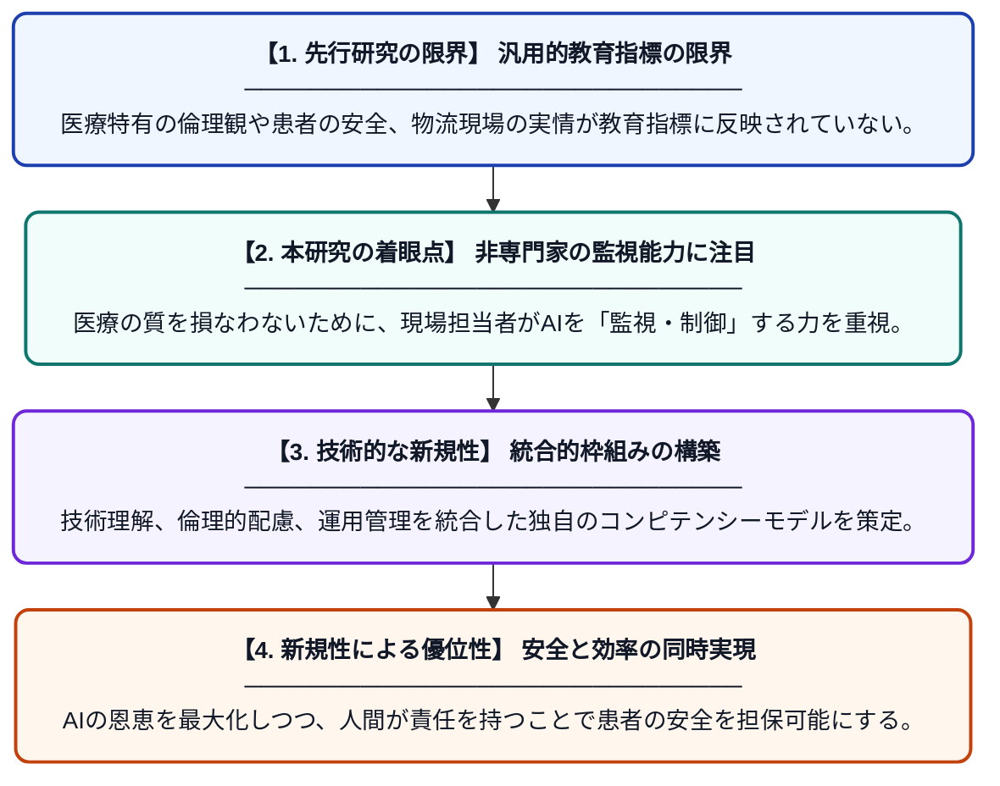

# ヘルスケア物流におけるAIリテラシーの概念的フレームワークの設計

**Original Title**: *Designing a Conceptual Framework for AI Literacy in Healthcare Logistics*

> **💡 一言要約**: 医療物流を支える非専門家のためのAI活用指針

| 項目 | 内容 |
|---|---|
| **著者** | R Colombari, E Libera, E Pessot |
| **掲載誌** | Working Conference on Virtual Enterprises 2026 |
| **アラートキーワード** | logistics |
| **原文リンク** | [https://link.springer.com/chapter/10.1007/978-3-032-41230-0_32](https://link.springer.com/chapter/10.1007/978-3-032-41230-0_32) |
| **PDF版要約** | [README.pdf](./README.pdf) |

---

## 📊 新規性の図解（先行研究との違いと本研究のブレークスルー）

## 📝 要約

ヘルスケア物流に従事する非専門家がAIを適切に活用・監視するための「AIリテラシー」の概念的枠組みを提案しています。医療の安全性と業務効率を両立させるため、人間による監視を維持しつつAIの恩恵を最大化するために必要なコンピテンシーを定義しています。

## ❓ どんな問題に取り組んだか

ヘルスケア物流へのAI導入は効率化を促進する一方で、誤った判断が患者の健康や安全に直結するリスクを孕んでいます。しかし、現場の非専門家がAIの限界を理解し、適切に制御するための標準化された教育基準やリテラシーの定義が不足していました。

## ✨ 何が新しい？何がすごい？（新規性）

本研究の新規性は、ヘルスケア物流という極めて公共性と安全性が求められる分野に特化した、非専門家向けの「統合型AIリテラシー・コンピテンシー・フレームワーク」を構築した点にあります。単なる技術的スキルの習得に留まらず、人間による監視（Human Oversight）を核心に据え、医療倫理と業務効率を両立させる具体的な能力を定義したことが、先行研究にはない主要な貢献です。

## 🎓 大学1年生向けの解説

病院に薬や医療機器を届ける「医療物流」の現場でもAIの活用が進んでいますが、AI任せにすると命に関わるミスが起きるかもしれません。そこで、AIの専門家ではない現場のスタッフが、AIの得意・不得意を正しく理解し、安全に使いこなすための「スキルの基準表」をこの論文は作りました。これがあれば、誰でもAIを道具として正しく使い、患者さんの安全を守りながら仕事を効率化できるようになります。
