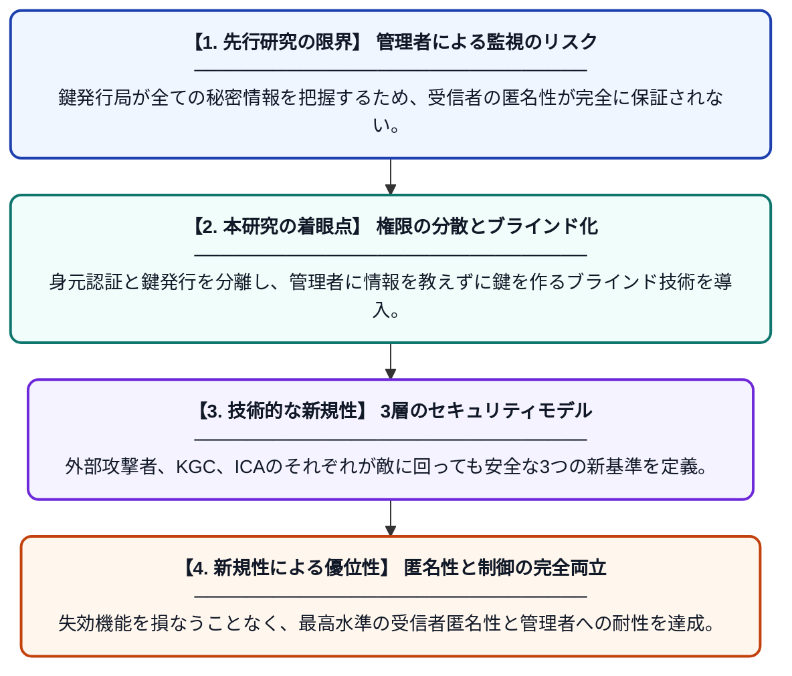

# 認証済みIDを用いたブラインド失効可能IDベース暗号

**Original Title**: *POSTER: Blind Revocable Identity-Based Encryption with Certified Identities*

> **💡 一言要約**: 管理者すら騙せない、究極の匿名ID暗号

| 項目 | 内容 |
|---|---|
| **著者** | JS Yang, CW Liao, ZY Liu |
| **掲載誌** | International Conference on Information and … 2026 |
| **アラートキーワード** | ICA |
| **原文リンク** | [https://link.springer.com/chapter/10.1007/978-981-92-6843-6_44](https://link.springer.com/chapter/10.1007/978-981-92-6843-6_44) |
| **PDF版要約** | [README.pdf](./README.pdf) |

---

## 📊 新規性の図解（先行研究との違いと本研究のブレークスルー）

## 📝 要約

受信者の匿名性と秘匿性を同時に確保しつつ、必要に応じてユーザーの権限を無効化できる新しい暗号方式を提案しています。鍵発行局（KGC）や身元認証局（ICA）といった管理者が不正を行っても、ユーザーのプライバシーが守られることを数学的に定義し証明しました。

## ❓ どんな問題に取り組んだか

従来のIDベース暗号では、鍵を発行する管理者がユーザーの情報を覗き見できてしまう「キーエスクロー問題」や、通信相手が誰であるか特定される匿名性の欠如が課題でした。また、ユーザーの有効期限が切れた際に安全に権限を無効化（失効）しつつ、これらのプライバシーを守る高度な仕組みが不足していました。

## ✨ 何が新しい？何がすごい？（新規性）

本研究は、身元認証局（ICA）と鍵発行局（KGC）の役割を分離し、双方が結託しない限りユーザーの秘密情報を得られない「ブラインド性」を失効可能モデルに導入しました。外部攻撃者だけでなく、不正を働くKGCやICAに対しても匿名性と秘匿性を保証する3つの独立したセキュリティモデルを定義した点が画期的です。これにより、実用的な失効機能を維持しながら、管理者に依存しない強固なプライバシー保護を実現しました。

## 🎓 大学1年生向けの解説

メールアドレスをそのまま暗号の鍵として使う便利な技術がありますが、これまでは「鍵を作る人」がメールの内容を覗き見できてしまう心配がありました。この論文では、鍵を作る役割を2つの組織に分け、お互いに情報を隠しながら協力させることで、管理者ですら「誰が誰に送ったか」が分からないようにしました。しかも、もし悪いユーザーが現れたらその人の鍵だけを使えなくする機能も備わっています。プライバシーを守る技術と、ルール違反を取り締まる技術を高度に両立させた研究です。
