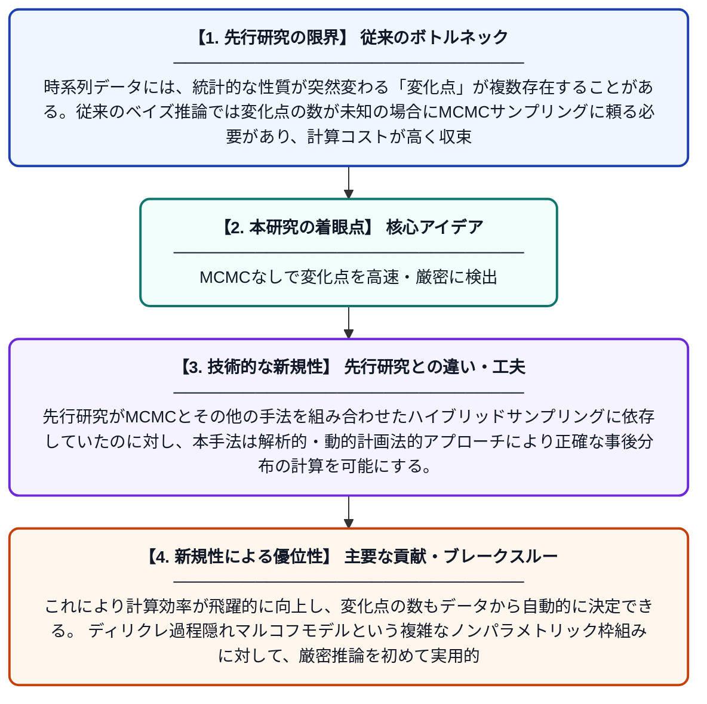

# ディリクレ過程隠れマルコフ多重変化点モデルのための効率的かつ厳密なベイズ推論

**Original Title**: *Efficient and exact Bayesian inference for Dirichlet process hidden Markov multiple change-point models*

> **💡 一言要約**: MCMCなしで変化点を高速・厳密に検出

| 項目 | 内容 |
|---|---|
| **著者** | M Majidizadeh |
| **掲載誌** | Statistical Papers 2026 |
| **アラートキーワード** | MCMC |
| **原文リンク** | [https://link.springer.com/article/10.1007/s00362-026-01883-2](https://link.springer.com/article/10.1007/s00362-026-01883-2) |
| **PDF版要約** | [README.pdf](./README.pdf) |

---

## 📊 新規性の図解（先行研究との違いと本研究のブレークスルー）

## 📝 要約

本論文は、時系列データにおける複数の変化点を検出するためのディリクレ過程隠れマルコフモデルに対して、MCMCを必要としない効率的な厳密ベイズ推論法を提案する。提案手法は標準的なMCMCアプローチを大幅に上回る性能を示し、計算コストを削減しながら高精度な推論を実現する。変化点の数が未知の場合にも柔軟に対応できる点が特徴である。

## ❓ どんな問題に取り組んだか

時系列データには、統計的な性質が突然変わる「変化点」が複数存在することがある。従来のベイズ推論では変化点の数が未知の場合にMCMCサンプリングに頼る必要があり、計算コストが高く収束の保証も難しいという課題があった。特にディリクレ過程を用いたノンパラメトリックモデルでは、この問題がさらに深刻であった。

## ✨ 何が新しい？何がすごい？（新規性）

本研究の最大の新規性は、MCMCを一切使わずに厳密なベイズ推論を実現する手法を提案した点である。先行研究がMCMCとその他の手法を組み合わせたハイブリッドサンプリングに依存していたのに対し、本手法は解析的・動的計画法的アプローチにより正確な事後分布の計算を可能にする。これにより計算効率が飛躍的に向上し、変化点の数もデータから自動的に決定できる。ディリクレ過程隠れマルコフモデルという複雑なノンパラメトリック枠組みに対して、厳密推論を初めて実用的に適用した点が主要な貢献である。

## 🎓 大学1年生向けの解説

例えば気温や株価のような時系列データは、ある時点を境に急に性質が変わることがあります。この「変わり目」を変化点と呼び、いつ・何回変化が起きたかを自動的に見つけるのがこの研究の目標です。従来はコンピュータで大量の乱数を発生させて計算する手法（MCMC）が使われており、時間がかかる上に正確さの保証が難しい問題がありました。この論文では、乱数に頼らずに数学的に厳密かつ高速に答えを求める新しい方法を開発しました。おかげで、変化点の数さえ事前に知らなくても、データから自動で正確に変化点を見つけられるようになりました。
