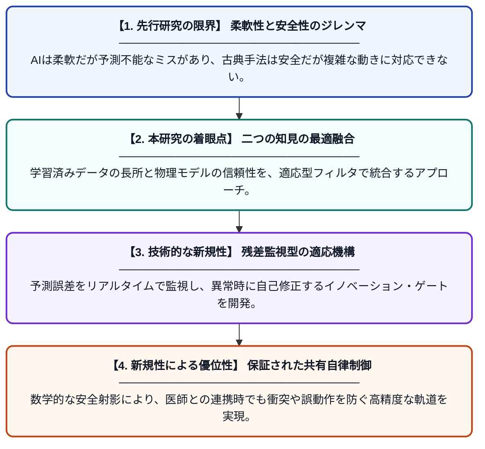

# dVRKに触発された手術タスクにおける安全な軌道生成のためのイノベーション・ゲート付き適応カルマン・機械学習融合

**Original Title**: *Innovation-Gated Adaptive Kalman-ML Fusion for Safe Trajectory Generation in a dVRK-Inspired Surgical Task*

> **💡 一言要約**: AIと古典制御の融合で手術ロボットの安全性を革新

| 項目 | 内容 |
|---|---|
| **著者** | M Hoshiaripour, S Sadeghnejad, MZ Pedram |
| **アラートキーワード** | kalman filter |
| **PDF** | [https://www.researchgate.net/profile/Soroush-Sadeghnejad/publication/417864672_Innovation-Gated_Adaptive_Kalman-ML_Fusion_for_Safe_Trajectory_Generation_in_a_dVRK-Inspired_Surgical_Task/links/6af72b010fef1c1d0a0e3f82/Innovation-Gated-Adaptive-Kalman-ML-Fusion-for-Safe-Trajectory-Generation-in-a-dVRK-Inspired-Surgical-Task.pdf](https://www.researchgate.net/profile/Soroush-Sadeghnejad/publication/417864672_Innovation-Gated_Adaptive_Kalman-ML_Fusion_for_Safe_Trajectory_Generation_in_a_dVRK-Inspired_Surgical_Task/links/6af72b010fef1c1d0a0e3f82/Innovation-Gated-Adaptive-Kalman-ML-Fusion-for-Safe-Trajectory-Generation-in-a-dVRK-Inspired-Surgical-Task.pdf) |
| **原文リンク** | [https://www.researchgate.net/profile/Soroush-Sadeghnejad/publication/417864672_Innovation-Gated_Adaptive_Kalman-ML_Fusion_for_Safe_Trajectory_Generation_in_a_dVRK-Inspired_Surgical_Task/links/6af72b010fef1c1d0a0e3f82/Innovation-Gated-Adaptive-Kalman-ML-Fusion-for-Safe-Trajectory-Generation-in-a-dVRK-Inspired-Surgical-Task.pdf](https://www.researchgate.net/profile/Soroush-Sadeghnejad/publication/417864672_Innovation-Gated_Adaptive_Kalman-ML_Fusion_for_Safe_Trajectory_Generation_in_a_dVRK-Inspired_Surgical_Task/links/6af72b010fef1c1d0a0e3f82/Innovation-Gated-Adaptive-Kalman-ML-Fusion-for-Safe-Trajectory-Generation-in-a-dVRK-Inspired-Surgical-Task.pdf) |
| **PDF版要約** | [README.pdf](./README.pdf) |

---

## 📊 新規性の図解（先行研究との違いと本研究のブレークスルー）

## 📝 要約

手術支援ロボットにおいて、機械学習による学習データと古典的な参照モデルを統合し、安全かつ高精度な動作軌道を生成する新手法を提案しています。誤差（イノベーション）に基づきリアルタイムでフィルタのパラメータを調整し、数学的な安全射影を組み合わせることで、医師とロボットの協調作業（共有自律）を支援します。

## ❓ どんな問題に取り組んだか

手術ロボットの自動化において、機械学習モデルは複雑な動作を学習できますが、未知の状況での予測誤差や安全性の欠如が大きな課題でした。また、従来の制御手法は安全ですが柔軟性に欠けるため、高い信頼性と柔軟な動作を両立する軌道生成アルゴリズムが求められていました。

## ✨ 何が新しい？何がすごい？（新規性）

本研究の核心は、単なるカルマンフィルタの利用ではなく、イノベーション（観測誤差）に基づいて共分散を動的に調整する「ゲート機能」を導入した点にあります。これにより、学習済みモデルの予測と古典的な物理リファレンスを状況に応じて最適に融合し、さらに決定論的な安全射影を組み込むことで、制御システムに即座に組み込める安全な共有自律制御を実現しました。先行研究と比較して、不確実な環境下での誤差検知と修正能力が飛躍的に向上しています。

## 🎓 大学1年生向けの解説

手術を助けるロボットが、どうすれば「安全」かつ「器用」に動けるかを考えた研究です。AIが得意な「過去の経験から学ぶ動き」と、数学が得意な「絶対に守るべき安全なルール」を、特殊な計算式（カルマンフィルタ）を使って上手くミックスしました。もしAIが変な動きをしそうになっても、システムが瞬時に「今の動きはおかしい」と気づいて修正してくれるので、お医者さんとロボットが安心して一緒に手術を進められるようになります。
