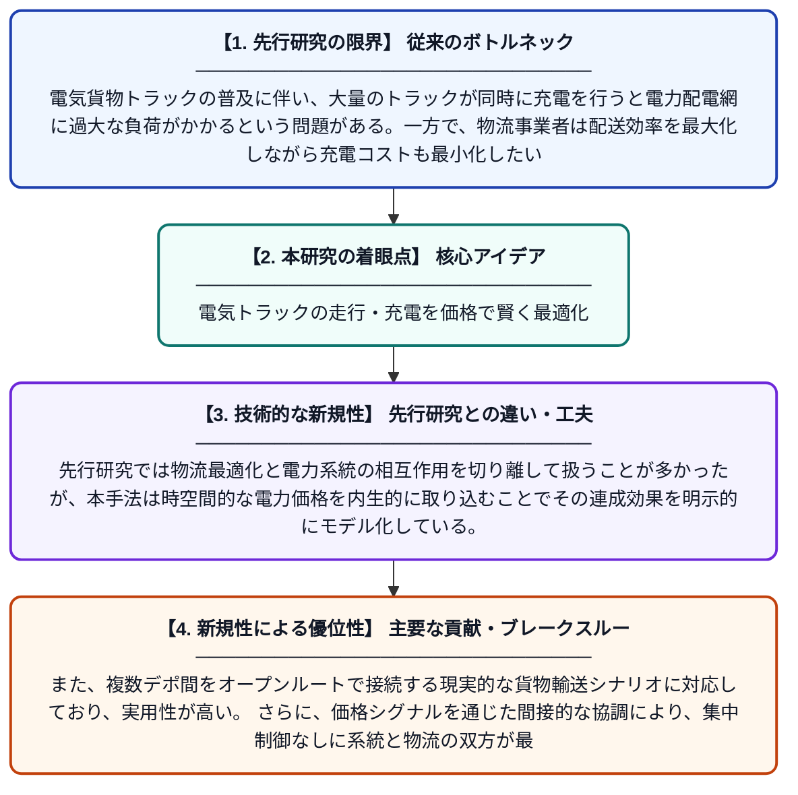

# TPIC：電気貨物トラックの経路計画・積載・充放電を統合する時空間価格駆動型協調フレームワーク

**Original Title**: *TPIC: A temporal–spatial price-driven integrated coordination framework for routing, loading, and (dis) charging of electric freight trucks*

> **💡 一言要約**: 電気トラックの走行・充電を価格で賢く最適化

| 項目 | 内容 |
|---|---|
| **著者** | X Liu, Y Ye, X Zhang, G Strbac |
| **掲載誌** | Applied Energy 2026 |
| **アラートキーワード** | VRP |
| **原文リンク** | [https://www.sciencedirect.com/science/article/pii/S0306261926011736](https://www.sciencedirect.com/science/article/pii/S0306261926011736) |
| **PDF版要約** | [README.pdf](./README.pdf) |

---

## 📊 新規性の図解（先行研究との違いと本研究のブレークスルー）

## 📝 要約

本論文は、電気貨物トラックの経路選択、荷物の積載計画、バッテリーの充放電スケジュールを同時に最適化する統合フレームワーク「TPIC」を提案している。この問題は、複数デポを持つ車両経路問題と電力配電市場の均衡制約を組み合わせた混合整数二レベル計画問題として定式化される。時空間的な電力価格シグナルを活用することで、物流効率と電力系統への負荷を同時に改善することを目指している。

## ❓ どんな問題に取り組んだか

電気貨物トラックの普及に伴い、大量のトラックが同時に充電を行うと電力配電網に過大な負荷がかかるという問題がある。一方で、物流事業者は配送効率を最大化しながら充電コストも最小化したいという相反するニーズを抱えている。これらの経路・積載・充放電の意思決定を個別に扱う従来手法では、物流コストと電力系統安定性の両立が困難であった。

## ✨ 何が新しい？何がすごい？（新規性）

本研究の最大の新規性は、車両経路問題・積載計画・充放電スケジューリングを電力市場の価格均衡と同時に解く統合二レベル最適化フレームワークを構築した点にある。先行研究では物流最適化と電力系統の相互作用を切り離して扱うことが多かったが、本手法は時空間的な電力価格を内生的に取り込むことでその連成効果を明示的にモデル化している。また、複数デポ間をオープンルートで接続する現実的な貨物輸送シナリオに対応しており、実用性が高い。さらに、価格シグナルを通じた間接的な協調により、集中制御なしに系統と物流の双方が最適化される仕組みを実現している。

## 🎓 大学1年生向けの解説

電気自動車のトラックが街中を走るとき、「どの道を通るか」「どこで充電するか」「荷物をどう積むか」をうまく決めないと、電力の使いすぎや配送の非効率が起きてしまいます。この研究では、電気料金が時間帯や場所によって変わることを利用して、トラックが自然と混雑を避けながら賢く動けるような仕組みを作りました。難しい数学的な問題（二重構造の最適化問題）として定式化し、コンピュータで解けるようにしたことが大きな貢献です。これにより、物流会社はコストを下げながら、電力会社も電気の使われ方を安定させることができます。
