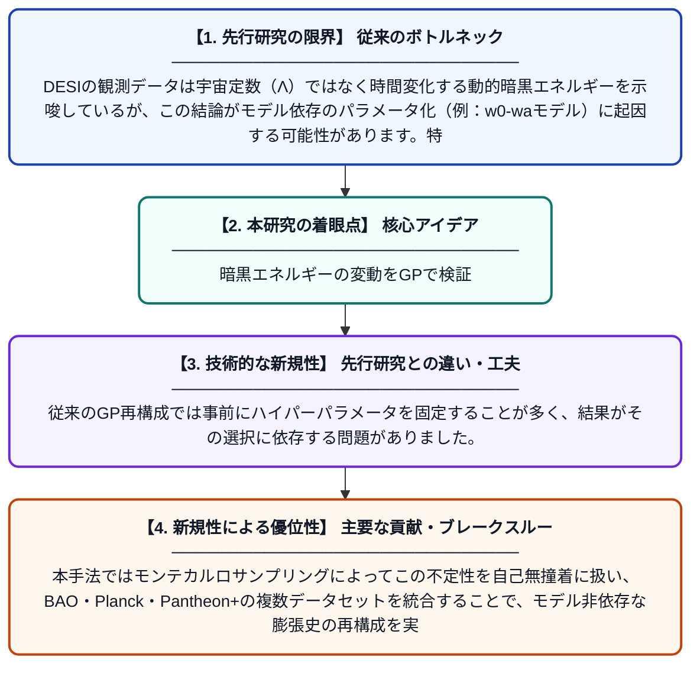

# DESIの動的暗黒エネルギー選好に対する階層的ガウス過程検定

**Original Title**: *Hierarchical Gaussian-process test of DESI's dynamical dark-energy preference*

> **💡 一言要約**: 暗黒エネルギーの変動をGPで検証

| 項目 | 内容 |
|---|---|
| **著者** | YH Mu, Z Zhou, E Li |
| **掲載誌** | arXiv preprint arXiv:2607.23593 2026 |
| **アラートキーワード** | gaussian process |
| **PDF** | [https://arxiv.org/pdf/2607.23593](https://arxiv.org/pdf/2607.23593) |
| **原文リンク** | [https://arxiv.org/abs/2607.23593](https://arxiv.org/abs/2607.23593) |
| **PDF版要約** | [README.pdf](./README.pdf) |

---

## 📊 新規性の図解（先行研究との違いと本研究のブレークスルー）

## 📝 要約

この論文は、DESIバリオン音響振動（BAO）観測が示す「動的暗黒エネルギー」の兆候を、階層的ガウス過程（GP）を用いて独立に検証したものです。カーネルハイパーパラメータを宇宙論パラメータと同時にサンプリングする手法で、BAO・Planck・Pantheon+データを統合し、宇宙膨張史を再構成しました。これにより、特定の暗黒エネルギーモデルに依存しない形で、DESIの結果がどの程度支持されるかを評価しています。

## ❓ どんな問題に取り組んだか

DESIの観測データは宇宙定数（Λ）ではなく時間変化する動的暗黒エネルギーを示唆しているが、この結論がモデル依存のパラメータ化（例：w0-waモデル）に起因する可能性があります。特定のモデルを仮定せずに、データそのものが動的暗黒エネルギーを支持するかどうかを独立に検証する手法が求められていました。

## ✨ 何が新しい？何がすごい？（新規性）

本研究の新規性は、ガウス過程のカーネルハイパーパラメータ（σf, l）を宇宙論パラメータと階層的に同時推定する点にあります。従来のGP再構成では事前にハイパーパラメータを固定することが多く、結果がその選択に依存する問題がありました。本手法ではモンテカルロサンプリングによってこの不定性を自己無撞着に扱い、BAO・Planck・Pantheon+の複数データセットを統合することで、モデル非依存な膨張史の再構成を実現しています。

## 🎓 大学1年生向けの解説

宇宙は加速膨張していますが、その原因は「暗黒エネルギー」と呼ばれる謎のエネルギーです。最近のDESI望遠鏡の観測は、この暗黒エネルギーが時間とともに変化している可能性を示しました。しかし、その結論が特定の計算モデルの仮定によるものかもしれないという疑問があります。この論文では、「ガウス過程」という機械学習的な手法を使って、モデルに頼らずにデータから直接宇宙の膨張の歴史を描き直しました。その結果、DESIの動的暗黒エネルギーの証拠が本物かどうかをより客観的に評価することができます。
