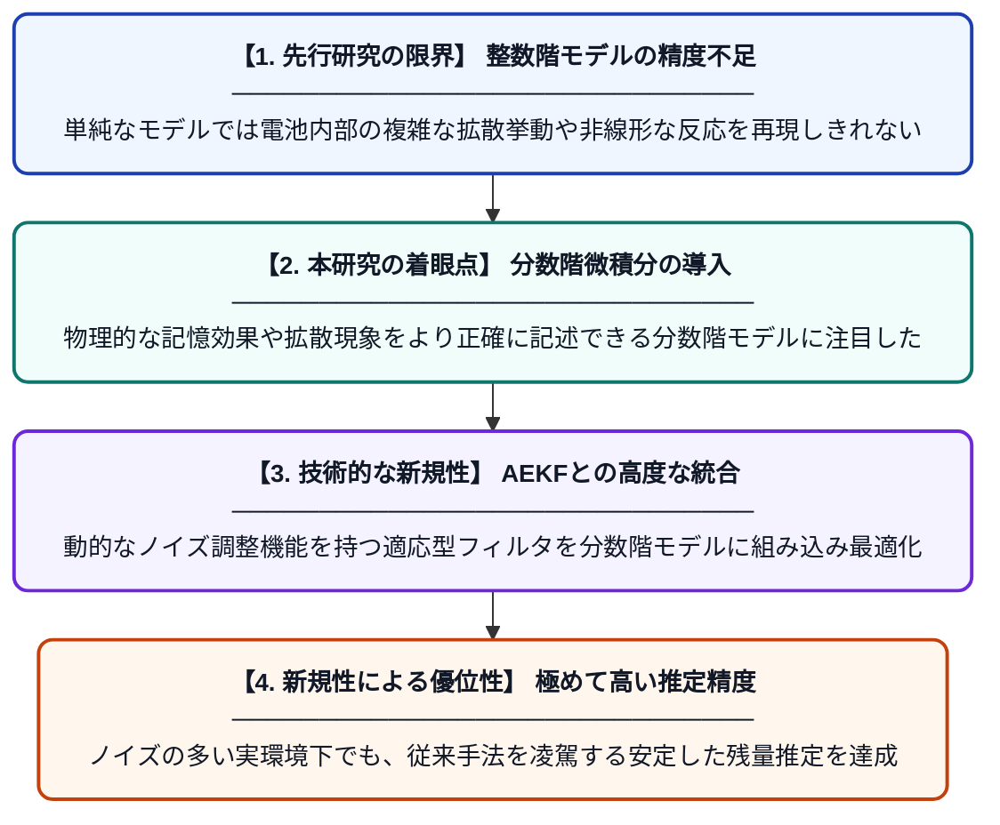

# 分数階モデルと適応型拡張カルマンフィルタの統合によるバナジウムレドックスフロー電池の充電状態推定

**Original Title**: *State-of-charge estimation for vanadium redox flow batteries by integrating a fractional-order model with adaptive extended Kalman filtering*

> **💡 一言要約**: 分数階モデルと進化型フィルタで電池残量を極限まで精密推定

| 項目 | 内容 |
|---|---|
| **著者** | X Wang, Y Fan, C Li, X Li, W Zhang, Z Wang |
| **掲載誌** | Journal of Energy Storage 2027 |
| **アラートキーワード** | kalman filter |
| **原文リンク** | [https://www.sciencedirect.com/science/article/pii/S2352152X26051844](https://www.sciencedirect.com/science/article/pii/S2352152X26051844) |
| **PDF版要約** | [README.pdf](./README.pdf) |

---

## 📊 新規性の図解（先行研究との違いと本研究のブレークスルー）

## 📝 要約

バナジウムレドックスフロー電池（VRFB）の充電状態（SOC）を正確に把握するため、複雑な物理現象を記述できる分数階モデルと、ノイズに強い適応型拡張カルマンフィルタ（AEKF）を組み合わせた推定手法を提案しています。これにより、従来のモデルでは捉えきれなかった電気化学的挙動を精密に再現し、推定精度の向上を実現しました。

## ❓ どんな問題に取り組んだか

バナジウムレドックスフロー電池のSOC推定において、従来の整数階モデルでは電極付近の複雑な拡散現象や容量特性を十分に表現できず、誤差が生じていました。また、実際の運用環境では測定ノイズが変動するため、固定的なフィルタ設定では精度の維持が困難であるという課題もありました。

## ✨ 何が新しい？何がすごい？（新規性）

本研究は、電気化学的な非線形性をより正確にモデル化できる「分数階微積分」を導入し、VRFBの動特性を記述するモデルの精度を抜本的に高めました。さらに、観測ノイズやシステムノイズの変化に応じて計算を自動調整する「適応型拡張カルマンフィルタ（AEKF）」を統合したことが大きな特徴です。この組み合わせにより、先行研究の標準的な手法と比較して、幅広い動作条件下での推定安定性と精度が大幅に向上しました。

## 🎓 大学1年生向けの解説

この研究は、大型の蓄電池である「バナジウムレドックスフロー電池」のバッテリー残量を、いかに正確に測定するかという挑戦です。電池の内部では複雑な化学反応が起きており、単純な計算式では正確な残量を出すのが難しいという問題がありました。そこで、より高度な数学（分数階微分）を使って電池の状態を細かくシミュレートし、さらに「周囲のノイズ」に合わせて計算方法を自分自身で微調整する賢いアルゴリズムを開発しました。その結果、どんな状況でもズレの少ない正確な残量表示が可能になりました。
