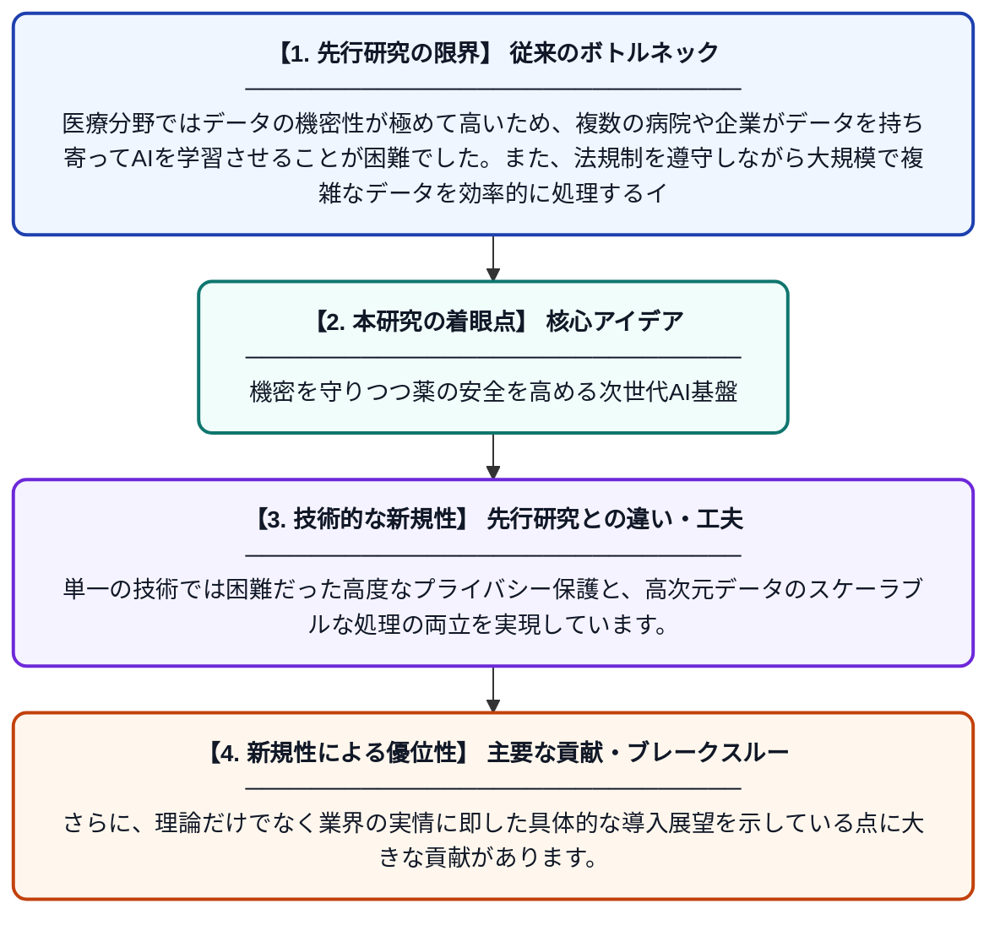

# 連合学習とプライバシー保護型の医薬品安全性分析 第5節：実世界での応用、ケーススタディ、および業界の展望

**Original Title**: *Federated Learning and Privacy-Preserving Drug Safety Analytics Section V: Real-World Applications, Case Studies, and Industry Perspectives*

> **💡 一言要約**: 機密を守りつつ薬の安全を高める次世代AI基盤

| 項目 | 内容 |
|---|---|
| **著者** | S Aarthi, JA Gohil |
| **掲載誌** | AI-Driven Pharmacology, Toxicology, and Drug Safety … 2027 |
| **アラートキーワード** | Secure Computing |
| **原文リンク** | [https://www.igi-global.com/chapter/federated-learning-and-privacy-preserving-drug-safety-analytics-section-v/426398](https://www.igi-global.com/chapter/federated-learning-and-privacy-preserving-drug-safety-analytics-section-v/426398) |
| **PDF版要約** | [README.pdf](./README.pdf) |

---

## 📊 新規性の図解（先行研究との違いと本研究のブレークスルー）

## 📝 要約

医療データの機密性を守りつつ共同でAIを学習させる「連合学習」と「プライバシー保護技術」を、医薬品の安全性評価に応用する手法を論じています。暗号化や差分プライバシーなどの技術を動的に統合するハイブリッドな仕組みが、厳格な法規制への対応に不可欠であることを強調しています。

## ❓ どんな問題に取り組んだか

医療分野ではデータの機密性が極めて高いため、複数の病院や企業がデータを持ち寄ってAIを学習させることが困難でした。また、法規制を遵守しながら大規模で複雑なデータを効率的に処理するインフラが不足しているという課題があります。

## ✨ 何が新しい？何がすごい？（新規性）

暗号化、差分プライバシー、秘密計算を状況に応じて組み合わせる「ハイブリッドPETアーキテクチャ」を提案した点が画期的です。単一の技術では困難だった高度なプライバシー保護と、高次元データのスケーラブルな処理の両立を実現しています。さらに、理論だけでなく業界の実情に即した具体的な導入展望を示している点に大きな貢献があります。

## 🎓 大学1年生向けの解説

新しい薬の安全性を確認するには、たくさんの患者さんのデータが必要です。しかし、個人の情報を病院の外に出すことは法律やプライバシーの関係で非常に難しいのが現状です。この研究では、データは元の場所においたまま、計算結果だけを共有してAIを賢くする「連合学習」という技術を提案しています。これに情報を暗号化する技術を組み合わせることで、プライバシーを完全に守りながら世界中のデータを活用して安全な薬を作る未来を目指しています。
