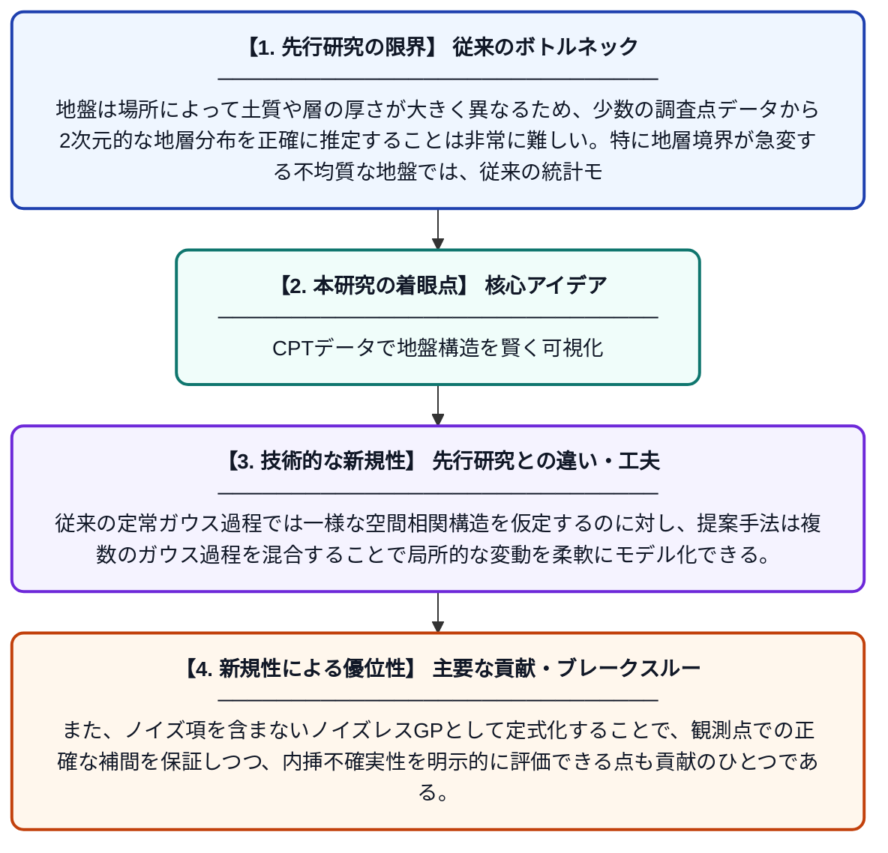

# CPTデータを用いた非定常混合ガウス過程による2次元地盤層序推定

**Original Title**: *CPT-based two-dimensional soil stratification using non-stationary mixture of Gaussian processes*

> **💡 一言要約**: CPTデータで地盤構造を賢く可視化

| 項目 | 内容 |
|---|---|
| **著者** | M Durmaz, Z Guan, MA Hicks |
| **掲載誌** | Computers and Geotechnics 2026 |
| **アラートキーワード** | gaussian process |
| **原文リンク** | [https://www.sciencedirect.com/science/article/pii/S0266352X26005653](https://www.sciencedirect.com/science/article/pii/S0266352X26005653) |
| **PDF版要約** | [README.pdf](./README.pdf) |

---

## 📊 新規性の図解（先行研究との違いと本研究のブレークスルー）

## 📝 要約

本研究では、コーン貫入試験（CPT）のデータから地盤の2次元的な層序（地層構造）を自動的に推定する手法を提案している。非定常な混合ガウス過程モデルを用いることで、地盤の空間的な不均質性や地層の急激な変化を柔軟に表現できる。従来手法と比べてより現実的な地盤モデルを構築でき、地盤工学的なリスク評価や設計精度の向上に貢献する。

## ❓ どんな問題に取り組んだか

地盤は場所によって土質や層の厚さが大きく異なるため、少数の調査点データから2次元的な地層分布を正確に推定することは非常に難しい。特に地層境界が急変する不均質な地盤では、従来の統計モデルでは空間変動を適切に表現できないという課題があった。

## ✨ 何が新しい？何がすごい？（新規性）

本研究の最大の新規性は、地盤の空間的統計特性が場所によって変化する「非定常性」を考慮した混合ガウス過程モデルを構築した点にある。従来の定常ガウス過程では一様な空間相関構造を仮定するのに対し、提案手法は複数のガウス過程を混合することで局所的な変動を柔軟にモデル化できる。また、ノイズ項を含まないノイズレスGPとして定式化することで、観測点での正確な補間を保証しつつ、内挿不確実性を明示的に評価できる点も貢献のひとつである。

## 🎓 大学1年生向けの解説

地面の下がどんな土でできているかを調べるとき、細い棒を地面に押し込んで抵抗力を測る「CPT」という試験を行います。この研究は、そのデータをもとに地面の断面図（どこにどんな土の層があるか）をコンピューターで自動的に描き出す方法を開発しました。地盤は場所によって土の種類や層の形が全然違うので、その複雑さを表現するために「混合ガウス過程」という高度な統計モデルを使っています。この手法により、少ない調査データからでも精度の高い地層マップが作れるようになり、建物や橋の設計をより安全に行えるようになります。
