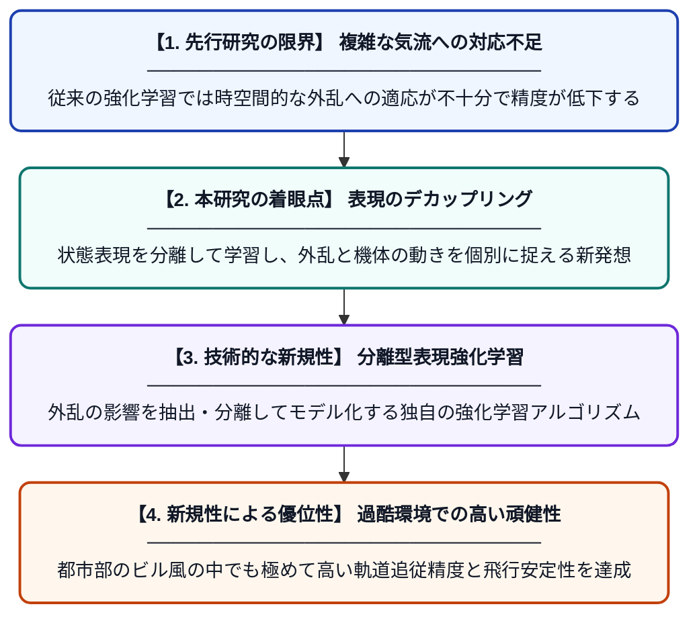

# 時空間的な外乱下における低高度物流ドローンのためのロバストな軌道追従：デカップリング表現強化学習アプローチ

**Original Title**: *Robust trajectory tracking for low-altitude logistics UAVs under spatiotemporal disturbances: A decoupled representation reinforcement learning approach*

> **💡 一言要約**: ビル風に負けない！物流ドローンの超安定飛行AI

| 項目 | 内容 |
|---|---|
| **著者** | W Liu, S Wang, Z Dai, Y Li, Y Xue |
| **掲載誌** | Transportation Research Part C: Emerging … 2027 |
| **アラートキーワード** | logistics |
| **原文リンク** | [https://www.sciencedirect.com/science/article/pii/S0968090X26005899](https://www.sciencedirect.com/science/article/pii/S0968090X26005899) |
| **PDF版要約** | [README.pdf](./README.pdf) |

---

## 📊 新規性の図解（先行研究との違いと本研究のブレークスルー）

## 📝 要約

都市部のビル風など、予測が困難な時空間的外乱が存在する環境において、物流ドローンが正確にルートを飛行するための新しい強化学習手法を提案しています。状態表現をデカップリング（分離）して学習することで、環境変化に対する頑健性を高め、安全で信頼性の高い自律飛行を実現しました。

## ❓ どんな問題に取り組んだか

都市部の低高度空間では、ビル周辺の複雑な気流（時空間外乱）がドローンの飛行を不安定にさせます。従来の制御手法や標準的な強化学習では、こうした激しい環境変化に対して飛行精度を維持することが難しく、物流システムの信頼性を損なう課題がありました。

## ✨ 何が新しい？何がすごい？（新規性）

本研究の核心は、環境の外乱要因とドローンの動特性を個別に学習する「デカップリング表現強化学習」を導入した点にあります。先行研究では状態を一括して学習していましたが、情報を分離することで、未知の外乱に対する適応能力が飛躍的に向上しました。これにより、複雑な都市環境下でも極めて高い軌道追従精度と頑健性を両立させることに成功しました。

## 🎓 大学1年生向けの解説

街中で荷物を運ぶドローンにとって、ビル風のような強い風は大きな障害です。この研究では、ドローンが「風の影響」と「自分の動き」を切り分けて考えることができる、新しいAIの学習方法を開発しました。これまでは風に流されやすかったドローンも、このAIを使うことで、複雑な風の中でも決められたルートを正確に飛べるようになります。将来、私たちの頭上をドローンが安全に飛び交うための重要な技術です。
