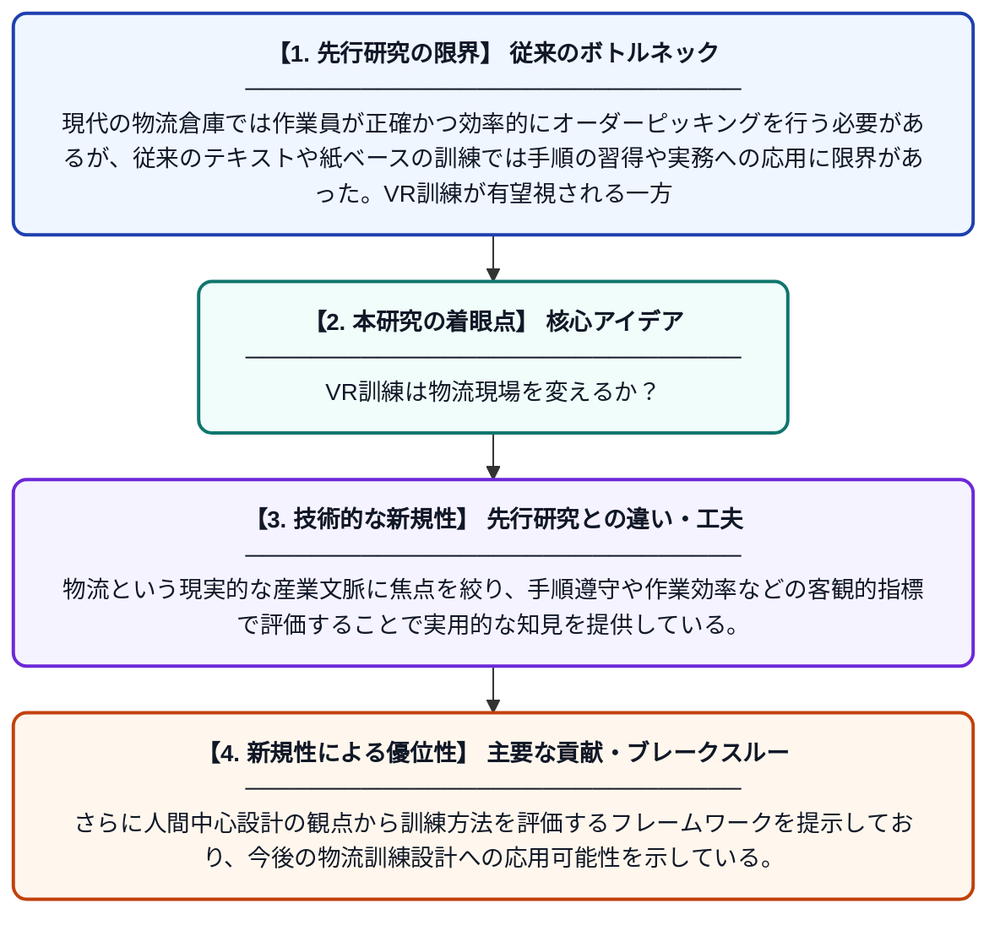

# デジタル物流環境における人間中心の訓練：手動オーダーピッキングにおけるVRとテキストベース指導の比較実験

**Original Title**: *Human-centric training in digital logistics environments: a controlled comparison of virtual reality and text-based instruction for manual order picking*

> **💡 一言要約**: VR訓練は物流現場を変えるか？

| 項目 | 内容 |
|---|---|
| **著者** | A Daios, I Kostavelis |
| **掲載誌** | Flexible Services and Manufacturing Journal 2026 |
| **アラートキーワード** | logistics |
| **原文リンク** | [https://link.springer.com/article/10.1007/s10696-026-09682-5](https://link.springer.com/article/10.1007/s10696-026-09682-5) |
| **PDF版要約** | [README.pdf](./README.pdf) |

---

## 📊 新規性の図解（先行研究との違いと本研究のブレークスルー）

## 📝 要約

本研究は、デジタル物流環境における手動オーダーピッキング作業の訓練方法として、VR（仮想現実）とテキストベースの指導を比較した制御実験である。VRによる没入型訓練と従来型のテキスト指導がそれぞれ作業手順の習得や運用パフォーマンスに与える影響を定量的に評価した。結果として、人間中心の訓練設計においてVRの有効性と限界を明確にしている。

## ❓ どんな問題に取り組んだか

現代の物流倉庫では作業員が正確かつ効率的にオーダーピッキングを行う必要があるが、従来のテキストや紙ベースの訓練では手順の習得や実務への応用に限界があった。VR訓練が有望視される一方で、その効果を従来手法と厳密に比較した実証的エビデンスが不足していた。

## ✨ 何が新しい？何がすごい？（新規性）

先行研究はVR訓練の定性的・主観的評価に留まることが多かったが、本研究は制御実験設計のもとでVRとテキスト指導を厳密に比較した点が新しい。物流という現実的な産業文脈に焦点を絞り、手順遵守や作業効率などの客観的指標で評価することで実用的な知見を提供している。さらに人間中心設計の観点から訓練方法を評価するフレームワークを提示しており、今後の物流訓練設計への応用可能性を示している。

## 🎓 大学1年生向けの解説

アマゾンのような大きな倉庫では、棚から商品を正確に取り出す『ピッキング』という作業があります。この作業を新人に教えるとき、VRゲームのような仮想空間で練習させるのと、説明書を読ませるのとでは、どちらが効果的かを実験で調べた研究です。研究者たちは実際に参加者を2グループに分けて訓練し、その後の作業成績を比べました。この研究のおかげで、物流会社がどんな訓練方法を選べば良いか、科学的な根拠をもとに判断できるようになります。
