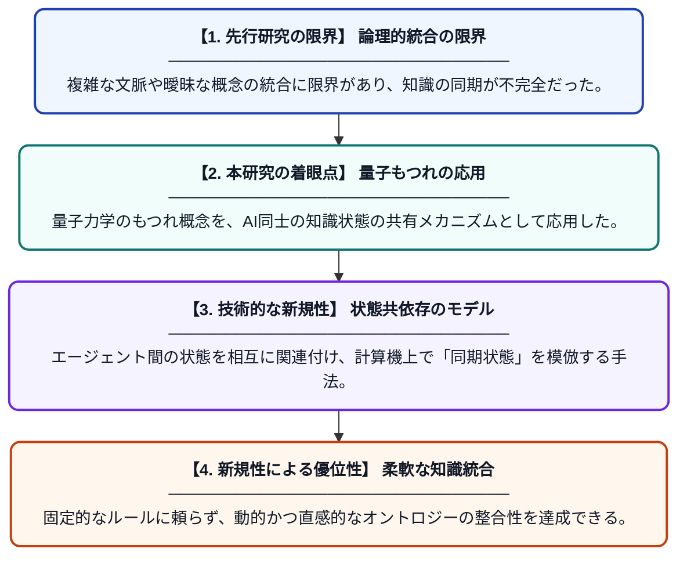

# 2つのAI間における「もつれ」のシミュレーション：オントロジー・マッチングのための概念実証

**Original Title**: *Simulation of Entanglement between Two AIs: A Proof of Concept for Ontology Matching*

> **💡 一言要約**: 量子もつれでAI同士の知識を同期する新発想

| 項目 | 内容 |
|---|---|
| **著者** | RM Dias |
| **アラートキーワード** | Ontology |
| **PDF** | [https://www.researchgate.net/profile/Roberto-Dias-8/publication/417821500_Simulation_of_Entanglement_between_Two_AIs_A_Proof_of_Concept_for_Ontology_Matching/links/6af64a864f874d57084b5aec/Simulation-of-Entanglement-between-Two-AIs-A-Proof-of-Concept-for-Ontology-Matching.pdf](https://www.researchgate.net/profile/Roberto-Dias-8/publication/417821500_Simulation_of_Entanglement_between_Two_AIs_A_Proof_of_Concept_for_Ontology_Matching/links/6af64a864f874d57084b5aec/Simulation-of-Entanglement-between-Two-AIs-A-Proof-of-Concept-for-Ontology-Matching.pdf) |
| **原文リンク** | [https://www.researchgate.net/profile/Roberto-Dias-8/publication/417821500_Simulation_of_Entanglement_between_Two_AIs_A_Proof_of_Concept_for_Ontology_Matching/links/6af64a864f874d57084b5aec/Simulation-of-Entanglement-between-Two-AIs-A-Proof-of-Concept-for-Ontology-Matching.pdf](https://www.researchgate.net/profile/Roberto-Dias-8/publication/417821500_Simulation_of_Entanglement_between_Two_AIs_A_Proof_of_Concept_for_Ontology_Matching/links/6af64a864f874d57084b5aec/Simulation-of-Entanglement-between-Two-AIs-A-Proof-of-Concept-for-Ontology-Matching.pdf) |
| **PDF版要約** | [README.pdf](./README.pdf) |

---

## 📊 新規性の図解（先行研究との違いと本研究のブレークスルー）

## 📝 要約

量子力学の「もつれ（エンタングルメント）」の概念を人工知能に応用し、2つのエージェント間で知識体系を同期させる新しい計算モデルを提案しています。異なる知識構造（オントロジー）を統合するための新しいアプローチとして、概念実証に向けたシミュレーションの枠組みを示しています。

## ❓ どんな問題に取り組んだか

異なるAIが持つ知識体系（オントロジー）を統合する際、従来の論理的なマッチング手法では、複雑な文脈や曖昧な概念の対応を正確に扱うことが困難でした。エージェント間で知識をより深く、動的に同期させるための新しい理論的枠組みが求められていました。

## ✨ 何が新しい？何がすごい？（新規性）

量子物理学の「もつれ」という概念を、物理現象としてではなくAI間の知識表現の同期メカニズムとして導入した点が極めて独創的です。先行研究が統計的または記号的な手法に依存していたのに対し、本研究はエージェント間の「状態の共依存」を計算機上でシミュレーションすることで、知識の整合性を保つ新しい手法を提案しました。これはオントロジー・マッチングに物理学的な洞察を持ち込む、パラダイムシフトの可能性を秘めた貢献です。

## 🎓 大学1年生向けの解説

「オントロジー」とは、AIが世界を理解するための「専門用語の辞書」のようなものです。別々の場所で学んだ2つのAIは、持っている辞書の内容が微妙に違うため、そのままでは協力できません。この研究は、量子力学の「もつれ」という現象をヒントに、2つのAIの頭の中をシンクロ（同期）させて、言葉の意味を一致させる新しい方法を提案しました。これによって、AI同士がまるでテレパシーを使っているかのように、スムーズに知識を共有できるようになるかもしれません。
