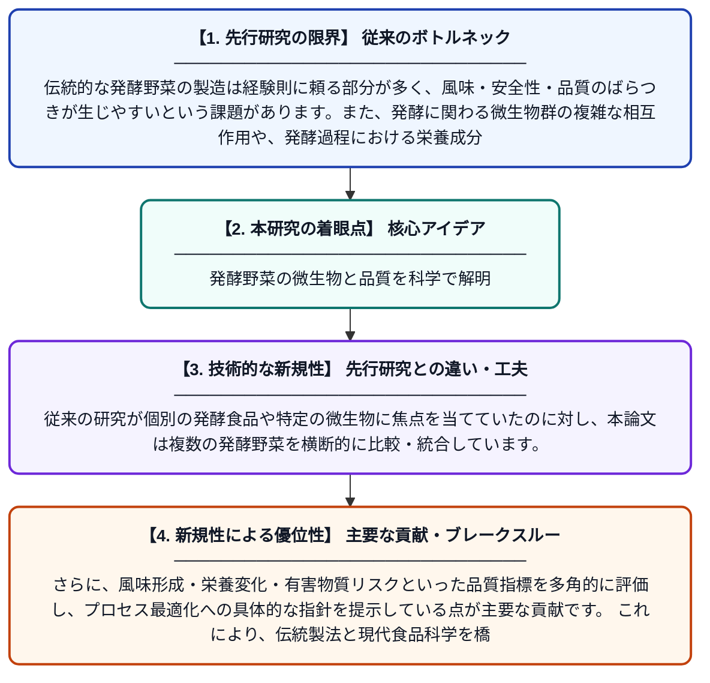

# 発酵野菜加工における微生物、品質変化、およびプロセス最適化

**Original Title**: *Microorganisms, Quality Changes, and Process Optimization in Fermented Vegetable Processing*

> **💡 一言要約**: 発酵野菜の微生物と品質を科学で解明

| 項目 | 内容 |
|---|---|
| **著者** | N Huang, S Yu, S Li, L Fang, Z Wu, Y Liu |
| **掲載誌** | Food Reviews International 2026 |
| **アラートキーワード** | optimization |
| **原文リンク** | [https://www.tandfonline.com/doi/abs/10.1080/87559129.2026.2707556](https://www.tandfonline.com/doi/abs/10.1080/87559129.2026.2707556) |
| **PDF版要約** | [README.pdf](./README.pdf) |

---

## 📊 新規性の図解（先行研究との違いと本研究のブレークスルー）

## 📝 要約

本論文は、世界中で親しまれている伝統的な発酵野菜に関して、関与する微生物の種類・役割、発酵中の品質変化、そして製造プロセスの最適化について包括的にレビューしたものです。発酵野菜が持つ独特の風味や腸内健康に有益なプロバイオティクスの形成メカニズムを科学的に解説しています。さらに、品質向上と安全性確保を両立させるための最新の加工技術についても考察しています。

## ❓ どんな問題に取り組んだか

伝統的な発酵野菜の製造は経験則に頼る部分が多く、風味・安全性・品質のばらつきが生じやすいという課題があります。また、発酵に関わる微生物群の複雑な相互作用や、発酵過程における栄養成分・機能性成分の変化が十分に解明されていませんでした。これらの課題が、品質の安定化や工業的スケールへの展開を困難にしていました。

## ✨ 何が新しい？何がすごい？（新規性）

本研究は、発酵野菜に関わる微生物の多様性・機能・相互作用を最新の知見をもとに体系的に整理した点で新規性があります。従来の研究が個別の発酵食品や特定の微生物に焦点を当てていたのに対し、本論文は複数の発酵野菜を横断的に比較・統合しています。さらに、風味形成・栄養変化・有害物質リスクといった品質指標を多角的に評価し、プロセス最適化への具体的な指針を提示している点が主要な貢献です。これにより、伝統製法と現代食品科学を橋渡しする実践的な知識基盤が構築されています。

## 🎓 大学1年生向けの解説

キムチや漬物などの発酵野菜は、微生物（主に乳酸菌）が野菜の糖分を分解することで独特の酸味や旨味が生まれる食品です。この論文では、どんな微生物がどのように働いて美味しさや健康効果が生まれるのかを詳しく調べています。また、発酵中に栄養素や風味がどのように変わるかも分析しています。こうした科学的な知見をもとに、より安全で美味しい発酵野菜を安定して作るための製造方法の改善策も提案しています。つまり、昔ながらの発酵食品を現代の科学で解き明かし、もっと上手に作れるようにしようという研究です。
