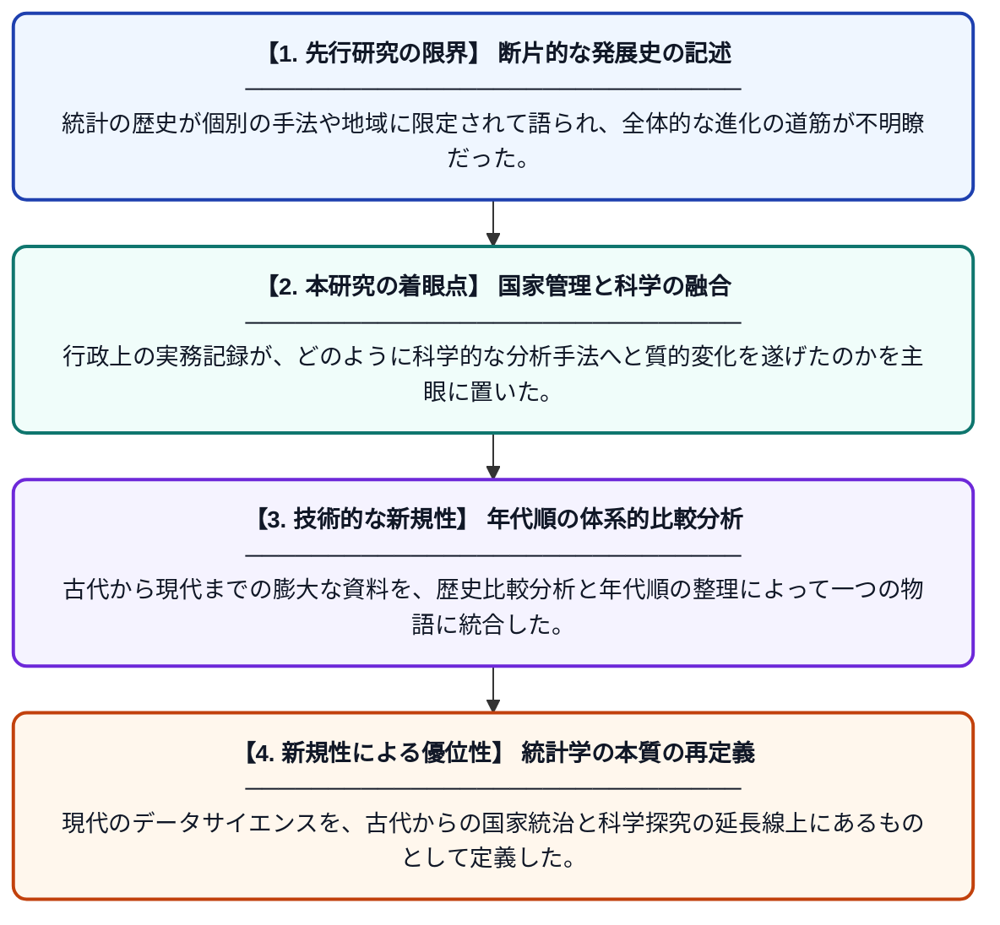

# 統計学の誕生と歴史的発展：古代の国家記録からデータサイエンスまで

**Original Title**: *The Emergence and Historical Development of Statistics*

> **💡 一言要約**: 国家記録からデータサイエンスへの進化を辿る統計史

| 項目 | 内容 |
|---|---|
| **著者** | XA Nematovich |
| **掲載誌** | Maulana Advances in Inclusive Education 2026 |
| **アラートキーワード** | MCMC |
| **PDF** | [https://maulanapress.com/index.php/maulana/article/download/77/51](https://maulanapress.com/index.php/maulana/article/download/77/51) |
| **原文リンク** | [https://maulanapress.com/index.php/maulana/article/download/77/51](https://maulanapress.com/index.php/maulana/article/download/77/51) |
| **PDF版要約** | [README.pdf](./README.pdf) |

---

## 📊 新規性の図解（先行研究との違いと本研究のブレークスルー）

## 📝 要約

古代の国家管理における記録業務から現代のデータサイエンスに至るまで、統計学がどのように進化してきたかを歴史比較分析を通じて明らかにしています。統計が単なる計数から独立した学問体系へと発展したプロセスを、年代順に体系化して論じています。

## ❓ どんな問題に取り組んだか

統計学の起源と発展のプロセスは多岐にわたり、古代の国家管理の実践がどのように現代の洗練されたデータサイエンスへと繋がったのか、その歴史的連続性と転換点が十分に整理されていませんでした。多様な歴史的資料を統合し、一つの学問体系としての進化を論理的に構造化する必要がありました。

## ✨ 何が新しい？何がすごい？（新規性）

本研究は、単なる統計手法の変遷に留まらず、社会的なニーズがいかにして統計的思考を形成したかという「歴史比較分析」を採用した点が画期的です。古代の徴税や人口調査という行政ツールが、科学的探究へと昇華される過程を、複数の情報源をクロスさせることで浮き彫りにしました。これにより、現代のデータサイエンスの背後にある本質的な目的と進化の力学を解明しています。

## 🎓 大学1年生向けの解説

統計学は今でこそAIやデータ分析に欠かせないものですが、元々は王様が国の税金や兵士の数を把握するために始めた「国家を治めるための道具」でした。この論文は、昔の記録の取り方が時代とともにどのように洗練され、現代のデータサイエンスという強力な学問に変わっていったのかを教えてくれます。歴史を知ることで、なぜ今私たちがデータを大切にするのか、その理由が深く理解できるようになります。
