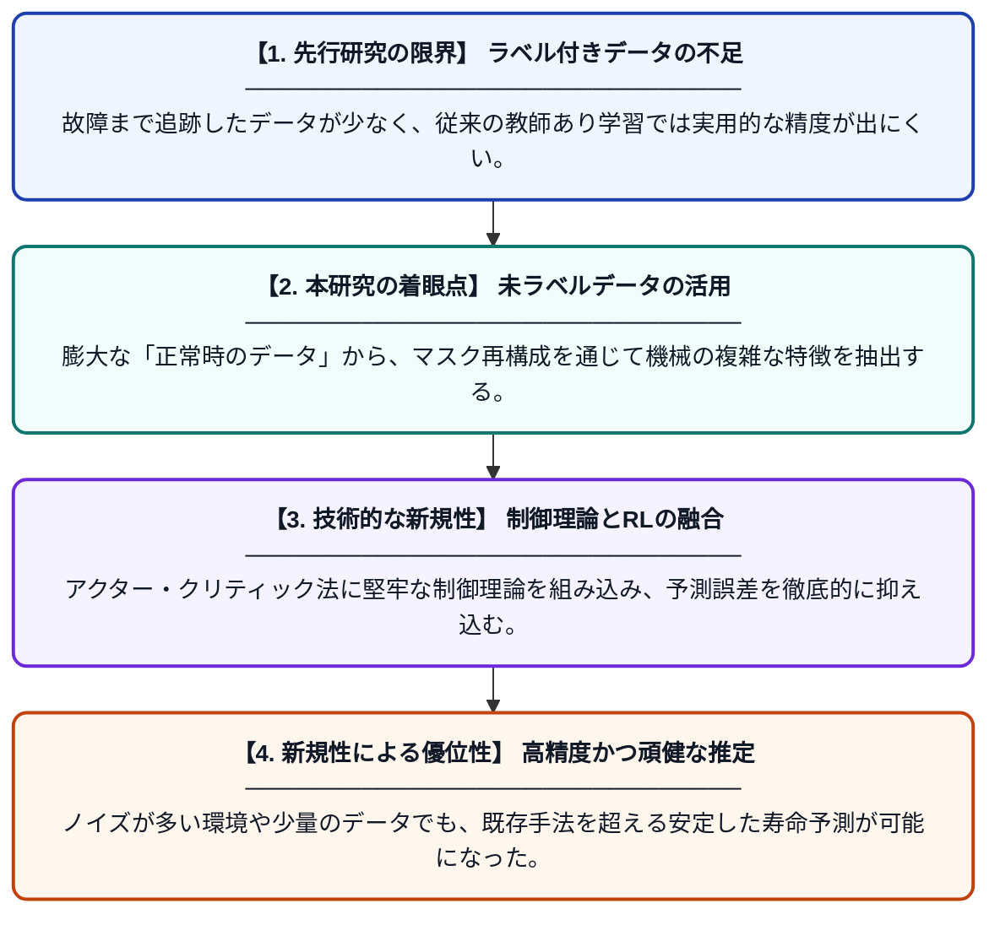

# マスク処理されたアテンション表現とアクター・クリティック・スライディングモード残差を用いた、残存有用寿命推定のためのハイブリッド半教師あり学習アプローチ

**Original Title**: *A hybrid semi-supervised approach for remaining useful life estimation using masked attention-based representations and actor–critic sliding-mode residual …*

> **💡 一言要約**: 少ないデータでエンジンの寿命を正確に予測するAI技術

| 項目 | 内容 |
|---|---|
| **著者** | J Paredes, D Chávez, R Isa-Jara, J Morales |
| **掲載誌** | Intelligent Systems with Applications 2026 |
| **アラートキーワード** | Semi supervise |
| **原文リンク** | [https://www.sciencedirect.com/science/article/pii/S2667305326001249](https://www.sciencedirect.com/science/article/pii/S2667305326001249) |
| **PDF版要約** | [README.pdf](./README.pdf) |

---

## 📊 新規性の図解（先行研究との違いと本研究のブレークスルー）

## 📝 要約

ターボファンエンジンの残存有用寿命（RUL）を推定するために、自己教師あり学習と強化学習の概念を組み合わせた新しい半教師あり学習モデルを提案しています。アテンション機構を用いたマスク再構成による事前学習と、制御理論を取り入れた学習アルゴリズムを統合することで、限られたラベル付きデータでも高精度な予測を実現しました。

## ❓ どんな問題に取り組んだか

産業機器の故障予測において、寿命が確定している「ラベル付きデータ」を大量に収集することはコストや時間の面で非常に困難です。また、センサーデータに含まれるノイズや急激な環境変化が予測精度を低下させるという課題がありました。

## ✨ 何が新しい？何がすごい？（新規性）

本研究は、入力データの一部を隠して復元させる「マスク学習」により、ラベルのないデータから機械の内部状態を深く理解する仕組みを導入しました。さらに、強化学習のアクター・クリティック手法にスライディングモード制御の理論を融合させ、予測誤差（残差）を最小化しつつ外乱に対する堅牢性を大幅に向上させています。これにより、ラベル付きデータが少ない状況でも、従来の深層学習手法を凌駕する推定精度を達成しました。

## 🎓 大学1年生向けの解説

飛行機のエンジンが「あとどのくらい使えるか」を予測するAIの新しい作り方の研究です。これまでは「故障するまでの全記録」がたくさん必要でしたが、この方法では「壊れていない時の普通の記録」もヒントにして学習できるのが特徴です。クイズで一部が隠された写真から全体を予想するような訓練と、間違いを自動で素早く修正する高度な計算を組み合わせています。その結果、データが少なくても、ノイズに負けずに正確な寿命を当てられるようになりました。
