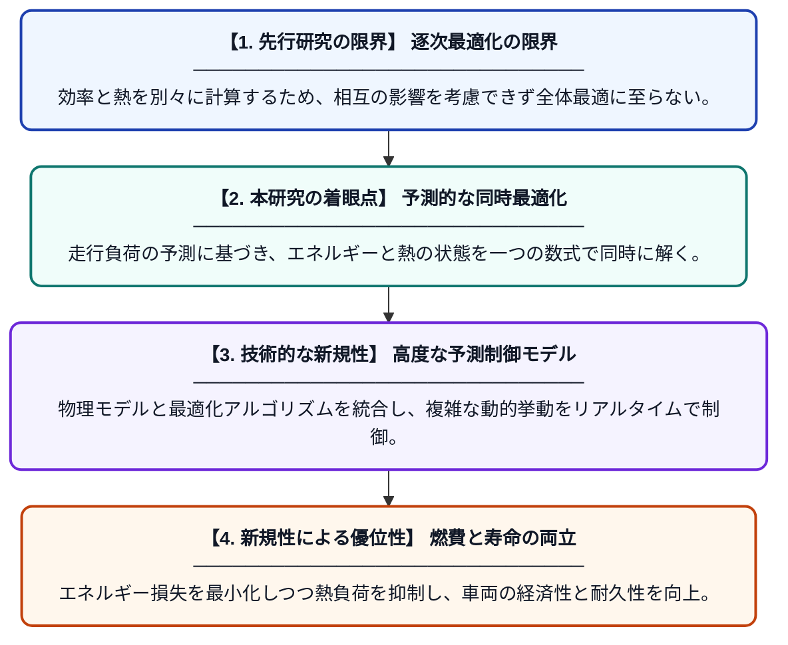

# 大型燃料電池車両におけるエネルギーと熱管理の予測的同時最適化

**Original Title**: *Predictive co-optimization of energy and thermal management in heavy-duty fuel cell vehicles*

> **💡 一言要約**: 燃費と熱を同時に操る、大型FCVの予測制御

| 項目 | 内容 |
|---|---|
| **著者** | M Bömerl, D Köppel, S Jakubek, C Hametner |
| **掲載誌** | International Journal of Hydrogen … 2026 |
| **アラートキーワード** | optimization |
| **原文リンク** | [https://www.sciencedirect.com/science/article/pii/S036031992604975X](https://www.sciencedirect.com/science/article/pii/S036031992604975X) |
| **PDF版要約** | [README.pdf](./README.pdf) |

---

## 📊 新規性の図解（先行研究との違いと本研究のブレークスルー）

## 📝 要約

大型燃料電池車両において、燃費向上とバッテリーの熱管理を同時に最適化する新しい制御手法を提案しています。従来の別々に最適化する方法とは異なり、予測制御を用いることで熱的な制約を守りつつ車両全体の効率を最大限に引き出すことに成功しました。

## ❓ どんな問題に取り組んだか

従来の燃料電池車両の制御では、エネルギー消費の最小化とバッテリーの温度管理を別々、あるいは段階的に最適化していました。このため、エネルギー効率と熱挙動の間の相互作用を十分に活用できず、全体の効率が低下したり、バッテリーの寿命に悪影響を及ぼしたりする課題がありました。

## ✨ 何が新しい？何がすごい？（新規性）

本研究の核心は「同時最適化（Co-optimization）」の導入にあります。階層的な制御構造を排除し、燃費と熱目標を単一の目的関数に統合して予測制御（MPC）を行うことで、将来の走行負荷を見越した最適な戦略を導き出しました。この統合アプローチにより、従来の逐次的最適化では見逃されていたエネルギーと熱のトレードオフを緻密に調整し、効率の大幅な向上が可能になりました。

## 🎓 大学1年生向けの解説

水素で走る大きなトラック（燃料電池車）は、効率よく走ることと同じくらい、部品が熱くなりすぎないように管理することが重要です。これまでは「どう走るか」を決めた後に「どう冷やすか」を考えていましたが、この研究ではその2つを同時に計算する賢い方法を開発しました。将来の道の状況を予測しながら、一番燃費が良くてバッテリーにも優しい走り方を自動で見つけてくれる技術です。
