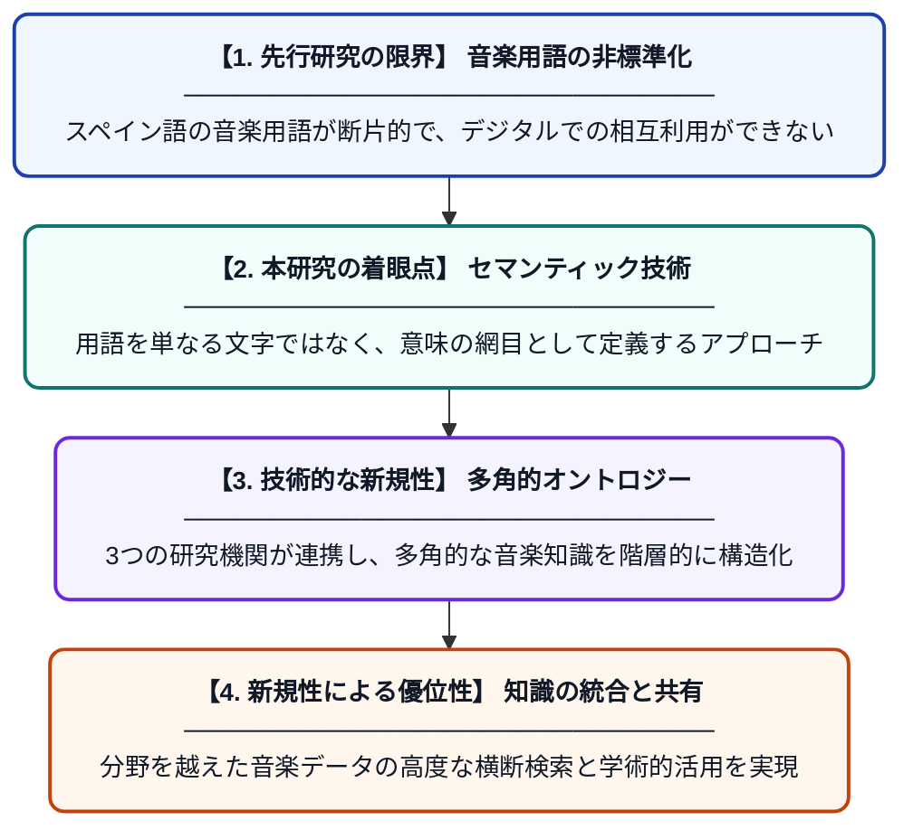

# スペイン語における音楽の語彙集とオントロジー（LexiMus）

**Original Title**: *A SPANISH LEXICON AND ONTOLOGY FOR MUSIC (LEXIMUS)*

> **💡 一言要約**: スペイン語音楽用語をデジタルで繋ぐ知識基盤

| 項目 | 内容 |
|---|---|
| **著者** | Á Torrente, JM Domínguez, T Cascudo, M Palacios… |
| **掲載誌** | Guida ai Linguaggi controllati per i … |
| **アラートキーワード** | Ontology |
| **PDF** | [https://iris.uniroma3.it/bitstream/11590/553296/1/Guida%20ai%20Linguaggi%20controllati%20per%20i%20Beni%20musicali.pdf#page=43](https://iris.uniroma3.it/bitstream/11590/553296/1/Guida%20ai%20Linguaggi%20controllati%20per%20i%20Beni%20musicali.pdf#page=43) |
| **原文リンク** | [https://iris.uniroma3.it/bitstream/11590/553296/1/Guida ai Linguaggi controllati per i Beni musicali.pdf#page=43](https://iris.uniroma3.it/bitstream/11590/553296/1/Guida ai Linguaggi controllati per i Beni musicali.pdf#page=43) |
| **PDF版要約** | [README.pdf](./README.pdf) |

---

## 📊 新規性の図解（先行研究との違いと本研究のブレークスルー）

## 📝 要約

LexiMusは、スペイン語圏における音楽用語の標準化と体系化を目指す、語彙集およびオントロジー（知識構造）の構築プロジェクトです。3つの研究グループによる共同開発により、音楽に関する概念をデジタル環境で高度に利用可能にすることを目的に設計されています。

## ❓ どんな問題に取り組んだか

スペイン語の音楽用語は非常に多様で歴史的な厚みがありますが、それらをデジタル上で統一的に扱うための標準的な知識ベースが不足していました。その結果、異なるデータベース間での情報共有や、正確な意味定義に基づく高度な学術的検索が困難であるという課題がありました。

## ✨ 何が新しい？何がすごい？（新規性）

本研究は、スペイン語に特化した包括的な音楽オントロジーを提案し、音楽用語間の階層関係や意味的な繋がりを厳密に定義した点が画期的です。単なる用語リストではなく、セマンティック・ウェブ技術に対応させることで、AIや機械が音楽の概念を正確に処理できる基盤を構築しました。これにより、複数の学術機関が持つ膨大な音楽アーカイブを横断的に結びつけることが可能になります。

## 🎓 大学1年生向けの解説

音楽の歴史や理論には難しい専門用語がたくさんありますが、実はスペイン語の用語をコンピュータが正しく理解できる仕組みはまだ整っていませんでした。この研究は、音楽用語を「意味のネットワーク」として整理し、コンピュータが音楽の歴史や知識を扱えるようにするプロジェクトです。これが完成すると、世界中の音楽データを一気に検索したり、AIが音楽の深い意味を理解したりできるようになります。音楽という芸術を、データサイエンスの力で整理整頓する基礎作りといえます。
