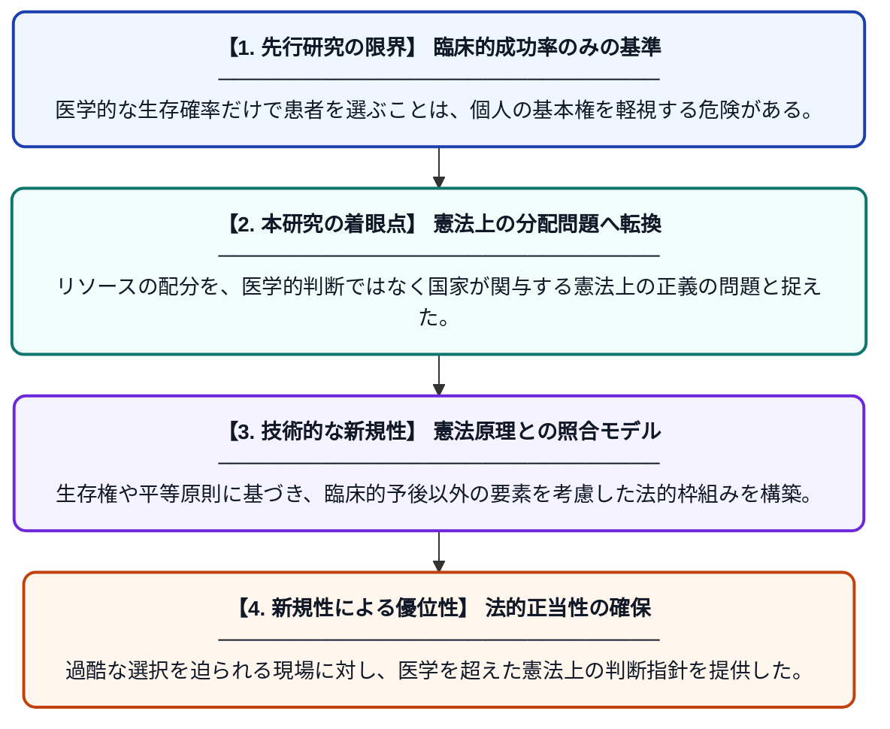

# 憲法問題としての集中治療へのアクセス

**Original Title**: *Der Zugang zur intensivmedizinischen Behandlung als Verfassungsproblem*

> **💡 一言要約**: 命の選別は医学か法か？集中治療の分配を憲法から問う

| 項目 | 内容 |
|---|---|
| **著者** | JL Kalhoff |
| **掲載誌** | 2026 |
| **アラートキーワード** | ALS |
| **原文リンク** | [https://elibrary.duncker-humblot.com/doi:10.3790/978-3-428-60022-9](https://elibrary.duncker-humblot.com/doi:10.3790/978-3-428-60022-9) |
| **PDF版要約** | [README.pdf](./README.pdf) |

---

## 📊 新規性の図解（先行研究との違いと本研究のブレークスルー）

## 📝 要約

限られた集中治療のリソースをどのように分配すべきかという問題を、純粋な医学的判断ではなく憲法上の「分配の正義」として再定義した論文です。臨床的な成功確率のみを唯一の選別基準とすることの憲法上の妥当性を批判的に検証しています。

## ❓ どんな問題に取り組んだか

パンデミックや災害時など、医療リソースが不足する状況で誰を優先的に治療するかという「トリアージ」の判断が迫られます。現在は「救命の可能性」が主な基準ですが、これが生存権や平等原則といった憲法上の権利とどう整合するのかが不明確でした。

## ✨ 何が新しい？何がすごい？（新規性）

本論文の核心は、医療資源の分配を単なる医学的効率性の問題から、憲法が規律すべき分配問題へと昇華させた点にあります。これまでの倫理的な議論を超え、臨床的成功の見込みのみを基準とすることが法的に不十分であることを証明しました。憲法上の基本権に基づいた新たな分配の正当化ロジックを提示したことが大きな貢献です。

## 🎓 大学1年生向けの解説

病院のベッドや人工呼吸器が足りなくなったとき、誰を優先して助けるかを決めるのはとても難しい問題です。これまでは「助かる確率が高い人」を優先するのが当たり前だと思われてきましたが、この論文は「それは法律（憲法）的に本当に正しいの？」と問いかけています。全ての人が持つ「平等に生きる権利」を守りながら、どうしても選ばなければならない時にどう考えるべきかを法学の視点で解説しています。
