# OrganLens: CT基盤モデルのための臓器特化型表現学習

**Original Title**: *OrganLens: Organ-Specific Representation Learning for CT Foundation Models*

> **💡 一言要約**: 臓器を「見る目」を使い分けるCT AI

| 項目 | 内容 |
|---|---|
| **著者** | Z Ge, A Li, S Al-Kindi, H Xu, W Qiu |
| **掲載誌** | arXiv preprint arXiv:2607.25164 2026 |
| **アラートキーワード** | representation learning |
| **PDF** | [https://arxiv.org/pdf/2607.25164](https://arxiv.org/pdf/2607.25164) |
| **Git リポジトリ** | [https://github.com/gezhixuan/OrganLens](https://github.com/gezhixuan/OrganLens) |
| **原文リンク** | [https://arxiv.org/abs/2607.25164](https://arxiv.org/abs/2607.25164) |
| **PDF版要約** | [README.pdf](./README.pdf) |

---

## 📊 新規性の図解（先行研究との違いと本研究のブレークスルー）

```mermaid
%%{init: {'flowchart': {'wrappingWidth': 520, 'nodeSpacing': 18, 'rankSpacing': 28, 'padding': 14, 'curve': 'basis'}, 'themeVariables': {'fontSize': '14px'}}}%%
flowchart TD
    S1["<b>【1. 先行研究の限界】 従来のボトルネック</b><br/>──────────────────────────────<br/>従来のCT画像向け基盤モデルは、全身を一律に処理するため、臓器ごとの形態・特性の違いを十分に捉えられない問題がありました。肝臓・心臓・腎臓などはそれぞれ外観や病変のパターンが大きく"]
    S2["<b>【2. 本研究の着眼点】 核心アイデア</b><br/>──────────────────────────────<br/>臓器を「見る目」を使い分けるCT AI"]
    S3["<b>【3. 技術的な新規性】 先行研究との違い・工夫</b><br/>──────────────────────────────<br/>先行研究の汎用CT基盤モデルとは異なり、臓器アイデンティティ情報をモデルに明示的に組み込む「臓器アイデンティティ条件付け」機構を導入しています。"]
    S4["<b>【4. 新規性による優位性】 主要な貢献・ブレークスルー</b><br/>──────────────────────────────<br/>これにより、単一モデルで複数臓器に対して高精度な特徴表現を実現し、効率性と専門性を両立させています。"]
    S1 --> S2
    S2 --> S3
    S3 --> S4
    style S1 fill:#EFF6FF,stroke:#1E40AF,stroke-width:2px,color:#111827,rx:8,ry:8
    style S2 fill:#F0FDFA,stroke:#0F766E,stroke-width:2px,color:#111827,rx:8,ry:8
    style S3 fill:#F5F3FF,stroke:#6D28D9,stroke-width:2px,color:#111827,rx:8,ry:8
    style S4 fill:#FFF7ED,stroke:#C2410C,stroke-width:2px,color:#111827,rx:8,ry:8
```

## 📝 要約

OrganLensは、CT画像の基盤モデルにおいて臓器ごとに特化した特徴表現を学習するフレームワークです。共有されたCT事前学習済みDINOv2エンコーダーをベースに、臓器アイデンティティ条件付けなど複数のコンポーネントを組み合わせることで、臓器ごとに最適化された表現を獲得します。これにより、異なる臓器の診断・解析タスクにおける精度と汎用性の向上を目指します。

## ❓ どんな問題に取り組んだか

従来のCT画像向け基盤モデルは、全身を一律に処理するため、臓器ごとの形態・特性の違いを十分に捉えられない問題がありました。肝臓・心臓・腎臓などはそれぞれ外観や病変のパターンが大きく異なるにもかかわらず、単一の汎用的な特徴表現ではこれらの違いを最大限に活かすことが困難でした。

## ✨ 何が新しい？何がすごい？（新規性）

OrganLensは、単一の共有エンコーダーを使いながらも、臓器ごとに条件付けされた特化型表現を獲得できる点が新しいアプローチです。先行研究の汎用CT基盤モデルとは異なり、臓器アイデンティティ情報をモデルに明示的に組み込む「臓器アイデンティティ条件付け」機構を導入しています。これにより、単一モデルで複数臓器に対して高精度な特徴表現を実現し、効率性と専門性を両立させています。

## 🎓 大学1年生向けの解説

CTスキャンとは、体の断面をX線で撮影した医療画像です。AIにこの画像を解析させる際、肝臓や心臓など臓器ごとに形や病気のパターンが全然違うため、全部まとめて同じように処理すると精度が落ちてしまいます。OrganLensは、一つのAIモデルを使いながらも、「今は肝臓を見ているよ」「今は腎臓だよ」という情報を与えることで、臓器ごとにピントを合わせた賢い解析ができるようにした仕組みです。例えるなら、カメラのレンズを自動で最適なものに切り替えてくれる機能のようなものです。
