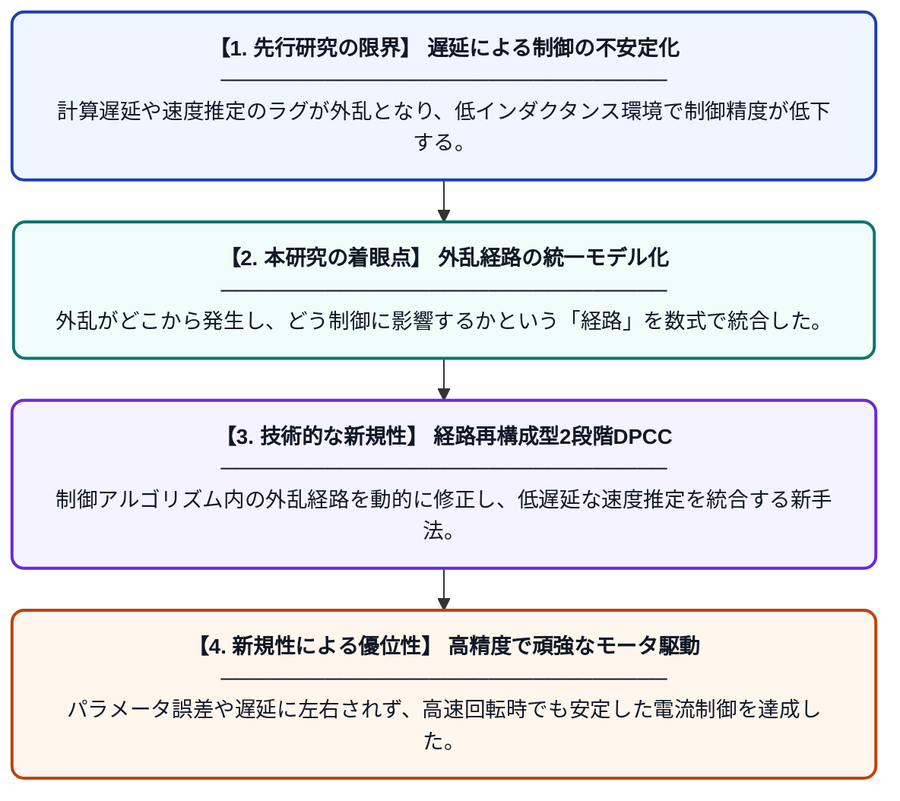

# 低インダクタンスPMSM駆動のための外乱経路再構成型デッドビート予測電流制御と低遅延速度推定

**Original Title**: *Disturbance-Path-Reshaped Deadbeat Predictive Current Control for Low-Inductance PMSM Drives With Low-Lag Speed Reconstruction*

> **💡 一言要約**: 外乱経路を書き換えて低インダクタンスモータを極める

| 項目 | 内容 |
|---|---|
| **著者** | Y Zhao, Z Zhang, S Huang, H Zhang, M Luo |
| **掲載誌** | IEEE Transactions on Industrial … 2026 |
| **アラートキーワード** | kalman filter |
| **原文リンク** | [https://ieeexplore.ieee.org/abstract/document/11807986/](https://ieeexplore.ieee.org/abstract/document/11807986/) |
| **PDF版要約** | [README.pdf](./README.pdf) |

---

## 📊 新規性の図解（先行研究との違いと本研究のブレークスルー）

## 📝 要約

低インダクタンスの永久磁石同期モータ（PMSM）において、制御遅延や外乱が性能を悪化させる課題を解決するため、外乱の「伝達経路」を再構成する新しい予測制御手法を提案しています。外乱の発生源から感度までを統合的にモデル化し、低遅延な速度推定と組み合わせることで、過酷な条件下でも安定した電流制御を実現しました。

## ❓ どんな問題に取り組んだか

低インダクタンスモータは電流応答が非常に速いため、デジタル制御の遅延や計算誤差、さらには速度推定のタイムラグが大きな「外乱」となり、制御が不安定になりやすい課題がありました。従来の手法では、これらの要因を個別のフィルタなどで対処しようとするため、動特性の改善には限界がありました。

## ✨ 何が新しい？何がすごい？（新規性）

本研究の最大の特徴は、外乱の影響を単に抑えるのではなく、制御系内部の「外乱の通り道（経路）」を数学的に再定義・再構成（Reshape）した点にあります。発生源・経路・感度の関係を統一的に定式化する「パス指向」のアプローチにより、特定のパラメータに依存しないロバストな2ステップ予測制御を構築しました。これにより、計算遅延や速度推定ラグといった複数の悪要因を一つの枠組みで効果的に排除することに成功しています。

## 🎓 大学1年生向けの解説

電気で動くモータの中には、電流が非常に流れやすく反応が良すぎるタイプがありますが、これは少しの計算の遅れがあるだけで制御がガタガタしてしまいます。この研究では、邪魔なノイズや遅れがどこを通って制御を邪魔しているのかという「ルート」を突き止め、そのルート自体を計算で作り変えてしまう方法を開発しました。これにより、スピードを測る際のタイムラグも気にせず、モータを非常に滑らかに、思い通りに動かせるようになります。
