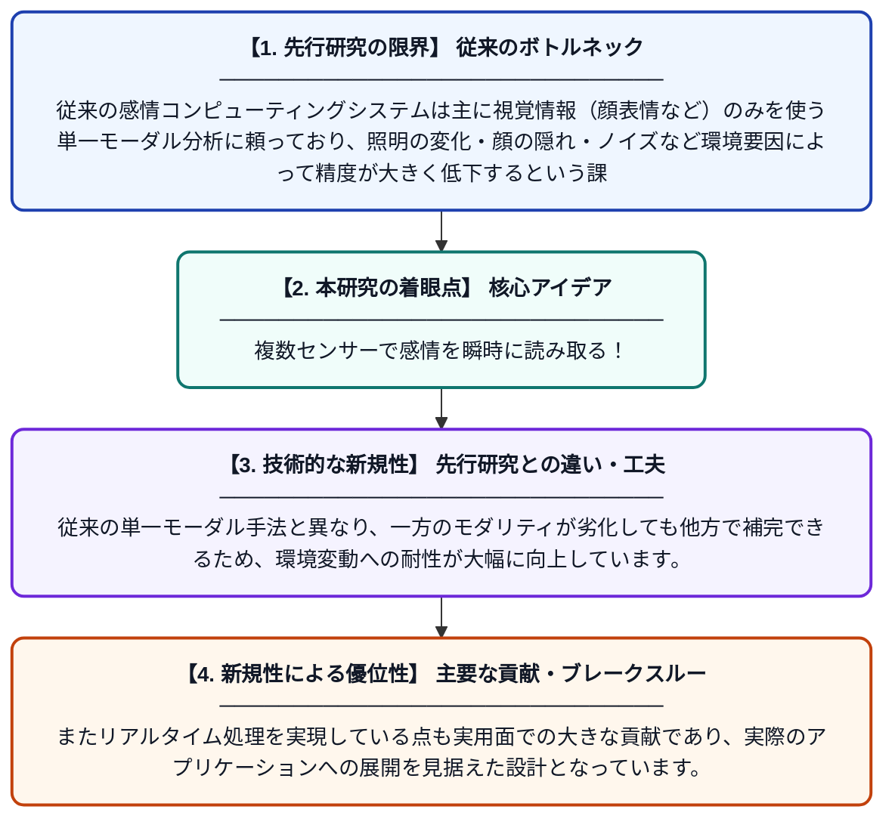

# マルチモーダル感情コンピューティング：リアルタイム感情認識のためのデュアルストリームアーキテクチャ

**Original Title**: *Multimodal Affective Computing: A Dual-Stream Architecture for Real Time Emotion Verification*

> **💡 一言要約**: 複数センサーで感情を瞬時に読み取る！

| 項目 | 内容 |
|---|---|
| **著者** | A Choudhary, B Tanay, B Tenani, R Somani, S Sinha |
| **掲載誌** | 2026 |
| **アラートキーワード** | affective computing |
| **PDF** | [https://actsoft.org/science/micro2026-pro/402-micro2026.pdf](https://actsoft.org/science/micro2026-pro/402-micro2026.pdf) |
| **原文リンク** | [https://actsoft.org/science/micro2026-pro/402-micro2026.pdf](https://actsoft.org/science/micro2026-pro/402-micro2026.pdf) |
| **PDF版要約** | [README.pdf](./README.pdf) |

---

## 📊 新規性の図解（先行研究との違いと本研究のブレークスルー）

## 📝 要約

本論文は、視覚情報のみに依存していた従来の感情認識システムの限界を克服するため、複数のモダリティ（映像・音声など）を組み合わせたマルチモーダルアプローチを提案しています。デュアルストリーム（二系統並列処理）アーキテクチャを採用することで、リアルタイムでの高精度な感情認識を実現しています。これにより、単一モーダル手法に比べてより頑健で誤りに強い感情検証システムを構築しています。

## ❓ どんな問題に取り組んだか

従来の感情コンピューティングシステムは主に視覚情報（顔表情など）のみを使う単一モーダル分析に頼っており、照明の変化・顔の隠れ・ノイズなど環境要因によって精度が大きく低下するという課題がありました。単一の情報源だけでは人間の複雑な感情状態を正確に捉えることが困難であり、より信頼性の高いシステムが求められていました。

## ✨ 何が新しい？何がすごい？（新規性）

本研究は、映像と音声など複数の情報ストリームを並列処理するデュアルストリームアーキテクチャを新たに提案しており、それぞれのモダリティの特徴を独立して学習しつつ最終的に統合するという設計が特徴です。従来の単一モーダル手法と異なり、一方のモダリティが劣化しても他方で補完できるため、環境変動への耐性が大幅に向上しています。またリアルタイム処理を実現している点も実用面での大きな貢献であり、実際のアプリケーションへの展開を見据えた設計となっています。

## 🎓 大学1年生向けの解説

人間は表情だけでなく、声のトーンや話し方でも感情を表現しますよね。従来のAIは顔の表情だけを見て感情を判断していたため、マスクをしていたり暗い場所では精度が落ちてしまいました。この研究では、顔の映像と音声の両方を同時に分析する『二本立て』の仕組みを作り、どちらかが使えなくても正確に感情を判定できるようにしました。しかもそれをリアルタイム（瞬時）に行える点が画期的です。スマートフォンやカメラを使ったメンタルヘルスケアや教育支援など、様々な場面への応用が期待されます。
