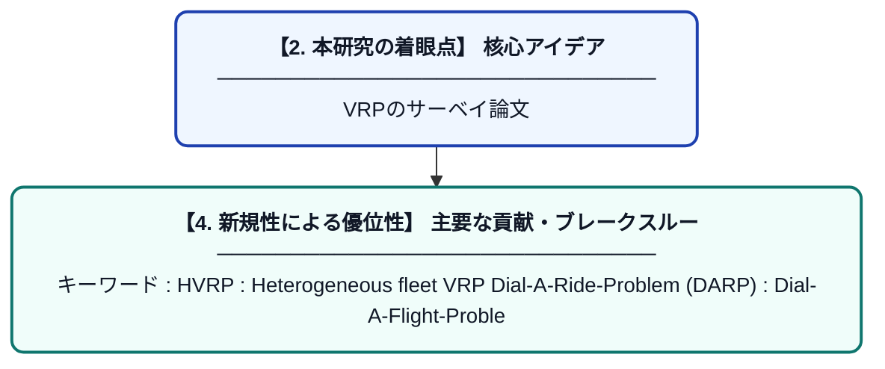

# A Review ofDynamic Vehicle Routing Problems

> **💡 一言要約**: VRPのサーベイ論文

| 項目 | 内容 |
|---|---|
| **PDF版要約** | [README.pdf](./README.pdf) |

---

## 📊 新規性の図解（先行研究との違いと本研究のブレークスルー）

## 📝 要約

キーワード :

HVRP : Heterogeneous fleet VRP

Dial-A-Ride-Problem (DARP) :

Dial-A-Flight-Problem (DAFP) :

VRPSD : the VRP with Stochastic Demands

現実世界へ適応する時の課題 :

配送計画作成者が把握できる情報が、ルートの実行中に変化する。

ダイナミクスの最も一般的な源泉は、配送中に逐次やってくる消費者の需要である。

ダイナミックな問題な場合は、目的関数も他の観点を取り込む場合がある

サービスレベルとか

スループット(サービスのリクエスト数、リクエストに対するレスポンスタイムとか)

など。

でも、意思決定の質の高さ(精度)とレスポンスの速さはトレードオフ的なことをいっている。

ダイナミクスの測定

ダイナミクスの測定は2つのレベルをもっているよ

リクエストの頻度

リクエストの切迫

ダイナミクスを測る指標はいくつか提案されていて、インパクトを与えたよ。

でも、それでも拾いきれていない側面があるのではないか、という議論もある。

応用事例 :

医者の派遣(ドクターヘリのことか？)

台風とかで道路がつかえなくなったりするよ。

新聞配達などの例

なんらかの理由で配達されなかった場合、顧客から配達のリクエストがはいる

そういう場合には、優先度を上げなくてはいけない。

病院での応用例

タクシーの配車の応用例

静的なアプローチは

その時点での情報のみに基づいて最適化をするので、新しい情報がきたときに最適であることは保証しないよ。

静的なアプローチはさらに二つに分類される。

周期的な再最適化

静的な最適化をベースにしている

主な欠点は、ルートの更新のたびに最適化計算をしなおさなくてはいけないことです。

アントコロニーシステム

連続的な再最適化

parallel Tabu Search (TS)

確率的最適化は2つのカテゴリに分類できる

サンプリングタイプ

確率タイプ

確率タイプ

顧客がサービスをあらかじめ与えられた確率で要求する場合のVRPモデルにマルコフ決定過程が使用されたよ。

しかし次元の呪いにより現実への適用はできなかった。

にもかかわらず、確率的な観点は新しい洞察をもたらした。

Approximate Dynamic Programming (ADP)

VRPSD.

サンプリングタイプ

現在の顧客に基づいて最適ルートを求める

ランダムにサンプリングされた顧客を加えた状態での最適ルートを求める

2で求めた最適ルートからランダムサンプリングの顧客だけ取り除く

準最適なルートがもとまり、かつ新しい顧客へも低コストで訪れる余地を残している。

他の戦略 :

リクエストが来た時にそのまま次の顧客へ向かうか、待つか。

様々なFrameworkで結果を残している戦略である。

待つかどうかとは別の戦略として、新しいリクエストが来そうな場所の近くに再配置するという戦略も考えられる。

この戦略は緊急時の車両配送計画問題に有効だ。

リクエストに優先順位をつけるという戦略もある。

精度評価の方法

精度の指標がわかりやすい静的な問題と比べて動的な問題は新しいタイプの精度の指標が必要だ。
