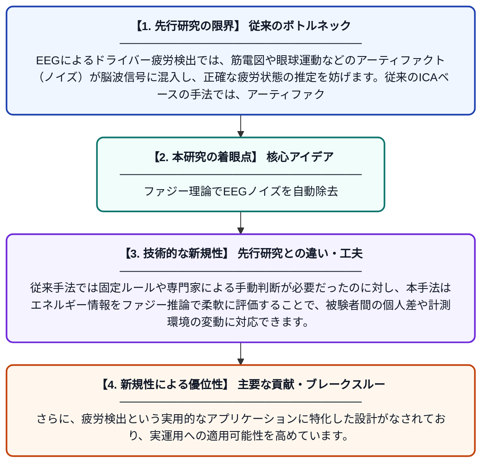

# FED-ICA：EEGを用いたドライバー疲労検出におけるアダプティブアーティファクト除去のためのファジーエネルギー駆動フレームワーク

**Original Title**: *FED-ICA: A Fuzzy Energy-Driven Framework for Adaptive Artifact Removal in EEG-Based Driver Fatigue Detection*

> **💡 一言要約**: ファジー理論でEEGノイズを自動除去

| 項目 | 内容 |
|---|---|
| **著者** | M Guiatni, R Salhi, Z Messaoudi |
| **掲載誌** | WCCI 2026 2026 |
| **アラートキーワード** | ICA |
| **PDF** | [http://linklings.s3.amazonaws.com/organizations/WCCI/wcci2026/submissions/stype108/wabq8-fuzz_pap280s2.pdf](http://linklings.s3.amazonaws.com/organizations/WCCI/wcci2026/submissions/stype108/wabq8-fuzz_pap280s2.pdf) |
| **原文リンク** | [http://linklings.s3.amazonaws.com/organizations/WCCI/wcci2026/submissions/stype108/wabq8-fuzz_pap280s2.pdf](http://linklings.s3.amazonaws.com/organizations/WCCI/wcci2026/submissions/stype108/wabq8-fuzz_pap280s2.pdf) |
| **PDF版要約** | [README.pdf](./README.pdf) |

---

## 📊 新規性の図解（先行研究との違いと本研究のブレークスルー）

## 📝 要約

本論文は、脳波（EEG）を用いたドライバーの疲労検出において、ノイズ（アーティファクト）を自動的かつ適応的に除去する新しいフレームワーク「FED-ICA」を提案しています。独立成分分析（ICA）にファジー理論とエネルギー評価を組み合わせることで、神経由来の信号と非神経由来のノイズを高精度に分離します。これにより、従来手法よりも柔軟かつロバストなEEG信号処理を実現します。

## ❓ どんな問題に取り組んだか

EEGによるドライバー疲労検出では、筋電図や眼球運動などのアーティファクト（ノイズ）が脳波信号に混入し、正確な疲労状態の推定を妨げます。従来のICAベースの手法では、アーティファクト成分の識別・除去に主観的な判断や固定的な閾値が必要であり、異なる被験者や環境への適応が困難でした。このため、リアルタイムかつ自動的にアーティファクトを除去できる適応的な手法が求められていました。

## ✨ 何が新しい？何がすごい？（新規性）

本研究は、ICAにファジー論理とエネルギー評価を組み合わせた「FED-ICA」フレームワークを新たに提案しており、アーティファクト成分の識別を自動化・適応化した点が大きな革新です。従来手法では固定ルールや専門家による手動判断が必要だったのに対し、本手法はエネルギー情報をファジー推論で柔軟に評価することで、被験者間の個人差や計測環境の変動に対応できます。さらに、疲労検出という実用的なアプリケーションに特化した設計がなされており、実運用への適用可能性を高めています。

## 🎓 大学1年生向けの解説

車を長時間運転すると疲れてきますが、これを脳波（EEG）という頭に電極を付けて脳の電気信号を測ることで検出しようという研究があります。ただし、脳波には目の動きや筋肉の動きなどの「ノイズ」が混ざってしまい、正確な分析が難しいです。この研究では、「ファジー理論」という『あいまいさ』を数学的に扱う技術と、信号のエネルギー量の評価を組み合わせることで、そのノイズを自動的かつ賢く取り除く方法を開発しました。これにより、脳波から運転者の疲労をより正確に、そして自動的に検出できるようになります。将来的には、疲労を感知して自動的に警告するより安全な車の実現につながる技術です。
