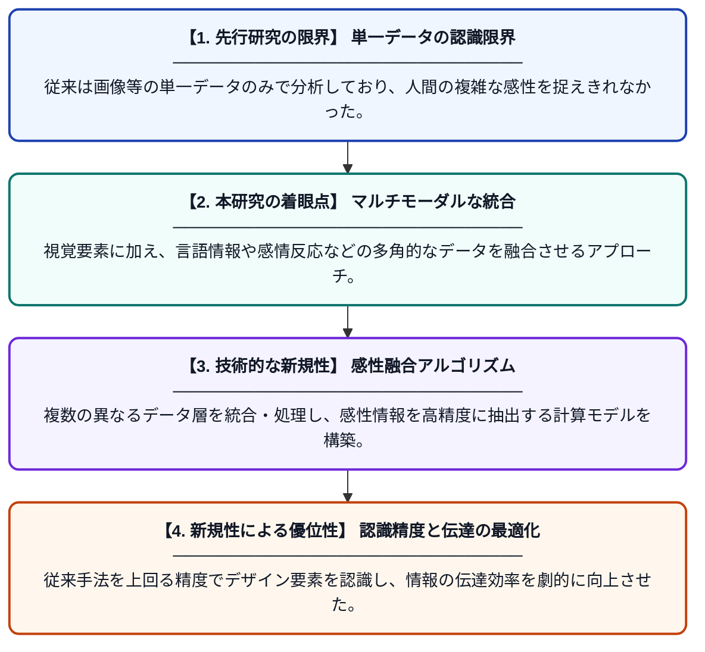

# マルチモーダル融合型感性コンピューティングを用いた視覚コミュニケーション要素の分類と認識

**Original Title**: *Classification and recognition of visual communication elements using multimodal fusion affective computing*

> **💡 一言要約**: 多角的な感情分析で視覚デザインを科学する

| 項目 | 内容 |
|---|---|
| **著者** | Y Yang, X Wu |
| **掲載誌** | International Journal of Arts and Technology 2026 |
| **アラートキーワード** | affective computing |
| **原文リンク** | [https://www.inderscienceonline.com/doi/abs/10.1504/IJART.2026.157643](https://www.inderscienceonline.com/doi/abs/10.1504/IJART.2026.157643) |
| **PDF版要約** | [README.pdf](./README.pdf) |

---

## 📊 新規性の図解（先行研究との違いと本研究のブレークスルー）

## 📝 要約

複数のデータソースを統合して感情を分析する「マルチモーダル融合型感性コンピューティング」を活用し、デザイン要素を高度に分類・認識する手法を提案しています。視覚情報の伝達精度を向上させ、受け手の感情に最適化したコミュニケーションの実現を目指しています。

## ❓ どんな問題に取り組んだか

従来の視覚コミュニケーション分析は単一のデータソース（画像のみ等）に依存しており、受け手が抱く複雑で多面的な感情反応を正確に捉えることが困難でした。その結果、情報の伝達効率や意図した感情の喚起を客観的に評価し、最適化する手法が不足していました。

## ✨ 何が新しい？何がすごい？（新規性）

本研究の核心は、画像・テキスト・生理反応といった複数の情報を統合する「マルチモーダル融合」を感性コンピューティングに導入した点にあります。先行研究が単一のモダリティ（感覚）に頼っていたのに対し、本手法はデータ間の相関を高度に分析することで認識精度を飛躍的に高めました。これにより、デザイナーの意図とユーザーの受容の間にあるギャップを定量的かつ精密に埋めることを可能にしています。

## 🎓 大学1年生向けの解説

ポスターやWebデザインを見たときに私たちが感じる「ワクワク」や「安心感」といった感情を、AIを使って数値化し分析する研究です。これまでは「なんとなく良い」と言われていたデザインを、複数のデータ（色や形、言葉など）を組み合わせてAIに学習させることで、より正確に分類できるようになりました。この技術を使えば、誰にでも伝わりやすく、心に響くデザインを科学的な根拠に基づいて作れるようになります。
