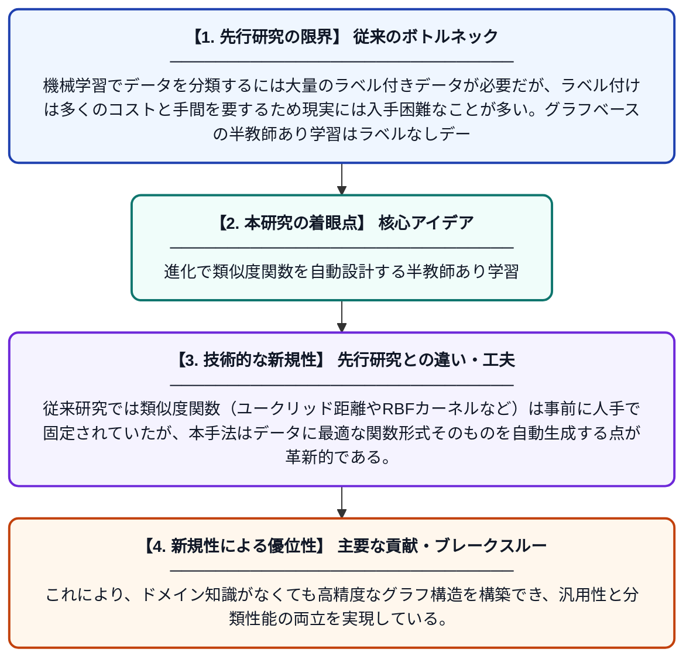

# グラフベース半教師あり学習のための類似度関数の進化的最適化

**Original Title**: *Evolving Similarity Functions for Graph-based Semi-Supervised Learning*

> **💡 一言要約**: 進化で類似度関数を自動設計する半教師あり学習

| 項目 | 内容 |
|---|---|
| **著者** | MP Basgalupp, F Neri, RG Rossi, RC Barros, R Cerri |
| **掲載誌** | IEEE Transactions on Evolutionary Computation 2026 |
| **アラートキーワード** | Semi supervise |
| **PDF** | [https://ieeexplore.ieee.org/iel8/4235/4358751/11626154.pdf](https://ieeexplore.ieee.org/iel8/4235/4358751/11626154.pdf) |
| **原文リンク** | [https://ieeexplore.ieee.org/iel8/4235/4358751/11626154.pdf](https://ieeexplore.ieee.org/iel8/4235/4358751/11626154.pdf) |
| **PDF版要約** | [README.pdf](./README.pdf) |

---

## 📊 新規性の図解（先行研究との違いと本研究のブレークスルー）

## 📝 要約

ラベル付きデータが少ない状況でも機械学習を可能にする半教師あり学習（SSL）において、グラフ構築に用いる類似度関数を進化的アルゴリズムで自動最適化する手法を提案する。従来は人手で設計されていた類似度関数を、データの特性に応じて自動的に進化させることで、分類精度の向上を目指す。実験により、提案手法が既存のグラフベースSSL手法と比較して有効であることを示している。

## ❓ どんな問題に取り組んだか

機械学習でデータを分類するには大量のラベル付きデータが必要だが、ラベル付けは多くのコストと手間を要するため現実には入手困難なことが多い。グラフベースの半教師あり学習はラベルなしデータも活用できる有望な手法だが、グラフ構造を決める類似度関数の設計は専門知識に依存しており、データごとに最適な関数を選ぶことが難しいという課題がある。

## ✨ 何が新しい？何がすごい？（新規性）

本研究は、グラフベースSSLにおける類似度関数を進化的アルゴリズム（遺伝的プログラミングなど）によって自動的に探索・最適化するという新しいアプローチを提案している。従来研究では類似度関数（ユークリッド距離やRBFカーネルなど）は事前に人手で固定されていたが、本手法はデータに最適な関数形式そのものを自動生成する点が革新的である。これにより、ドメイン知識がなくても高精度なグラフ構造を構築でき、汎用性と分類性能の両立を実現している。

## 🎓 大学1年生向けの解説

コンピュータにデータを分類させるには、通常たくさんの「答え付きデータ」が必要ですが、答えを付ける作業はとても大変です。そこで「答えなしデータ」も一緒に使って学習する半教師あり学習という方法があります。この方法ではデータ同士の「似ている度合い」を計算してグラフを作りますが、その計算方法（類似度関数）をどう決めるかが難しい問題でした。この研究では、生物の進化のように試行錯誤を繰り返すアルゴリズムを使って、最適な類似度関数を自動で見つけ出す仕組みを作りました。これにより、人間が手作業で設計しなくても、データに合った高性能な分類器を作れるようになります。
