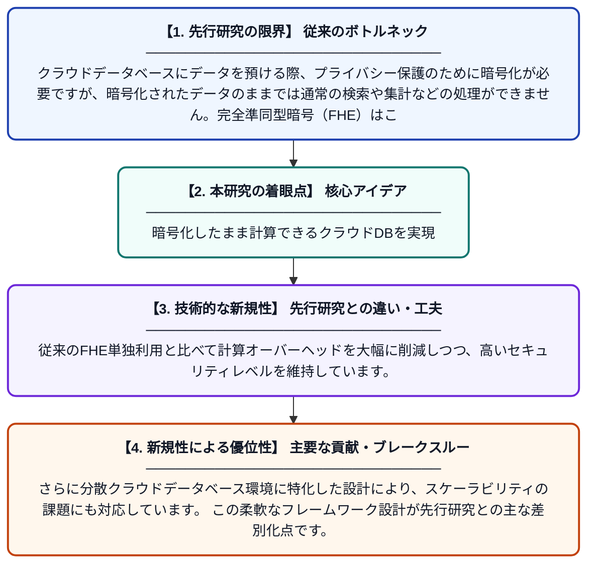

# 分散クラウドデータベースにおける安全かつ効率的なクエリ処理のためのハイブリッド準同型暗号フレームワーク

**Original Title**: *A HYBRID HOMOMORPHIC ENCRYPTION FRAMEWORK FOR SECURE AND EFFICIENT QUERY PROCESSING IN DISTRIBUTED CLOUD DATABASES*

> **💡 一言要約**: 暗号化したまま計算できるクラウドDBを実現

| 項目 | 内容 |
|---|---|
| **著者** | K Kumar, K Singh |
| **アラートキーワード** | Secure Computing |
| **PDF** | [https://www.researchgate.net/profile/Kulwant-Singh-22/publication/410730112_A_HYBRID_HOMOMORPHIC_ENCRYPTION_FRAMEWORK_FOR_SECURE_AND_EFFICIENT_QUERY_PROCESSING_IN_DISTRIBUTED_CLOUD_DATABASES/links/6a621833f475b23f400e5b06/A-HYBRID-HOMOMORPHIC-ENCRYPTION-FRAMEWORK-FOR-SECURE-AND-EFFICIENT-QUERY-PROCESSING-IN-DISTRIBUTED-CLOUD-DATABASES.pdf](https://www.researchgate.net/profile/Kulwant-Singh-22/publication/410730112_A_HYBRID_HOMOMORPHIC_ENCRYPTION_FRAMEWORK_FOR_SECURE_AND_EFFICIENT_QUERY_PROCESSING_IN_DISTRIBUTED_CLOUD_DATABASES/links/6a621833f475b23f400e5b06/A-HYBRID-HOMOMORPHIC-ENCRYPTION-FRAMEWORK-FOR-SECURE-AND-EFFICIENT-QUERY-PROCESSING-IN-DISTRIBUTED-CLOUD-DATABASES.pdf) |
| **原文リンク** | [https://www.researchgate.net/profile/Kulwant-Singh-22/publication/410730112_A_HYBRID_HOMOMORPHIC_ENCRYPTION_FRAMEWORK_FOR_SECURE_AND_EFFICIENT_QUERY_PROCESSING_IN_DISTRIBUTED_CLOUD_DATABASES/links/6a621833f475b23f400e5b06/A-HYBRID-HOMOMORPHIC-ENCRYPTION-FRAMEWORK-FOR-SECURE-AND-EFFICIENT-QUERY-PROCESSING-IN-DISTRIBUTED-CLOUD-DATABASES.pdf](https://www.researchgate.net/profile/Kulwant-Singh-22/publication/410730112_A_HYBRID_HOMOMORPHIC_ENCRYPTION_FRAMEWORK_FOR_SECURE_AND_EFFICIENT_QUERY_PROCESSING_IN_DISTRIBUTED_CLOUD_DATABASES/links/6a621833f475b23f400e5b06/A-HYBRID-HOMOMORPHIC-ENCRYPTION-FRAMEWORK-FOR-SECURE-AND-EFFICIENT-QUERY-PROCESSING-IN-DISTRIBUTED-CLOUD-DATABASES.pdf) |
| **PDF版要約** | [README.pdf](./README.pdf) |

---

## 📊 新規性の図解（先行研究との違いと本研究のブレークスルー）

## 📝 要約

本論文は、クラウドデータベース上の暗号化されたデータに対して安全に計算を行うための新しいハイブリッド準同型暗号フレームワークを提案しています。完全準同型暗号（FHE）の高いセキュリティと、部分準同型暗号の計算効率を組み合わせることで、分散クラウド環境における実用的なクエリ処理を実現します。これにより、データを復号することなく検索や集計などの操作が可能となります。

## ❓ どんな問題に取り組んだか

クラウドデータベースにデータを預ける際、プライバシー保護のために暗号化が必要ですが、暗号化されたデータのままでは通常の検索や集計などの処理ができません。完全準同型暗号（FHE）はこの問題を解決できますが、計算コストが非常に高く実用性に乏しいという課題があります。安全性と処理効率を両立する仕組みが求められていました。

## ✨ 何が新しい？何がすごい？（新規性）

本研究は、完全準同型暗号（FHE）と部分準同型暗号（PHE）を組み合わせたハイブリッドアプローチを提案しており、処理の種類に応じて最適な暗号方式を使い分けることで効率化を図っています。従来のFHE単独利用と比べて計算オーバーヘッドを大幅に削減しつつ、高いセキュリティレベルを維持しています。さらに分散クラウドデータベース環境に特化した設計により、スケーラビリティの課題にも対応しています。この柔軟なフレームワーク設計が先行研究との主な差別化点です。

## 🎓 大学1年生向けの解説

クラウド（インターネット上のサーバー）にデータを保存するとき、他人に見られないよう「暗号化」という鍵をかけます。しかし暗号化すると、そのデータを使って計算や検索ができなくなるのが普通です。「準同型暗号」という特別な技術を使うと、暗号化したままデータを計算できるようになります。この論文では、安全性が高い方式と速い方式をうまく組み合わせることで、クラウド上で安全かつ素早くデータを扱えるしくみを作りました。たとえるなら、金庫の中身を取り出さずに金庫ごと計算できる魔法のような技術です。
