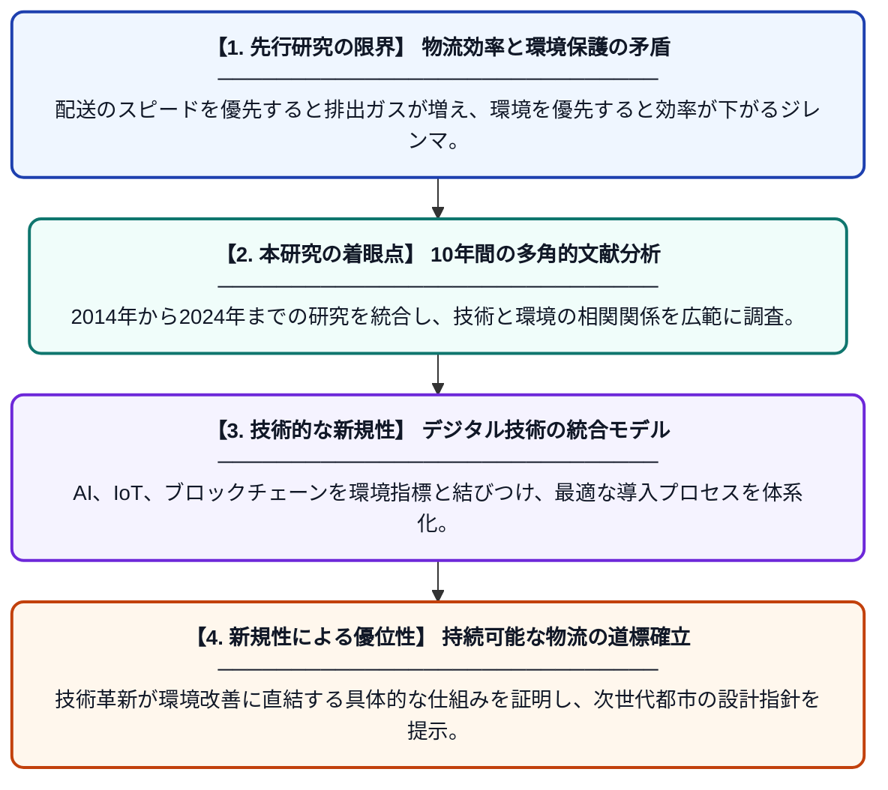

# 持続可能な都市のためのスマート都市物流：10年間の技術革新と環境統合（2014–2024）

**Original Title**: *Smart urban logistics for sustainable cities: A decade of technological innovation and environmental integration (2014–2024)*

> **💡 一言要約**: スマート技術で都市物流と環境を守る10年の軌跡

| 項目 | 内容 |
|---|---|
| **著者** | Y Deng, A Ye |
| **掲載誌** | Heliyon 2026 |
| **アラートキーワード** | logistics |
| **原文リンク** | [https://www.sciencedirect.com/science/article/pii/S2405844026011400](https://www.sciencedirect.com/science/article/pii/S2405844026011400) |
| **PDF版要約** | [README.pdf](./README.pdf) |

---

## 📊 新規性の図解（先行研究との違いと本研究のブレークスルー）

## 📝 要約

2014年から2024年までのスマート都市物流に関する研究動向を網羅的に分析し、デジタル技術と持続可能性の融合プロセスを明らかにしたレビュー論文です。682件の主要な学術記録に基づき、AIやIoTなどの技術革新が都市環境に与える影響と将来の展望を体系的にまとめています。

## ❓ どんな問題に取り組んだか

急速な都市化に伴う配送需要の増加が、深刻な交通渋滞や二酸化炭素排出を引き起こし、都市の持続可能性を脅かしています。しかし、最新のデジタル技術をどのように物流システムへ統合すれば、環境負荷を最小化できるかという全体的な指針が不足していました。

## ✨ 何が新しい？何がすごい？（新規性）

過去10年間の膨大な研究データを精査し、AI、IoT、ブロックチェーン等のデジタル技術が環境保護とどのように統合されてきたかを初めて体系的にマッピングしました。単なる技術紹介にとどまらず、技術革新がいかにして具体的な環境目標の達成に結びつくかをロードマップとして提示した点が画期的です。これにより、持続可能な都市物流を実現するための理論的かつ実践的な枠組みを構築しました。

## 🎓 大学1年生向けの解説

ネット通販などの普及で荷物が増える一方、トラックの排気ガスや渋滞が大きな問題になっています。この論文は、AIやロボット、自動運転といった最新技術をうまく使って、街をきれいに保ちながら効率よく荷物を運ぶ方法を、過去10年間の膨大な研究からまとめたものです。技術が進化することで、未来の私たちの街がどのように便利でクリーンになるかを教えてくれます。
