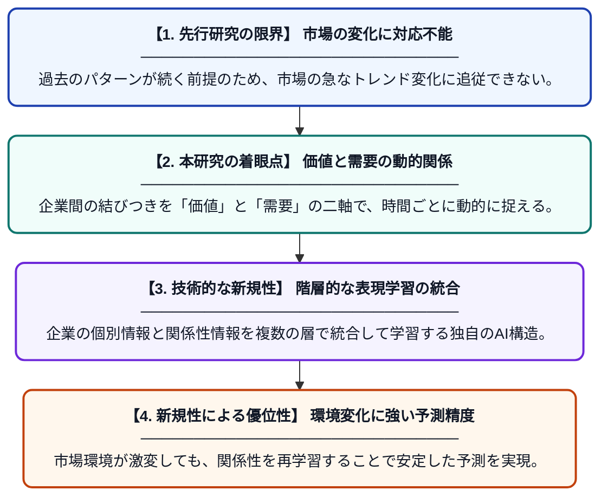

# 株式リターンの予測における時間的変化に対応した動的な価値・需要グラフ表現学習

**Original Title**: *Dynamic Value-Demand Graph Representation Learning for Cross-Sectional Equity Returns under Temporal Shift*

> **💡 一言要約**: 市場の変化をグラフで捉え、株価予測の精度を革新

| 項目 | 内容 |
|---|---|
| **著者** | C Zhu, Z Han, W Yang |
| **掲載誌** | Expert Systems with Applications 2026 |
| **アラートキーワード** | representation learning |
| **原文リンク** | [https://www.sciencedirect.com/science/article/pii/S0957417426040170](https://www.sciencedirect.com/science/article/pii/S0957417426040170) |
| **PDF版要約** | [README.pdf](./README.pdf) |

---

## 📊 新規性の図解（先行研究との違いと本研究のブレークスルー）

## 📝 要約

市場環境が時間とともに変化する「時間的シフト」に対応するため、企業間の価値と需要の相互関係を動的なグラフとして学習する手法を提案しています。表現学習、関係構造の学習、予測統合の3層構造により、複雑な金融市場における株価予測の精度を向上させました。

## ❓ どんな問題に取り組んだか

株式市場では企業間の関係性やトレンドが常に変化するため、従来の静的なモデルでは予測精度が低下するという課題があります。また、企業の個別データだけでは、市場全体に波及する複雑な相互影響を十分に考慮できないという限界がありました。

## ✨ 何が新しい？何がすごい？（新規性）

本研究は「価値」と「需要」という二つの側面から企業間の動的な関係をグラフ構造として定義し、学習する手法を開発しました。時間の経過に伴う市場構造の変化を適応的に捉えることで、従来の固定的なグラフ学習よりも柔軟な予測が可能です。さらに、表現学習と関係学習を統合することで、ノイズの多い金融データから本質的な特徴を抽出することに成功しました。

## 🎓 大学1年生向けの解説

株の値段を予想するのはとても難しいですが、それは「A社の調子が良いと、取引先のB社の株も上がる」といった会社同士の繋がりがあるからです。しかも、その繋がり方は景気や時代によってどんどん変わってしまいます。この研究は、AIを使ってその「繋がりの変化」を最新の地図のように描き出すことで、今の市場の状態に合わせた正確な予測を可能にしました。
