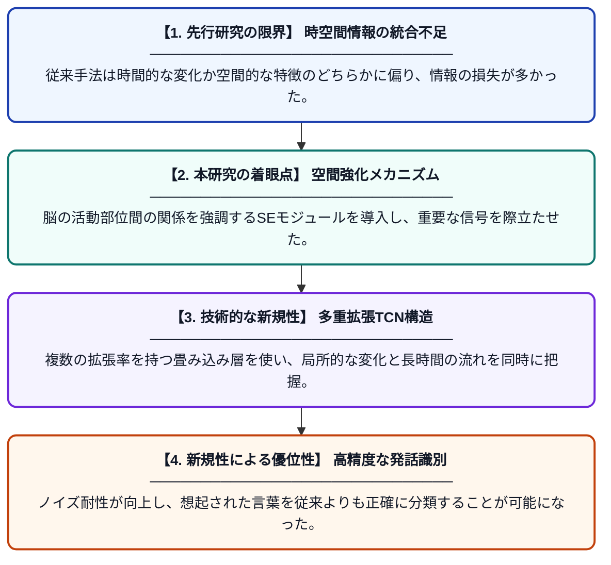

# SE-MDTCN: 脳波信号を用いた想起発話分類のための空間強化型時系列畳み込みネットワーク

**Original Title**: *SE-MDTCN: A Spatially Enhanced Temporal Convolutional Network for Imagined Speech Classification from Electroencephalography Signals*

> **💡 一言要約**: 脳波から「心の声」を読み取る次世代AIモデル

| 項目 | 内容 |
|---|---|
| **著者** | F Qiua, TS Tana, SNS Kbaha |
| **掲載誌** | Jurnal Kejuruteraan 2026 |
| **アラートキーワード** | ICA |
| **PDF** | [https://www.ukm.my/jkukm/wp-content/uploads/2026/3807/30.pdf](https://www.ukm.my/jkukm/wp-content/uploads/2026/3807/30.pdf) |
| **Git リポジトリ** | [https://github.com/Fujie-UTM/SE_MDTCN.3545METHODOLOGYMODEL](https://github.com/Fujie-UTM/SE_MDTCN.3545METHODOLOGYMODEL) |
| **原文リンク** | [https://www.ukm.my/jkukm/wp-content/uploads/2026/3807/30.pdf](https://www.ukm.my/jkukm/wp-content/uploads/2026/3807/30.pdf) |
| **PDF版要約** | [README.pdf](./README.pdf) |

---

## 📊 新規性の図解（先行研究との違いと本研究のブレークスルー）

## 📝 要約

脳波（EEG）信号から頭の中で思い描いた言葉（想起発話）を解読するための新しい深層学習モデル「SE-MDTCN」を提案しました。空間的特徴と時系列的な特徴を効果的に抽出する独自の構造により、ノイズの多い生データやノイズ除去後のデータの双方で高い分類精度を達成しています。

## ❓ どんな問題に取り組んだか

想起発話の脳波信号は非常に微弱かつ複雑で、時間的な変化と脳内の空間的な活動パターンの両方を同時に、かつ正確に捉えることが困難でした。また、まばたきなどのノイズ（アーティファクト）が分類精度を大きく低下させるという課題がありました。

## ✨ 何が新しい？何がすごい？（新規性）

本研究は、時系列データの処理に優れたTCNに、空間情報を強調する「空間強化（Spatial Enhancement）」メカニズムと、複数の異なる時間解像度で特徴を捉える「多重拡張（Multi-dilated）」構造を統合しました。これにより、脳の活動部位の関連性を強化しつつ、長期的な依存関係を効率的に学習することに成功しています。先行研究と比較して、複雑な前処理への依存を減らしつつ、頑健な識別性能を実証した点が大きな貢献です。

## 🎓 大学1年生向けの解説

私たちが言葉を口に出さず、頭の中で「こんにちは」と考えるとき、脳の中では微かな電気信号が流れます。この研究は、その脳波をAIに読み取らせて、何を考えているかを当てる技術の開発です。脳波はノイズが混じりやすいため、このAIは「脳のどの場所が反応したか」と「時間の経過でどう変化したか」を同時に整理して読み取れるように工夫されています。これが進化すれば、病気で声が出せない人でも、考えるだけで会話ができるようになる未来につながります。
