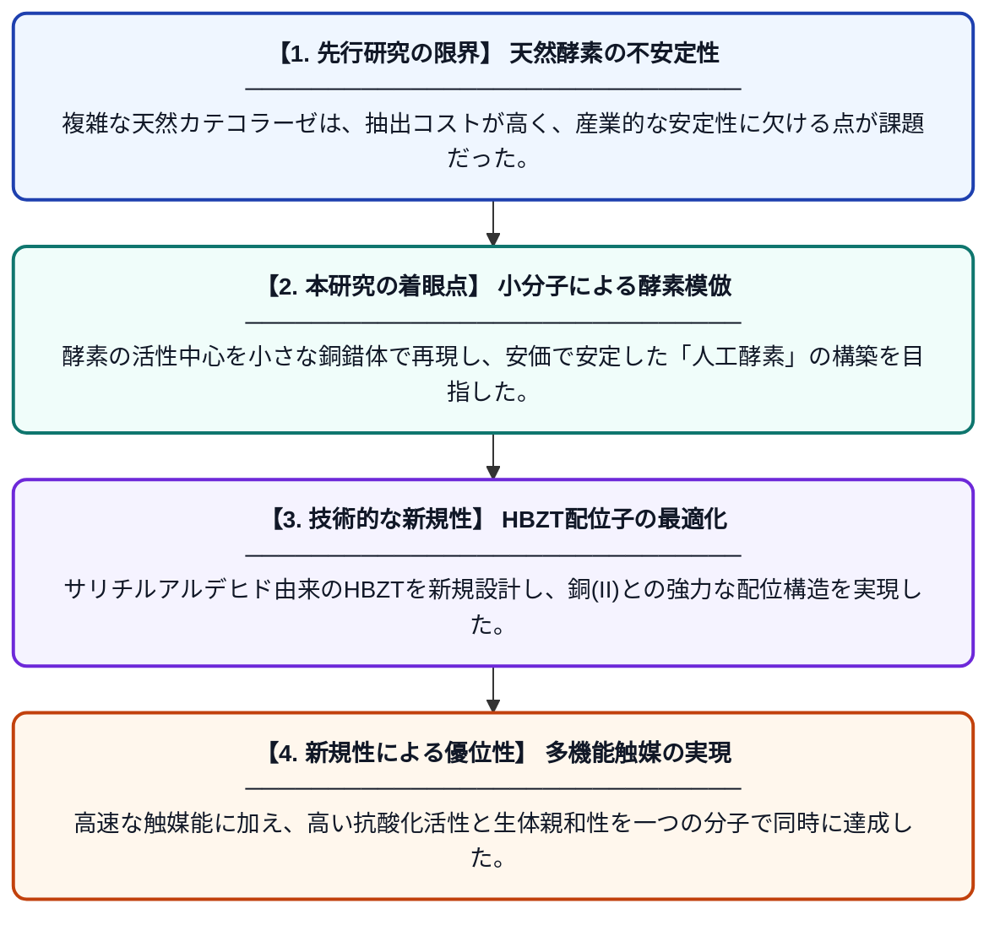

# ヒドロキシベンジリデン・チオセミカルバゾン銅(II)複合体によるカテコラーゼ模倣触媒：構造、速度論、抗酸化能、ドッキング研究

**Original Title**: *A hydroxybenzylidene thiosemicarbazone–copper (II) platform for catecholase-mimetic catalysis: structural, kinetic, antioxidant, and docking studies*

> **💡 一言要約**: 酵素を模倣し酸化を制御する、多機能な新型銅錯体の開発

| 項目 | 内容 |
|---|---|
| **著者** | I Belfilali, T Roisnel |
| **掲載誌** | Inorganica Chimica Acta 2026 |
| **アラートキーワード** | ICA |
| **原文リンク** | [https://www.sciencedirect.com/science/article/pii/S0020169326004755](https://www.sciencedirect.com/science/article/pii/S0020169326004755) |
| **PDF版要約** | [README.pdf](./README.pdf) |

---

## 📊 新規性の図解（先行研究との違いと本研究のブレークスルー）

## 📝 要約

サリチルアルデヒドから誘導された新規チオセミカルバゾン配位子(HBZT)とその銅(II)錯体を合成し、生体内のカテコラーゼ酵素を模倣した触媒能を解明しました。この錯体は高い触媒活性に加え、優れた抗酸化能と生体分子への結合親和性を示すことが多角的な研究により明らかになりました。

## ❓ どんな問題に取り組んだか

天然の酵素カテコラーゼは生物学的プロセスにおいて重要ですが、構造が複雑で抽出コストや安定性に課題があります。そのため、酵素の機能を安価かつ効率的に再現でき、かつ医療や工業に転用可能な安定した人工モデルの構築が急務となっていました。

## ✨ 何が新しい？何がすごい？（新規性）

新規配位子HBZTを用いた銅(II)錯体が、高い収率(83%)で合成され、カテコラーゼ様の酸化反応を効率的に促進することを実証しました。先行研究の単純な触媒評価に留まらず、速度論的解析、ラジカル消去能（抗酸化性）、さらには分子ドッキングによるタンパク質相互作用までを包括的に評価した点が特徴です。この多機能性の証明により、単なる触媒の枠を超えたバイオミメティック材料としての新たな指針を提示しました。

## 🎓 大学1年生向けの解説

私たちの体内にある「酵素」は、化学反応をスムーズに進める魔法のような道具ですが、そのまま使うのは大変です。この研究では、身近な材料から「酵素の代わりになる小さな金属の塊（銅錯体）」を作り出しました。これは、特定の化学反応を早めるだけでなく、体のサビを防ぐ力（抗酸化能）も持っています。将来、新しい薬や環境に優しい触媒を作るための重要なステップになります。
