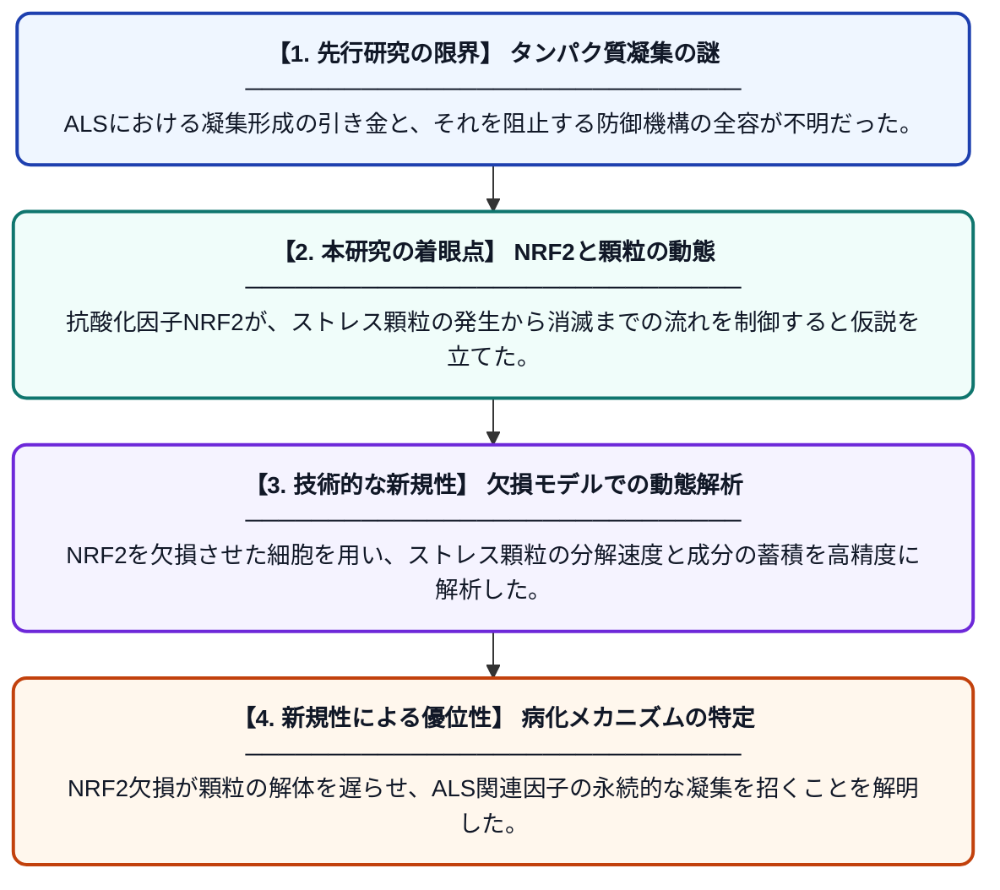

# NRF2発現の欠損はストレス顆粒の動態を変化させ、ALS関連タンパク質の凝集を促進する

**Original Title**: *Lack of NRF2 expression alters the dynamics of stress granules promoting the aggregation of ALS disease-associated proteins.*

> **💡 一言要約**: 抗酸化の鍵NRF2がALSのタンパク質凝集を防ぐ

| 項目 | 内容 |
|---|---|
| **著者** | J Jiménez-Villegas, D Carnicero-Senabre, A Sicart… |
| **掲載誌** | Redox Biology 2026 |
| **アラートキーワード** | ALS |
| **原文リンク** | [https://www.sciencedirect.com/science/article/pii/S2213231726004611](https://www.sciencedirect.com/science/article/pii/S2213231726004611) |
| **PDF版要約** | [README.pdf](./README.pdf) |

---

## 📊 新規性の図解（先行研究との違いと本研究のブレークスルー）

## 📝 要約

この研究は、抗酸化応答の鍵となる転写因子NRF2が、筋萎縮性側索硬化症（ALS）における有害なタンパク質凝集を抑制するメカニズムを解明しました。NRF2が欠損すると、一時的なストレス顆粒の分解が妨げられ、ALSの原因となるタンパク質の不可逆的な凝集が促進されることを明らかにしています。

## ❓ どんな問題に取り組んだか

ALSは運動神経の死を招く難病であり、細胞内でのタンパク質凝集が大きな特徴ですが、その形成プロセスを制御する分子基盤は不明な点が多く残されています。特に、正常なストレス応答である「ストレス顆粒」が、なぜ病的な凝集へと変質してしまうのかという問いが課題となっていました。

## ✨ 何が新しい？何がすごい？（新規性）

本研究は、酸化ストレス防御の司令塔であるNRF2が、ストレス顆粒の「解体」プロセスを直接的に制御していることを発見しました。NRF2が欠損した環境では、ストレス顆粒の動態が鈍くなり、TDP-43などの病原性タンパク質が取り込まれて固まってしまうことを証明した点が画期的です。これにより、酸化ストレス応答とタンパク質恒常性の維持が密接にリンクしていることを具体的に示しました。

## 🎓 大学1年生向けの解説

私たちの細胞は、ストレスを感じるとタンパク質を一時的に避難させる「仮置き場（ストレス顆粒）」を作ります。通常、ストレスが去ればこの場所は片付けられますが、ALSという病気ではここがゴミ溜めのように固まって神経を壊してしまいます。この研究は、体内の「掃除の指揮官」であるNRF2というタンパク質が、この仮置き場を正しく片付けるために必要であることを突き止めました。NRF2の働きを高めることが、ALSの新しい治療法になる可能性があります。
