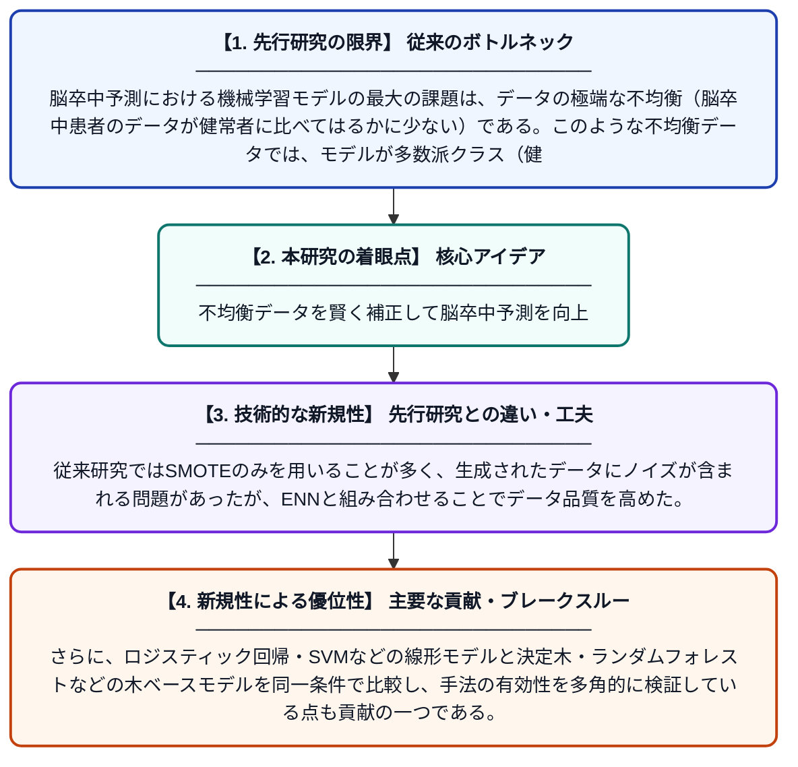

# SMOTE-ENNハイブリッドリサンプリングによる脳卒中予測の改善：線形モデルと木ベースモデルの比較分析

**Original Title**: *Hybrid SMOTE-ENN Resampling for Improved Stroke Prediction: A Comparative Analysis of Linear and Tree-Based Models*

> **💡 一言要約**: 不均衡データを賢く補正して脳卒中予測を向上

| 項目 | 内容 |
|---|---|
| **著者** | TTH Phan |
| **掲載誌** | International Conference on Multidisciplinary Social Sciences 2026 |
| **アラートキーワード** | SMOTE |
| **原文リンク** | [https://link.springer.com/chapter/10.1007/978-3-032-33384-1_43](https://link.springer.com/chapter/10.1007/978-3-032-33384-1_43) |
| **PDF版要約** | [README.pdf](./README.pdf) |

---

## 📊 新規性の図解（先行研究との違いと本研究のブレークスルー）

## 📝 要約

本研究は、医療データにおけるクラス不均衡問題（脳卒中患者データが極めて少ない問題）を解決するため、SMOTE-ENNというハイブリッドリサンプリング手法を提案した。合成少数クラスデータの生成と不要データの除去を組み合わせることで、ロジスティック回帰（LR）やサポートベクターマシン（SVM）などのモデルが少数クラス（脳卒中患者）をより正確に検出できるようになった。線形モデルと木ベースモデルを比較し、各手法の予測性能を包括的に評価した。

## ❓ どんな問題に取り組んだか

脳卒中予測における機械学習モデルの最大の課題は、データの極端な不均衡（脳卒中患者のデータが健常者に比べてはるかに少ない）である。このような不均衡データでは、モデルが多数派クラス（健常者）ばかりを正しく予測し、実際に重要な少数派クラス（脳卒中患者）を見逃してしまう問題が生じる。医療の現場ではこの見逃しが命に関わるため、少数クラスの検出精度向上が急務とされている。

## ✨ 何が新しい？何がすごい？（新規性）

本研究の新規性は、SMOTEによる少数クラスの合成データ生成とENN（Edited Nearest Neighbors）によるノイズデータ除去を組み合わせたハイブリッド手法を脳卒中予測に適用した点にある。従来研究ではSMOTEのみを用いることが多く、生成されたデータにノイズが含まれる問題があったが、ENNと組み合わせることでデータ品質を高めた。さらに、ロジスティック回帰・SVMなどの線形モデルと決定木・ランダムフォレストなどの木ベースモデルを同一条件で比較し、手法の有効性を多角的に検証している点も貢献の一つである。

## 🎓 大学1年生向けの解説

脳卒中（脳の血管が詰まる病気）をAIで早期発見しようとするとき、データの中に「脳卒中になった人」がとても少ないという問題があります。AIはデータが少ないと、その病気を見逃しやすくなってしまいます。この研究では、少ない脳卒中患者のデータをコンピュータで人工的に増やし（SMOTE）、さらに邪魔なデータを取り除く（ENN）という2つの工夫を組み合わせました。その結果、AIが脳卒中患者をより正確に見つけられるようになりました。まるで勉強が得意な科目のノートをコピーして増やし、間違えたメモだけを消すようなイメージです。
