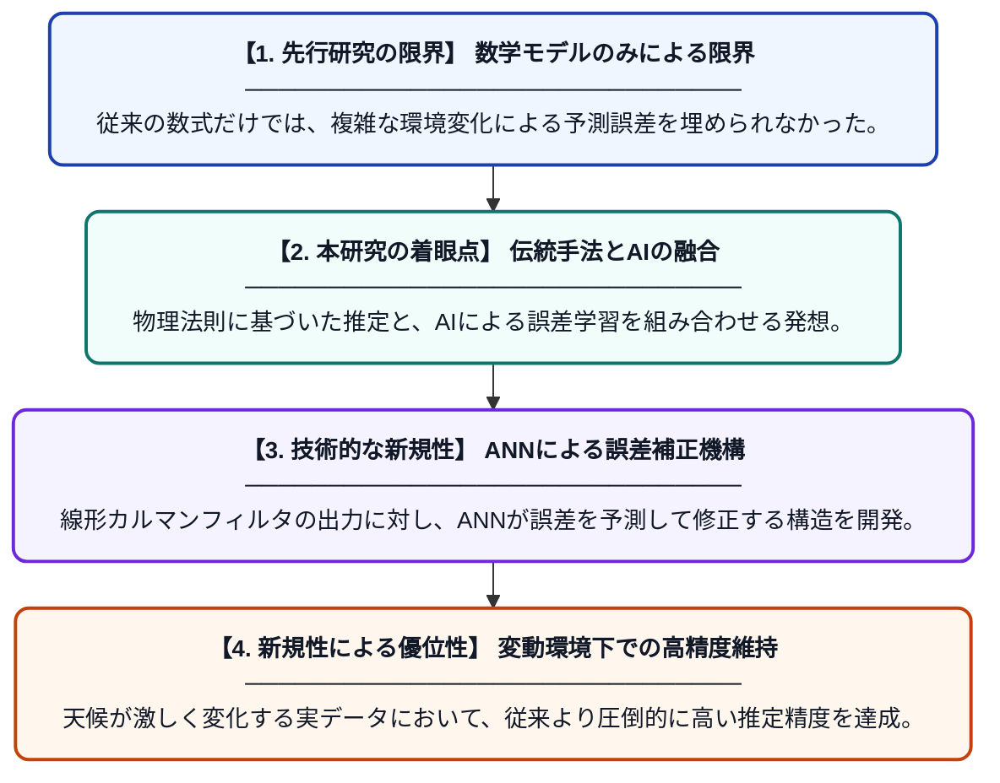

# カルマンフィルタとニューラルネットワーク補正器を用いた、変動する環境条件下における太陽光パネルの状態推定

**Original Title**: *State Estimation of Photovoltaic Panels Under Variable Environmental Conditions Using Kalman Filter and Neural Network Corrector*

> **💡 一言要約**: AIで進化する太陽光パネルの超精密な発電量推定

| 項目 | 内容 |
|---|---|
| **著者** | MF Huerta-Sánchez, JJ Saucedo-Dorantes… |
| **掲載誌** | IEEE 14th … 2026 |
| **アラートキーワード** | kalman filter |
| **原文リンク** | [https://ieeexplore.ieee.org/abstract/document/11738935/](https://ieeexplore.ieee.org/abstract/document/11738935/) |
| **PDF版要約** | [README.pdf](./README.pdf) |

---

## 📊 新規性の図解（先行研究との違いと本研究のブレークスルー）

## 📝 要約

この論文は、天候や気温が変化する環境下で太陽光パネルの発電状態を正確に把握するため、線形カルマンフィルタと人工ニューラルネットワーク（ANN）を組み合わせたハイブリッド手法を提案しています。約80分間の実測データを用いた検証により、従来の数学モデルだけでは困難だった複雑な誤差の補正を、AIとの融合によって実現しました。

## ❓ どんな問題に取り組んだか

太陽光発電は日射量や温度などの環境変化に大きく左右されますが、これらをリアルタイムで正確に把握することは困難です。従来の数学的な推定モデルだけでは、実際の複雑な環境変動によって生じる非線形な誤差を完全に取り除くことができず、推定精度が低下するという課題がありました。

## ✨ 何が新しい？何がすごい？（新規性）

本研究の新規性は、伝統的な制御理論である「線形カルマンフィルタ」に、機械学習の「ANN」を誤差補正器として組み込んだハイブリッド構造にあります。先行研究では複雑な非線形カルマンフィルタが使われることが多かったですが、本手法はあえて計算負荷の低い線形モデルを使い、その不足分をAIが補うというアプローチをとっています。これにより、高い計算効率を維持しながら、モデル化が困難な外乱の影響を劇的に軽減できることを実証しました。

## 🎓 大学1年生向けの解説

太陽光パネルが今どれくらい発電しているかを正確に知るのは、実はとても難しいことです。雲が流れたり気温が変わったりすると、計算が狂ってしまうからです。この研究では、昔から使われている「計算式による予測」に、最近流行りの「AIによる間違い直し」を組み合わせました。計算式が得意な基本の予測を、AIがさらに磨き上げることで、天気がコロコロ変わる日でもパネルの状態をピタリと当てられるようになりました。
