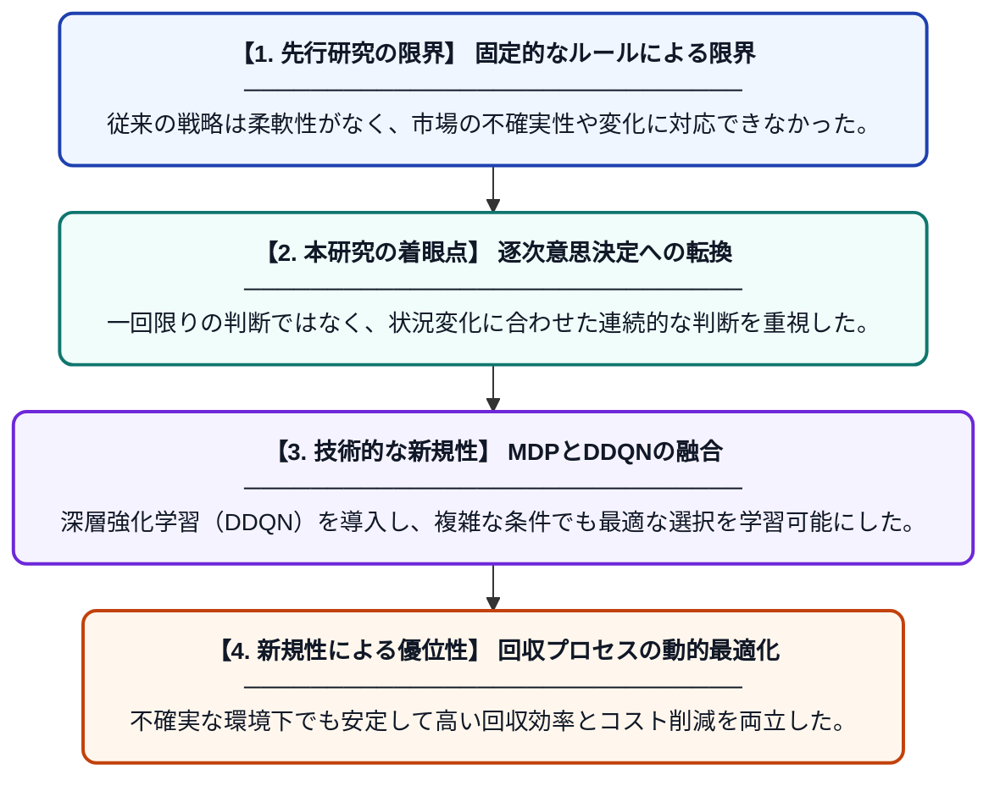

# マルコフ決定過程とDouble Deep Q-Networkを用いたリバースロジスティクスにおける携帯電話回収管理の逐次意思決定最適化

**Original Title**: *Markov Decision Process and Double Deep Q-Network-Based Sequential Decision Optimization for Cellphone Return Management in Reverse Logistics*

> **💡 一言要約**: AIがスマホ回収の最適なタイミングを賢く判断

| 項目 | 内容 |
|---|---|
| **著者** | AA Ibrahim, W Abdul-Kader |
| **掲載誌** | Big Data and Cognitive Computing 2026 |
| **アラートキーワード** | logistics |
| **PDF** | [https://www.mdpi.com/2504-2289/10/11/390/pdf](https://www.mdpi.com/2504-2289/10/11/390/pdf) |
| **原文リンク** | [https://www.mdpi.com/2504-2289/10/11/390/pdf](https://www.mdpi.com/2504-2289/10/11/390/pdf) |
| **PDF版要約** | [README.pdf](./README.pdf) |

---

## 📊 新規性の図解（先行研究との違いと本研究のブレークスルー）

## 📝 要約

電子廃棄物の増加に対し、携帯電話の回収率を向上させるための動的な意思決定モデルを提案しています。マルコフ決定過程（MDP）と深層強化学習（DDQN）を組み合わせることで、不確実な環境下でも最適な回収戦略を導き出します。

## ❓ どんな問題に取り組んだか

電子廃棄物への意識は高まっているものの、携帯電話の回収率は依然として低いままです。従来の逆物流戦略は静的なルールに依存しており、市場の不確実性や時間の経過に伴う複雑な意思決定に対応できていないという課題がありました。

## ✨ 何が新しい？何がすごい？（新規性）

本研究は、不確実な環境下での逐次的な意思決定を最適化するために、MDPとDDQNを統合した点が画期的です。DDQNを採用することで強化学習における過大評価問題を解消し、より安定した学習と精度の高い戦略策定を実現しました。これにより、消費者の行動や市場価格の変化に柔軟に適応する、次世代の回収マネジメント手法を確立しています。

## 🎓 大学1年生向けの解説

使い終わったスマホをリサイクルに出してもらうのは、環境を守るためにとても重要ですが、実は「いつ・どんな条件で回収するのが一番効率的か」を決めるのは非常に難しい問題です。この研究では、AI（深層強化学習）を使って、状況に合わせて最適な回収のタイミングや方法を自動で判断する仕組みを作りました。まるでゲームの攻略法を覚えるように、コンピュータが最も効率的な回収パターンを学習します。これにより、無駄を減らしながら、より多くのスマホを再利用できるようになります。
