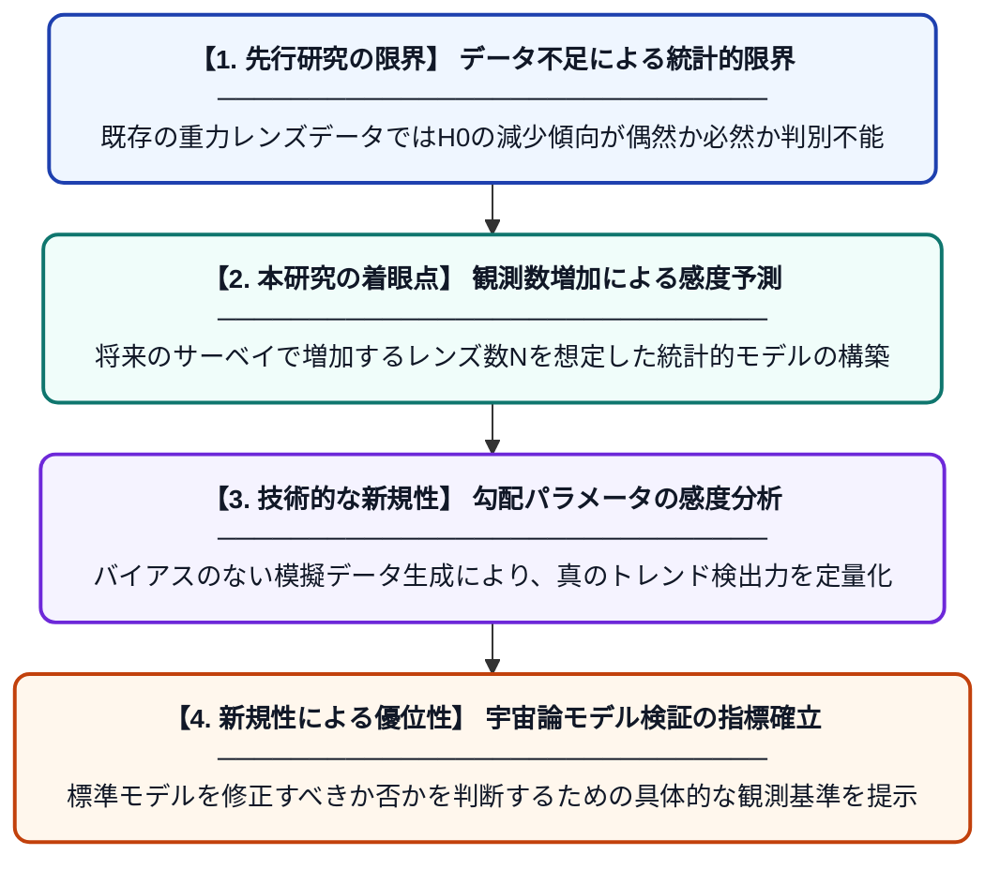

# タイムディレイ・コスモグラフィーにおけるH0減少傾向検証の将来予測

**Original Title**: *A Forecast for Testing the Decreasing $ H_0 $ Trend in Time-Delay Cosmography*

> **💡 一言要約**: H0減少トレンドが本物か、将来の観測で白黒つける

| 項目 | 内容 |
|---|---|
| **著者** | S Brady, EÓ Colgáin, MM Sheikh-Jabbari |
| **掲載誌** | arXiv preprint arXiv:2611.21821 2026 |
| **アラートキーワード** | MCMC |
| **PDF** | [https://arxiv.org/pdf/2611.21821](https://arxiv.org/pdf/2611.21821) |
| **原文リンク** | [https://arxiv.org/pdf/2611.21821](https://arxiv.org/pdf/2611.21821) |
| **PDF版要約** | [README.pdf](./README.pdf) |

---

## 📊 新規性の図解（先行研究との違いと本研究のブレークスルー）

## 📝 要約

重力レンズのタイムディレイ観測から得られるハッブル定数（H0）が、赤方偏移とともに減少する傾向にあるという仮説を検証した研究です。将来の観測レンズ数が増加した際に、この傾向が統計的に有意に検出可能かどうかを模擬データ（Mock）を用いて定量的に予測しています。

## ❓ どんな問題に取り組んだか

現在の宇宙論では、観測手法によってハッブル定数の値が異なる「ハッブル緊張」が大きな課題となっています。特に強重力レンズを用いた測定において、観測対象の距離に応じてH0の値が減少する傾向が示唆されていますが、現在のデータ量ではそれが統計的な偶然なのか物理的な実体なのか判断できていません。

## ✨ 何が新しい？何がすごい？（新規性）

本研究は、将来の観測計画を見据え、H0の減少傾向を示す勾配パラメータをどれほどの精度で決定できるかを予測するフレームワークを構築しました。従来の解析ではMCMC法による模擬データの生成に限界がありましたが、本研究ではレンズ数Nの増加がパラメータ推定に与える影響を厳密に評価しています。これにより、現在の標準的な宇宙論モデルからの逸脱を判定するために必要な観測規模を明確にしました。

## 🎓 大学1年生向けの解説

宇宙がどれくらいの速さで膨張しているかを示す「ハッブル定数」という数値があります。実は、遠くの星を見る方法によってこの数値が少しずつズレてしまうという、宇宙物理学最大のミステリーが起きています。この論文は、遠くの銀河が光を曲げる「重力レンズ」という現象を使って、そのズレが本当に宇宙の仕組みによるものなのかを調べる方法を考えました。将来、もっとたくさんのデータが集まれば、この謎が解けるかもしれないという期待を込めた研究です。
