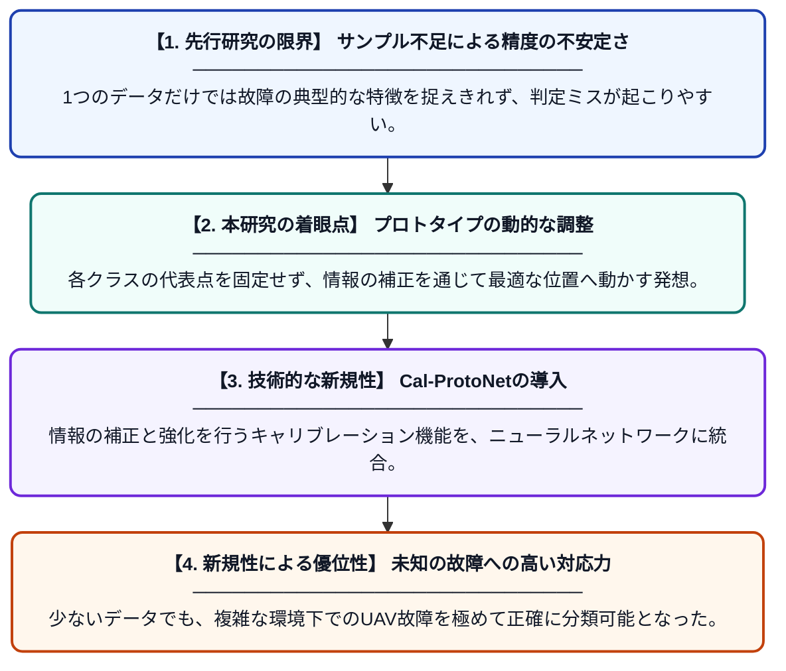

# キャリブレーションされたプロトタイプ学習によるUAVのワンショット故障診断

**Original Title**: *One-Shot UAV Fault Diagnosis via Calibrated Prototype Learning*

> **💡 一言要約**: たった1つのデータでドローンの故障を正確に見抜く

| 項目 | 内容 |
|---|---|
| **著者** | Y Sun, Y Ma, J Li, F Mustapha |
| **掲載誌** | IEEE Access 2026 |
| **アラートキーワード** | one shot |
| **PDF** | [https://ieeexplore.ieee.org/iel8/6287639/6514899/11789606.pdf](https://ieeexplore.ieee.org/iel8/6287639/6514899/11789606.pdf) |
| **原文リンク** | [https://ieeexplore.ieee.org/iel8/6287639/6514899/11789606.pdf](https://ieeexplore.ieee.org/iel8/6287639/6514899/11789606.pdf) |
| **PDF版要約** | [README.pdf](./README.pdf) |

---

## 📊 新規性の図解（先行研究との違いと本研究のブレークスルー）

## 📝 要約

無人航空機（UAV）の故障診断において、わずか1つの学習データから高精度に分類を行うCal-ProtoNetを提案しています。プロトタイプ（各クラスの代表点）の変動に対する脆弱性を克服するため、情報の補正と強化を行う仕組みを導入しています。

## ❓ どんな問題に取り組んだか

従来のワンショット学習では、1つのサンプルから作成されるプロトタイプがデータの個体差に強く影響され、診断精度が不安定になる課題がありました。特にUAVの動作環境は複雑であり、単一のデータから故障の典型的な特徴を捉えることは困難でした。

## ✨ 何が新しい？何がすごい？（新規性）

本研究は、単一のサンプルから生成されるプロトタイプを動的に修正する「Prototype Calibration Network (Cal-ProtoNet)」を開発しました。先行研究がサンプルの特徴をそのまま利用していたのに対し、提案手法はクラス間の関係性を考慮して代表点の位置を補正する機能を備えています。これにより、未知の故障パターンに対しても高い頑健性と識別性能を維持することが可能になりました。

## 🎓 大学1年生向けの解説

ドローンが故障した際、その原因を特定するには大量のデータが必要ですが、故障データは滅多に手に入りません。そこで、たった1回しか見たことがない故障でも正しく判定できるAIが必要とされています。この研究では、1つの例から「故障の共通的な特徴」を賢く推測し、情報のズレを自動で直す技術を開発しました。これによって、少ないヒントからでも正確にドローンの異常を診断できるようになります。
