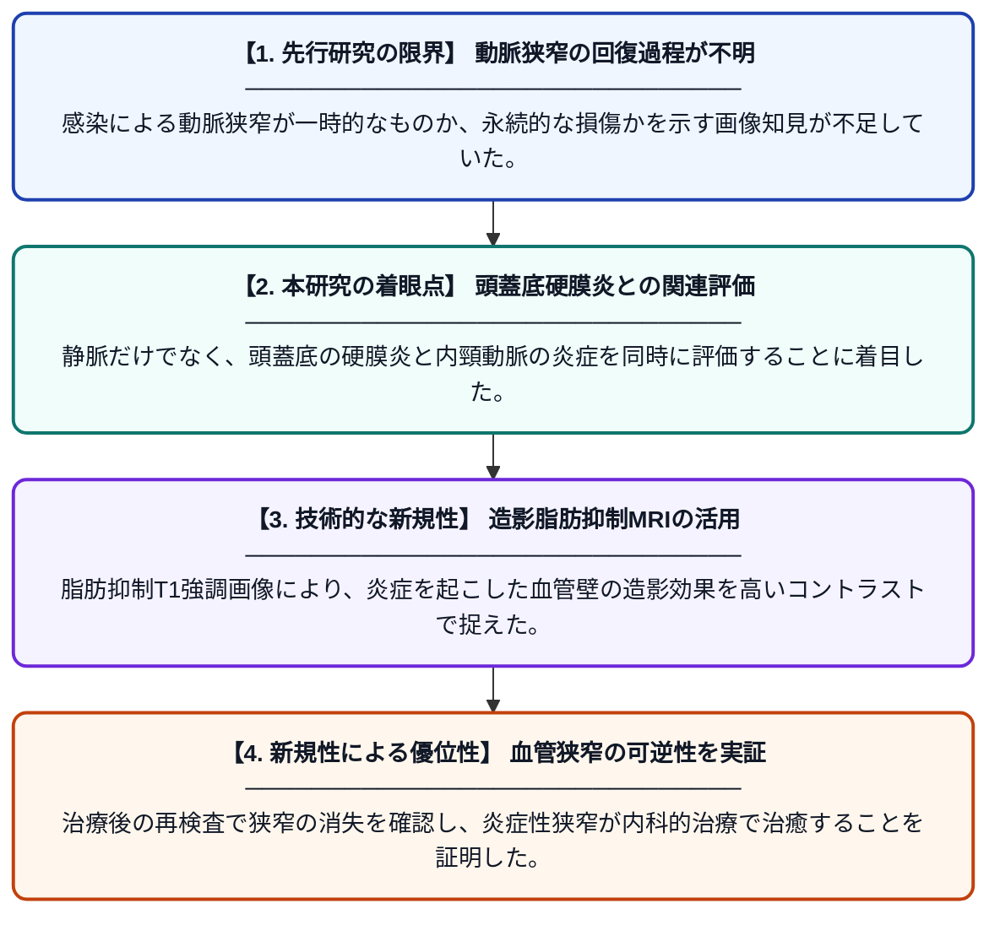

# レミエール症候群の稀な神経血管合併症：頭蓋底硬膜炎と内頸動脈の可逆的炎症性狭窄

**Original Title**: *A rare neurovascular complication of Lemierre syndrome: Skull base pachymeningitis and reversible inflammatory stenosis of the petrous-cavernous internal carotid …*

> **💡 一言要約**: レミエール症候群による稀な血管狭窄の可逆性を解明

| 項目 | 内容 |
|---|---|
| **著者** | PDGD Tsioukaka, PDWYM Traoré, PDDDL Ye… |
| **掲載誌** | Radiology Case Reports 2026 |
| **アラートキーワード** | ICA |
| **原文リンク** | [https://www.sciencedirect.com/science/article/pii/S193004332600926X](https://www.sciencedirect.com/science/article/pii/S193004332600926X) |
| **PDF版要約** | [README.pdf](./README.pdf) |

---

## 📊 新規性の図解（先行研究との違いと本研究のブレークスルー）

## 📝 要約

喉の感染症から波及するレミエール症候群において、極めて稀な頭蓋底硬膜炎と内頸動脈の炎症性狭窄が発生した症例を報告しています。MRIを用いた詳細な画像評価により、炎症によって細くなった内頸動脈が適切な治療によって回復する可逆的な過程を明らかにしました。

## ❓ どんな問題に取り組んだか

レミエール症候群は通常、静脈の血栓を特徴としますが、動脈系への影響は非常に稀です。特に、頭蓋底の硬膜炎を伴う内頸動脈の狭窄がどのように進行し、治療によって改善するのかという画像医学的知見が不足していました。

## ✨ 何が新しい？何がすごい？（新規性）

本研究の新規性は、造影後脂肪抑制T1強調画像を用いることで、岩様部から海綿静脈洞部にかけての内頸動脈壁の炎症と狭窄を鮮明に可視化した点にあります。健常な反対側の血管と比較し、さらに経時的な観察を行うことで、この深刻な血管狭窄が「可逆的」であることを臨床的に証明しました。頭蓋底硬膜炎という極めて稀な合併症との関連性を整理した点も重要な貢献です。

## 🎓 大学1年生向けの解説

喉のひどい腫れ（感染症）が原因で、首の大きな血管に血栓ができたり炎症が起きたりする「レミエール症候群」という病気についての研究です。この患者さんは、脳に血液を送る大切な動脈までもが炎症で細くなってしまいましたが、最新のMRI検査でその様子を詳しく調べました。すると、適切な治療を行うことで細くなった血管が元通りに治ることが分かったのです。この発見は、お医者さんが似たような重い症状の患者さんを診断し、治療する際の大きな助けになります。
