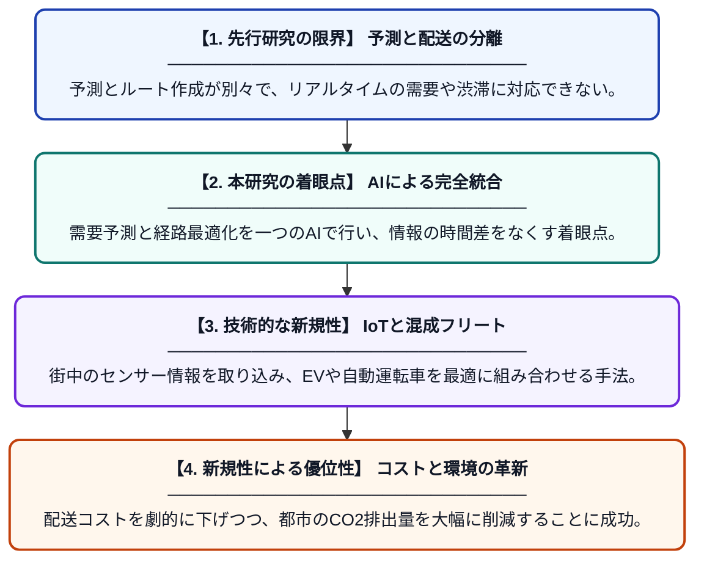

# UrbanLogix-AI：スマートシティ貨物ネットワークに向けたAI強化型ラストワンマイル物流最適化

**Original Title**: *UrbanLogix-AI: AI-augmented last-mile logistics optimization for smart city freight networks*

> **💡 一言要約**: AIとIoTで都市物流のコストと排出量を最小化

| 項目 | 内容 |
|---|---|
| **著者** | S Elattar, J Bashatah |
| **掲載誌** | Computers & Industrial Engineering 2026 |
| **アラートキーワード** | logistics |
| **原文リンク** | [https://www.sciencedirect.com/science/article/pii/S036083522600700X](https://www.sciencedirect.com/science/article/pii/S036083522600700X) |
| **PDF版要約** | [README.pdf](./README.pdf) |

---

## 📊 新規性の図解（先行研究との違いと本研究のブレークスルー）

## 📝 要約

物流コストの約53%を占めるラストワンマイルの課題に対し、AIとIoTを統合した新しい最適化フレームワークを提案しています。需要予測とルート計画をリアルタイムで同期させ、電気自動車を含む多様な車両編成に対応することで、配送効率と環境負荷を同時に改善します。

## ❓ どんな問題に取り組んだか

ラストワンマイル物流は、配送コスト全体の半分以上、都市部のCO2排出量の約3割を占める非効率な分野です。既存の手法は需要予測とルート作成が分断されており、リアルタイムの交通状況や多様な車種の組み合わせを十分に考慮できていませんでした。

## ✨ 何が新しい？何がすごい？（新規性）

本研究の最大の特徴は、需要予測と経路最適化を単一のAIフレームワークに統合した点にあります。先行研究が単一の車種や静的なデータを前提としていたのに対し、IoTを活用したリアルタイムデータ収集と、電気自動車や自律走行車を含む「混成フリート」の管理を同時に実現しました。これにより、都市環境の動的な変化に即応する高度な物流ネットワークの構築を可能にしています。

## 🎓 大学1年生向けの解説

ネット通販などで注文した荷物が玄関先に届くまでの「最後の区間」は、実は最もお金と手間がかかり、環境にも負担をかけています。この論文は、AIを使って「いつ、どの車で、どの道を通れば一番効率よく荷物を届けられるか」を自動で計算するシステムを作りました。道路の混み具合をセンサーでキャッチしながら、電気自動車なども組み合わせて賢く配送することで、無駄なコストと排気ガスを減らすことができます。
