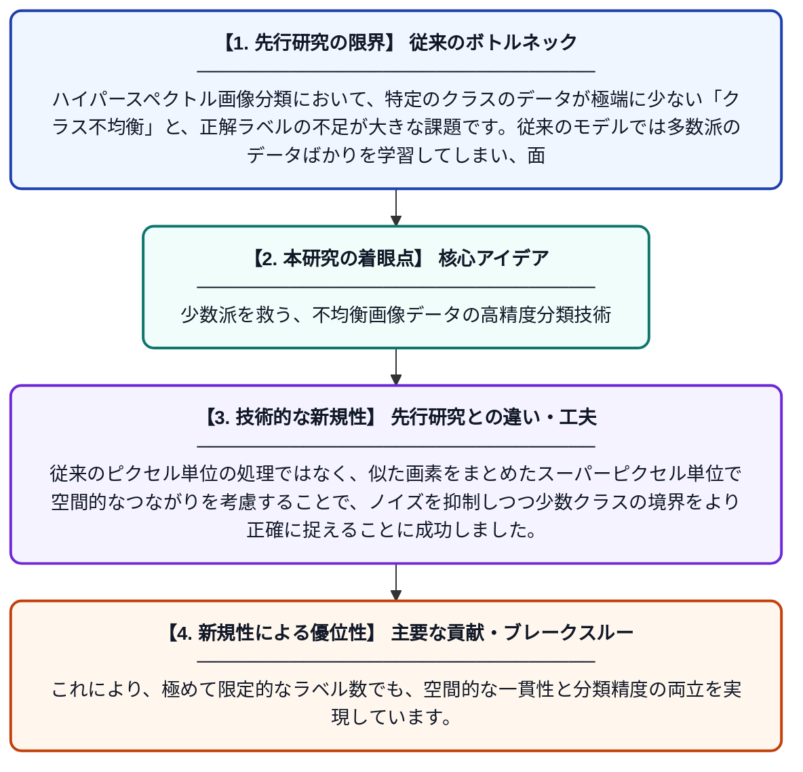

# 少数のクラスを考慮した半教師あり学習による、ラベルが限定的な不均衡ハイパースペクトル画像の分類

**Original Title**: *Minority-Aware Semi-Supervised Learning for Class-Imbalanced Hyperspectral Image Classification with Limited Labels*

> **💡 一言要約**: 少数派を救う、不均衡画像データの高精度分類技術

| 項目 | 内容 |
|---|---|
| **著者** | N Zhang, T Semere, SN Rouamba |
| **掲載誌** | Information Science and Technology (ICIST) 2026 |
| **アラートキーワード** | Markov random"  fields |
| **原文リンク** | [https://ieeexplore.ieee.org/abstract/document/11727868/](https://ieeexplore.ieee.org/abstract/document/11727868/) |
| **PDF版要約** | [README.pdf](./README.pdf) |

---

## 📊 新規性の図解（先行研究との違いと本研究のブレークスルー）

## 📝 要約

この研究は、ラベル付きデータが少なく、かつクラス間でデータの数に偏りがあるハイパースペクトル画像の分類精度を向上させる手法を提案しています。スーパーピクセル単位のマルコフ確率場（MRF）などの空間情報を活用することで、少数派クラスの識別精度と画像全体の一貫性を高めています。

## ❓ どんな問題に取り組んだか

ハイパースペクトル画像分類において、特定のクラスのデータが極端に少ない「クラス不均衡」と、正解ラベルの不足が大きな課題です。従来のモデルでは多数派のデータばかりを学習してしまい、面積の小さい地物や希少なクラスを正確に判別できない問題がありました。

## ✨ 何が新しい？何がすごい？（新規性）

本研究の新規性は、少数派クラスを意識した半教師あり学習に、スーパーピクセルレベルのマルコフ確率場（MRF）を統合した点にあります。従来のピクセル単位の処理ではなく、似た画素をまとめたスーパーピクセル単位で空間的なつながりを考慮することで、ノイズを抑制しつつ少数クラスの境界をより正確に捉えることに成功しました。これにより、極めて限定的なラベル数でも、空間的な一貫性と分類精度の両立を実現しています。

## 🎓 大学1年生向けの解説

人工衛星などで撮影される「ハイパースペクトル画像」を使って、地面に何があるかを当てるAIの研究です。現実の世界では、広い草原の中に少しだけ珍しい植物があるように、データの数に大きな偏りがあるため、AIは数が多いものばかりを優先して覚えてしまう癖があります。この研究では、似た色や形のエリアをひとまとめにして考える工夫をすることで、データが少ない珍しいものもしっかりと見分けられるようにしました。これにより、少ないヒントからでも正確に地図を作るようなことが可能になります。
