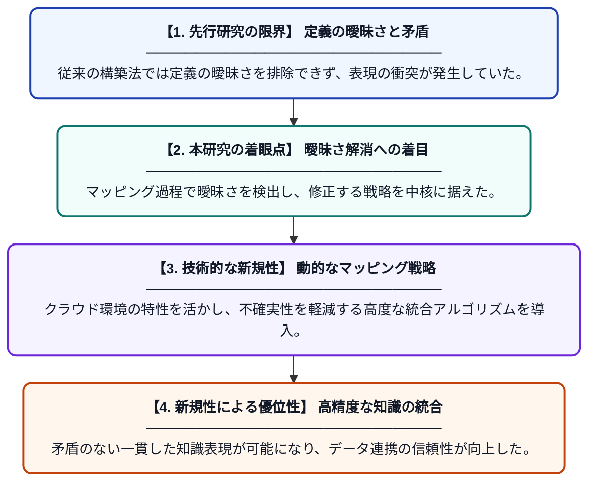

# クラウド環境における一貫した知識表現を実現するためのオントロジーマッピング戦略

**Original Title**: *Strategies for Ontology Mapping to Achieve Cohesive Knowledge Representation in Cloud Environments*

> **💡 一言要約**: オントロジーの曖昧さを解消しクラウド統合を加速

| 項目 | 内容 |
|---|---|
| **著者** | S Gupta, LS Sharma |
| **掲載誌** | Journal of Information & Knowledge Management 2026 |
| **アラートキーワード** | Ontology |
| **原文リンク** | [https://www.worldscientific.com/doi/abs/10.1142/S0219649226500723](https://www.worldscientific.com/doi/abs/10.1142/S0219649226500723) |
| **PDF版要約** | [README.pdf](./README.pdf) |

---

## 📊 新規性の図解（先行研究との違いと本研究のブレークスルー）

## 📝 要約

クラウド環境でのデータ統合において、オントロジーの曖昧さが原因で生じる表現の矛盾や不確実性を解決する戦略を提案しています。効果的なマッピング手法を用いることで、異なるシステム間でも一貫性のある信頼性の高い知識共有を可能にします。

## ❓ どんな問題に取り組んだか

クラウド上の膨大なデータを統合する際、オントロジー（概念の定義）の曖昧さが原因で、データの解釈に齟齬が生じたりシステム間で矛盾が発生したりします。従来の構築手法では、これらの曖昧さを完全に取り除くことが難しく、知識表現の信頼性が低下するという課題がありました。

## ✨ 何が新しい？何がすごい？（新規性）

本研究は、クラウド特有の動的な環境に対応したオントロジーマッピングの新しい戦略を提案している点が特徴です。単なる語彙の一致だけでなく、曖昧さを体系的に解消するプロセスを導入することで、知識表現の結束力を高めています。これにより、異なるドメイン間でのデータ連携における信頼性を飛躍的に向上させ、大規模システムにおける意思決定の精度を高めることに貢献しました。

## 🎓 大学1年生向けの解説

「オントロジー」とは、コンピュータがデータを正しく理解するための「共通の辞書」のようなものです。クラウドには膨大な情報がありますが、システムごとに言葉の使い方が少しずつ違うと、情報のやり取りがうまくいきません。この論文は、その「言葉のズレや曖昧さ」を自動で調整し、正しく繋ぎ合わせるための新しいルールを考えています。これにより、世界中のコンピュータが同じ意味でデータを共有できるようになります。
