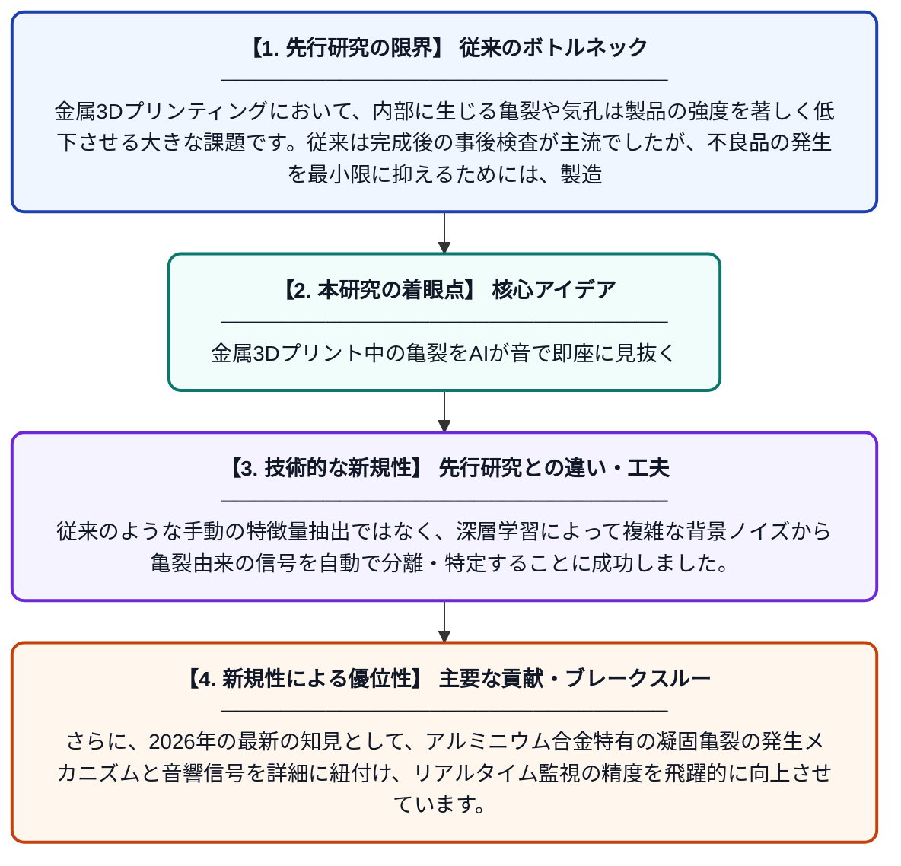

# レーザ粉末床溶融結合法によるアルミニウム合金製造時の亀裂形成に伴うアコースティック・エミッション信号の特定：リアルタイム検出に向けた埋め込み表現学習

**Original Title**: *Acoustic emission signatures of crack formation in aluminium-based alloys processed by laser powder bed fusion: Embedded representation learning toward real-time …*

> **💡 一言要約**: 金属3Dプリント中の亀裂をAIが音で即座に見抜く

| 項目 | 内容 |
|---|---|
| **著者** | DY Kononenko, D Chernyavsky, M Seleznev, L Beyer… |
| **掲載誌** | Additive Manufacturing 2026 |
| **アラートキーワード** | representation learning |
| **原文リンク** | [https://www.sciencedirect.com/science/article/pii/S2214860426003349](https://www.sciencedirect.com/science/article/pii/S2214860426003349) |
| **PDF版要約** | [README.pdf](./README.pdf) |

---

## 📊 新規性の図解（先行研究との違いと本研究のブレークスルー）

## 📝 要約

レーザ粉末床溶融結合法（LPBF）によるアルミニウム合金の製造中に発生する亀裂を、アコースティック・エミッション（AE）法と深層学習を用いてリアルタイムで検知する手法を提案しています。AE信号から亀裂特有のパターンを「埋め込み表現学習」によって抽出することで、製造プロセスにおける欠陥の早期発見を可能にしました。

## ❓ どんな問題に取り組んだか

金属3Dプリンティングにおいて、内部に生じる亀裂や気孔は製品の強度を著しく低下させる大きな課題です。従来は完成後の事後検査が主流でしたが、不良品の発生を最小限に抑えるためには、製造中にリアルタイムで欠陥の兆候を捉える技術が求められていました。

## ✨ 何が新しい？何がすごい？（新規性）

本研究の大きな特徴は、AE信号の解析に「埋め込み表現学習」を導入した点にあります。従来のような手動の特徴量抽出ではなく、深層学習によって複雑な背景ノイズから亀裂由来の信号を自動で分離・特定することに成功しました。さらに、2026年の最新の知見として、アルミニウム合金特有の凝固亀裂の発生メカニズムと音響信号を詳細に紐付け、リアルタイム監視の精度を飛躍的に向上させています。

## 🎓 大学1年生向けの解説

金属の粉をレーザーで溶かして固める3Dプリンターでは、急激な熱変化で材料に目に見えないほどの小さなヒビ（亀裂）が入ることがあります。この研究は、ヒビが入る瞬間に発生する「ミクロな音」をマイクで聞き取り、AIを使ってそれが亀裂の音かどうかを即座に判断する技術です。健康診断で心音を聞いて病気を見つけるように、機械の音から製品の異常をいち早く察知して、壊れない部品作りを目指しています。
