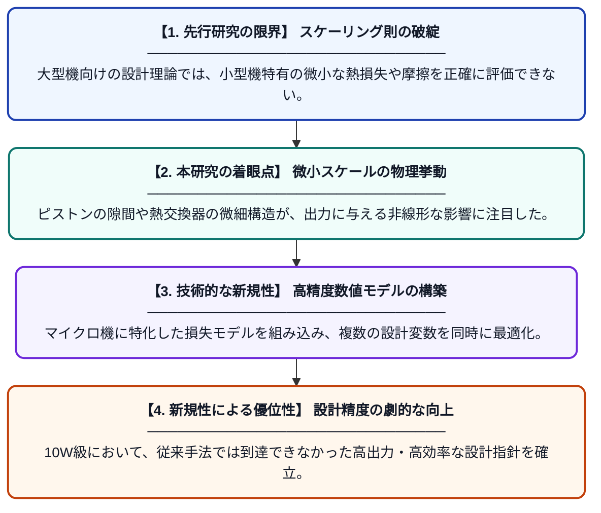

# 10Wマイクロフリーピストン・スターリング発電機のパラメータ影響分析と最適化

**Original Title**: *Parameter effect analysis and optimization of a 10 W micro-free-piston Stirling generator*

> **💡 一言要約**: 極限環境で輝く超小型発電機の「設計の黄金比」を解明

| 項目 | 内容 |
|---|---|
| **著者** | Z Zhang, T Yang, Y Yuan, H Liu, X Yu, J Mou, C Chi… |
| **掲載誌** | Energy 2026 |
| **アラートキーワード** | optimization |
| **原文リンク** | [https://www.sciencedirect.com/science/article/pii/S0360544226028756](https://www.sciencedirect.com/science/article/pii/S0360544226028756) |
| **PDF版要約** | [README.pdf](./README.pdf) |

---

## 📊 新規性の図解（先行研究との違いと本研究のブレークスルー）

## 📝 要約

宇宙空間や深海などの極限環境での利用を想定し、10W級の超小型フリーピストン・スターリング発電機（FPSG）の性能を向上させる研究です。小型化に伴う特有の熱損失や物理的相互作用を詳細に分析し、シミュレーションを通じて最適な設計パラメータを明らかにしました。

## ❓ どんな問題に取り組んだか

従来のスターリング発電機の設計手法は大型機を基準としており、マイクロサイズ化に伴う熱損失や摩擦の影響を正確に予測できませんでした。特に10W程度の微小出力帯では、部品同士のクリアランスや熱交換器の隙間が性能に与える影響が極めて敏感になり、効率維持が困難という課題がありました。

## ✨ 何が新しい？何がすごい？（新規性）

本研究は、マイクロFPSGに特化した高精度な数値モデルを構築し、微小スケール特有の非線形な挙動を解明した点に新規性があります。単なるサイズ縮小ではなく、出力と効率を最大化するためのパラメータ間の相関関係を多角的に分析しました。さらに、最適化アルゴリズムを導入することで、従来の設計指針を大幅に上回る性能を実現するための具体的な構造パラメータの組み合わせを提示しました。

## 🎓 大学1年生向けの解説

スターリングエンジンは、温度差を電気に変える非常にクリーンで壊れにくい機械です。この研究では、それを宇宙探査機などで使えるように、スマホの充電器ほどの小さなサイズ（10W）に作り直す方法を調べました。機械を小さくすると熱が逃げやすくなるなどの難しい問題が起きますが、コンピュータを使って「どうすれば一番効率よく動くか」というパズルの正解を見つけ出したのがこの論文のすごいところです。
