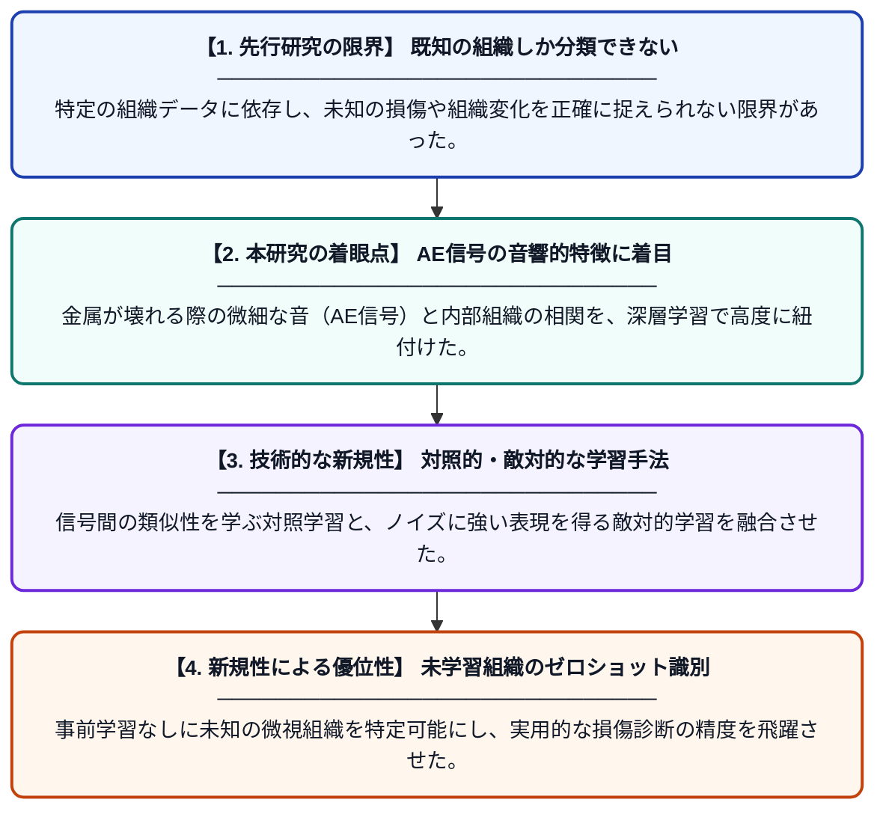

# WAAM低炭素鋼におけるアコースティック・エミッションの対照的・敵対的学習を用いたき裂先端微視組織のゼロショット識別

**Original Title**: *Zero-shot identification of crack tip microstructure in WAAM low-carbon steel using acoustic emission contrastive-adversarial learning*

> **💡 一言要約**: AE信号とAIで金属のき裂をゼロショットで特定

| 項目 | 内容 |
|---|---|
| **著者** | W Zhang, X Li, M Cao, Y Zhao, J Yang, X Guan, J He |
| **掲載誌** | Mechanical Systems and … 2027 |
| **アラートキーワード** | representation learning |
| **原文リンク** | [https://www.sciencedirect.com/science/article/pii/S0888327026013853](https://www.sciencedirect.com/science/article/pii/S0888327026013853) |
| **PDF版要約** | [README.pdf](./README.pdf) |

---

## 📊 新規性の図解（先行研究との違いと本研究のブレークスルー）

## 📝 要約

WAAM（ワイヤーアーク積層造形）で作られた低炭素鋼の疲労き裂進展において、き裂先端の微細な組織を特定する新しいAE（アコースティック・エミッション）解析手法を開発しました。対照学習と敵対的学習を組み合わせることで、ラベルのない未知の組織状態に対しても高い精度で識別可能な表現学習を実現しています。

## ❓ どんな問題に取り組んだか

材料の疲労き裂が進展する際、内部の微視的な組織変化をリアルタイムで把握することは非常に困難です。また、従来の機械学習手法では、学習データに含まれない未知の組織や損傷パターンを正確に識別できないという課題がありました。

## ✨ 何が新しい？何がすごい？（新規性）

本研究の最大の特徴は、AE信号から微視組織に敏感な特徴を抽出するために「対照的・敵対的学習」を導入した点にあります。これにより、特定のラベルがない状態でも組織を識別できるゼロショット性能を達成しました。AE信号と顕微鏡による組織観察を同期させ、物理的な現象と音響信号を高度に紐付けたことが先行研究にはない大きな貢献です。

## 🎓 大学1年生向けの解説

金属に繰り返し力が加わって「ひび」が入るとき、材料の内部からは微かな音（AE信号）が発生します。この研究は、その音をAIに聞かせることで、金属のミクロな構造がどうなっているかを言い当てる技術です。すごいのは、AIが一度も見たことがない構造であっても、音の特徴から正しく推測できる点です。これを使えば、建物や乗り物の金属が壊れそうな予兆を、より正確に見つけることができるようになります。
