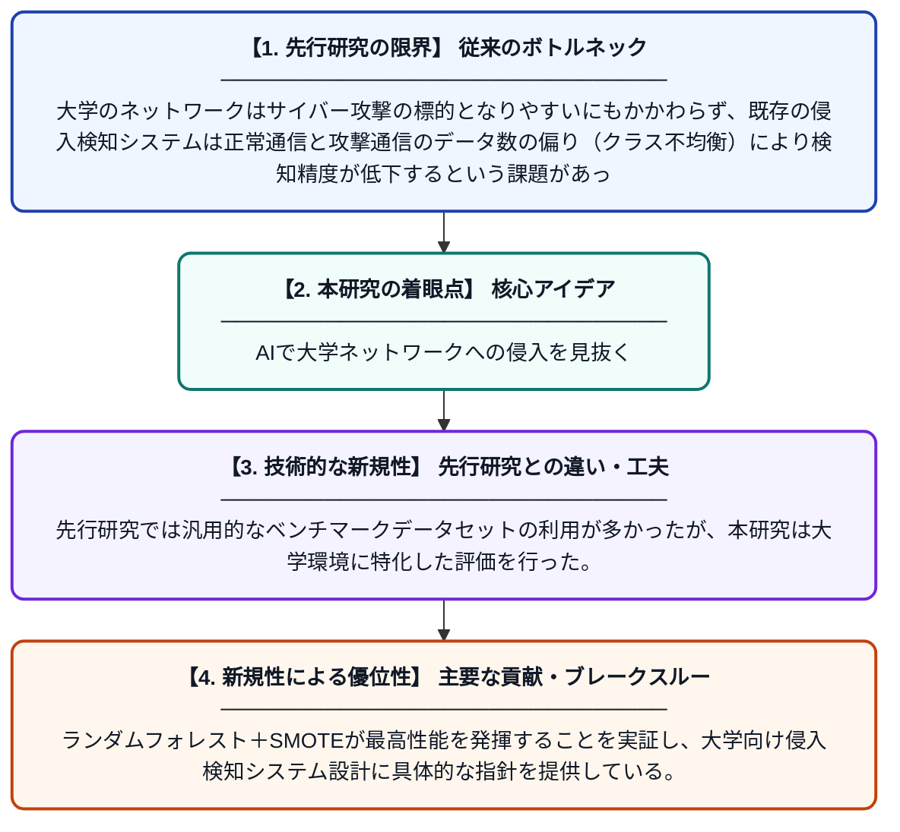

# SMOTEを用いた最適化高速学習ネットワークモデルによる大学ネットワーク侵入検知システム

**Original Title**: *Optimized Fast-Learning Network Model With SMOTE for University Network Intrusion Detection Systems*

> **💡 一言要約**: AIで大学ネットワークへの侵入を見抜く

| 項目 | 内容 |
|---|---|
| **著者** | R Wamusi, G Ali, T Habibu |
| **掲載誌** | Baghdad Science Journal 2026 |
| **アラートキーワード** | SMOTE |
| **PDF** | [https://bsj.uobaghdad.edu.iq/cgi/viewcontent.cgi?article=5367&context=home](https://bsj.uobaghdad.edu.iq/cgi/viewcontent.cgi?article=5367&context=home) |
| **原文リンク** | [https://bsj.uobaghdad.edu.iq/cgi/viewcontent.cgi?article=5367&context=home](https://bsj.uobaghdad.edu.iq/cgi/viewcontent.cgi?article=5367&context=home) |
| **PDF版要約** | [README.pdf](./README.pdf) |

---

## 📊 新規性の図解（先行研究との違いと本研究のブレークスルー）

## 📝 要約

本研究は、大学のネットワーク環境における不正侵入を検知するため、ランダムフォレストやXGBoost、CNNなど複数の機械学習モデルとデータ拡張手法SMOTEを組み合わせた侵入検知システムを提案・比較した。最も優れた性能を示したのはランダムフォレストとSMOTEの組み合わせであり、精度81.88%、適合率82.17%を達成した。クラス不均衡問題に対処しながら、実用的な大学ネットワーク向け侵入検知の最適化手法を示している。

## ❓ どんな問題に取り組んだか

大学のネットワークはサイバー攻撃の標的となりやすいにもかかわらず、既存の侵入検知システムは正常通信と攻撃通信のデータ数の偏り（クラス不均衡）により検知精度が低下するという課題があった。また、多様な機械学習モデルの中でどの組み合わせが大学環境に最適かが明確でなかった。

## ✨ 何が新しい？何がすごい？（新規性）

本研究では、複数の機械学習・深層学習モデル（RF、XGBoost、AdaBoost、決定木、CNN）を体系的に比較するだけでなく、クラス不均衡を補正するSMOTE（合成少数サンプル生成法）との組み合わせ効果を大学ネットワーク特有のデータで検証した点が新しい。先行研究では汎用的なベンチマークデータセットの利用が多かったが、本研究は大学環境に特化した評価を行った。ランダムフォレスト＋SMOTEが最高性能を発揮することを実証し、大学向け侵入検知システム設計に具体的な指針を提供している。

## 🎓 大学1年生向けの解説

大学のインターネット回線には、外部から悪意ある攻撃者が侵入しようとすることがあります。この研究は、AIを使ってその不正アクセスを自動的に見つけ出すシステムを作りました。ただし、攻撃の記録は正常な通信の記録に比べてとても少ないため、AIが学習しにくいという問題がありました。そこで「SMOTE」という技術で攻撃データを人工的に増やし、AIが正確に学べるように工夫しました。その結果、ランダムフォレストというAIモデルとSMOTEを組み合わせると最も精度が高くなることがわかりました。
