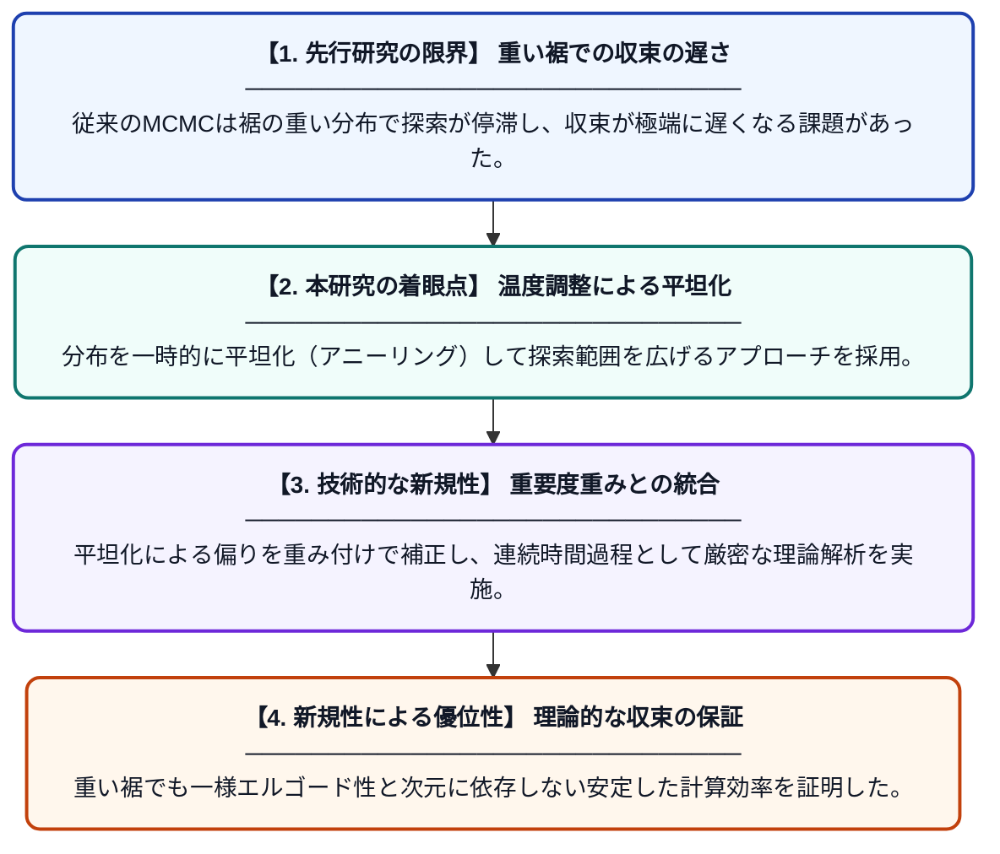

# 重い裾を持つターゲット分布に対する重要度重み付けアニーリングMCMCの一様エルゴード性とスペクトルギャップ

**Original Title**: *Uniform ergodicity and spectral gap of importance-tempered MCMC with heavy-tailed targets*

> **💡 一言要約**: 重い裾の分布も「温度調整」で高速かつ確実にサンプリング

| 項目 | 内容 |
|---|---|
| **著者** | Q Zhou |
| **掲載誌** | Biometrika 2026 |
| **アラートキーワード** | MCMC |
| **PDF** | [https://academic.oup.com/biomet/advance-article-pdf/doi/10.1093/biomet/asag068/73259168/asag068.pdf](https://academic.oup.com/biomet/advance-article-pdf/doi/10.1093/biomet/asag068/73259168/asag068.pdf) |
| **原文リンク** | [https://academic.oup.com/biomet/advance-article-pdf/doi/10.1093/biomet/asag068/73259168/asag068.pdf](https://academic.oup.com/biomet/advance-article-pdf/doi/10.1093/biomet/asag068/73259168/asag068.pdf) |
| **PDF版要約** | [README.pdf](./README.pdf) |

---

## 📊 新規性の図解（先行研究との違いと本研究のブレークスルー）

## 📝 要約

重い裾を持つ分布からのサンプリングにおいて、ターゲット分布を平坦化して探索し重要度重みで補正するアルゴリズムの収束性を解析した研究です。この手法が一様エルゴード性を持ち、次元に対してロバストなスペクトルギャップの下界を有することを理論的に証明しました。

## ❓ どんな問題に取り組んだか

従来のMCMC手法（ランダムウォーク・メトロポリス法など）は、裾の重い（減少が遅い）分布を扱う際に、探索が局所的に停滞し収束が極めて遅くなるという課題がありました。特に高次元の設定において、効率的かつ数学的に保証されたサンプリング手法の構築が困難でした。

## ✨ 何が新しい？何がすごい？（新規性）

本研究は、アニーリング（温度上げ）による分布の平坦化と重要度重み付けを組み合わせた手法の動態を、連続時間マルコフ過程として精密に記述しました。先行研究では達成困難だった「重い裾」のターゲットに対しても、初期値に依存せず一定速度で収束する「一様エルゴード性」が成立することを初めて示しました。さらに、計算効率の指標となるスペクトルギャップが次元の変化に対して安定していることを導出しました。

## 🎓 大学1年生向けの解説

データ分析では、複雑な「確率の山」の形を調べるためにMCMCという手法を使いますが、山の裾がどこまでも広がっているような分布では、計算がなかなか終わらない問題がありました。この論文は、分布を一度わざと平坦にしてから広く探索し、後で重みをつけて元の形に戻すという工夫を提案しました。この方法を使えば、非常に難しい形の分布でも、数学的に「確実に、しかも早く」正解にたどり着けることが証明されました。これにより、複雑な現象のシミュレーションがより正確に行えるようになります。
