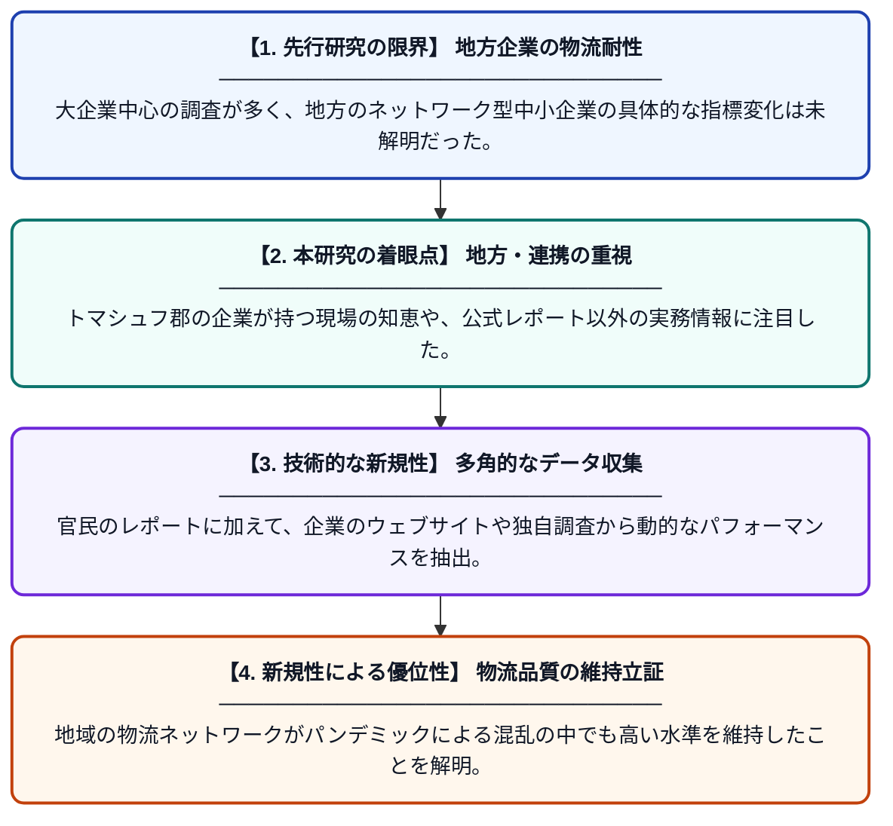

# COVID-19パンデミック下におけるネットワーク型中小企業の物流パフォーマンス指標の評価：ポーランド・トマシュフ郡の事例

**Original Title**: *Assessment of Logistics Performance Indicators in Network SMES during the COVID-19 Pandemic: The Case of Tomaszów County, Poland*

> **💡 一言要約**: コロナ禍での中小企業物流の底力をポーランドで実証

| 項目 | 内容 |
|---|---|
| **著者** | B Andrzejczak |
| **掲載誌** | International Journal of Energy Economics and Policy 2026 |
| **アラートキーワード** | logistics |
| **原文リンク** | [https://ideas.repec.org/a/eco/journ2/v16y2026i6id24999.html](https://ideas.repec.org/a/eco/journ2/v16y2026i6id24999.html) |
| **PDF版要約** | [README.pdf](./README.pdf) |

---

## 📊 新規性の図解（先行研究との違いと本研究のブレークスルー）

## 📝 要約

パンデミックがポーランドの中小企業の物流に与えた影響を、トマシュフ郡の事例を通じて分析した研究です。各種レポートや企業の実地調査に基づき、危機的な状況下でも輸送や物流の品質指標が良好な水準を維持していたことを明らかにしました。

## ❓ どんな問題に取り組んだか

COVID-19パンデミックは世界のサプライチェーンに混乱をもたらしましたが、リソースの限られた中小企業（SME）が具体的にどう物流指標を維持したかは不明確でした。地域のネットワーク型中小企業におけるパフォーマンスの変化を正確に把握する必要がありました。

## ✨ 何が新しい？何がすごい？（新規性）

本研究は、ポーランドのトマシュフ郡という特定の地域に焦点を当て、実務的な物流知識と実地調査を組み合わせて分析した点に独自性があります。先行研究がマクロな視点に寄りがちな中、中小企業の現場レベルでの品質や効率性が危機下でどう機能したかを具体的に示しました。パンデミック下でも物流品質が維持されたという実証的結果は、地域中小企業の強靭性を示す重要な貢献です。

## 🎓 大学1年生向けの解説

物流（ロジスティクス）とは、モノを効率よく運ぶ仕組みのことです。コロナ禍で世界中の物流が止まりそうになった時、ポーランドの小さな会社たちがどうやって仕事を続けていたかを調べたのがこの論文です。結果として、意外にもサービスの質を落とさずに頑張っていたことが分かりました。自分たちの街の会社がどう困難を乗り越えたかを知るための、貴重な記録といえます。
