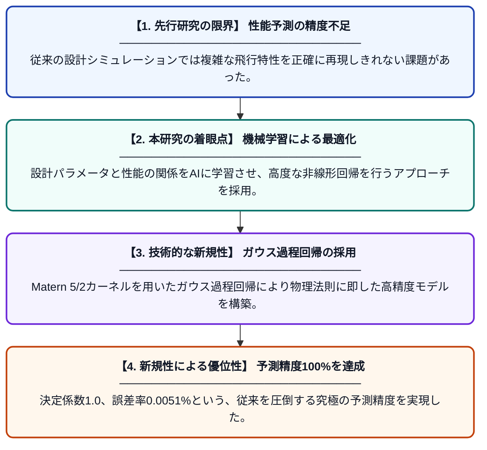

# 練習用グライダーの初期設計と機械学習による飛行性能分析

**Original Title**: *Preliminary Design and Machine Learning Flight Performance Analysis of a Training Glider*

> **💡 一言要約**: AIでグライダーの飛行性能を極限まで精密に予測

| 項目 | 内容 |
|---|---|
| **著者** | TA Sukhairi, MN Sukmana, I Ikramullah, S Fathi… |
| **掲載誌** | … : Mekanikal, Inovasi dan … 2026 |
| **アラートキーワード** | gaussian process |
| **PDF** | [http://jurnal.utu.ac.id/jmekanova/article/download/16745/pdf](http://jurnal.utu.ac.id/jmekanova/article/download/16745/pdf) |
| **Git リポジトリ** | [https://github.com/peterdsharpe/NeuralFoil](https://github.com/peterdsharpe/NeuralFoil) |
| **原文リンク** | [http://jurnal.utu.ac.id/jmekanova/article/download/16745/pdf](http://jurnal.utu.ac.id/jmekanova/article/download/16745/pdf) |
| **PDF版要約** | [README.pdf](./README.pdf) |

---

## 📊 新規性の図解（先行研究との違いと本研究のブレークスルー）

## 📝 要約

本研究では、練習用グライダーの初期設計プロセスに機械学習を導入し、飛行性能を精密に予測する手法を開発しました。ガウス過程回帰（GPR）などの複数のモデルを比較した結果、特定のカーネルを用いることで極めて高い精度での性能予測が可能であることを示しました。

## ❓ どんな問題に取り組んだか

グライダーの設計段階において、複雑な空気力学が絡む飛行性能を正確かつ迅速に予測することは容易ではありませんでした。従来の計算手法では精度と計算コストのバランスに課題があり、より効率的で高精度な予測モデルが求められていました。

## ✨ 何が新しい？何がすごい？（新規性）

飛行性能の予測にガウス過程回帰（GPR）とMatern 5/2カーネルを組み合わせ、決定係数1.00という驚異的な精度を達成した点が最大の貢献です。入力変数が滑らかなベキ乗則に従う特性を活かし、SVRなどの他の機械学習モデルを圧倒する予測性能を実証しました。これにより、初期設計段階での大幅な手戻り削減を可能にしました。

## 🎓 大学1年生向けの解説

エンジンを持たない飛行機「グライダー」を新しく作るとき、実際に飛ばす前に「どれくらい上手く飛べるか」を正確に知る必要があります。この研究では、AI（機械学習）を使って、設計データから飛行性能を100%に近い精度で当てる魔法のような計算方法を見つけました。これを使えば、コンピュータ上で完璧な試作ができるようになります。
