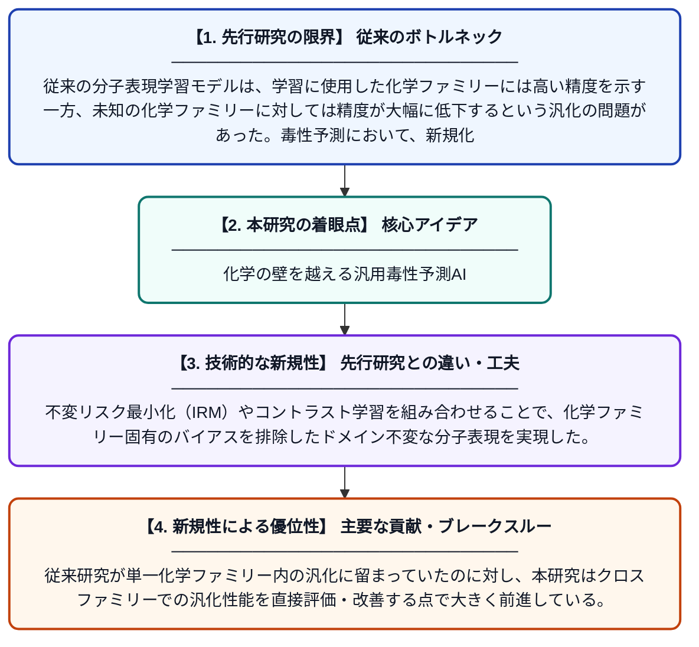

# 化学ファミリーを横断した毒性予測のためのドメイン汎化表現学習

**Original Title**: *Domain-generalized representation learning for cross-chemical-family toxicity prediction*

> **💡 一言要約**: 化学の壁を越える汎用毒性予測AI

| 項目 | 内容 |
|---|---|
| **著者** | WA Mahdi, A Alhowyan, AJ Obaidullah |
| **掲載誌** | Scientific Reports 2026 |
| **アラートキーワード** | representation learning |
| **PDF** | [https://www.nature.com/articles/s41598-026-64174-8_reference.pdf](https://www.nature.com/articles/s41598-026-64174-8_reference.pdf) |
| **原文リンク** | [https://www.nature.com/articles/s41598-026-64174-8_reference.pdf](https://www.nature.com/articles/s41598-026-64174-8_reference.pdf) |
| **PDF版要約** | [README.pdf](./README.pdf) |

---

## 📊 新規性の図解（先行研究との違いと本研究のブレークスルー）

## 📝 要約

本研究は、異なる化学物質ファミリー間で汎用的に毒性を予測するため、ドメイン不変表現学習の有効性を検証した。不変リスク最小化（IRM）やコントラスト学習などの手法を活用し、特定の化学ファミリーに過剰適合しないロバストな分子表現の獲得を目指している。これにより、未知の化学ファミリーに対しても高精度な毒性予測が可能となることが示された。

## ❓ どんな問題に取り組んだか

従来の分子表現学習モデルは、学習に使用した化学ファミリーには高い精度を示す一方、未知の化学ファミリーに対しては精度が大幅に低下するという汎化の問題があった。毒性予測において、新規化合物や未知の化学構造群に対応できないことは、創薬や安全性評価における大きな障壁となっている。

## ✨ 何が新しい？何がすごい？（新規性）

本研究は毒性予測にドメイン汎化の観点を明示的に導入した先駆的な取り組みであり、異なる化学ファミリーをそれぞれ独立したドメインとして扱う新しい枠組みを提案している。不変リスク最小化（IRM）やコントラスト学習を組み合わせることで、化学ファミリー固有のバイアスを排除したドメイン不変な分子表現を実現した。従来研究が単一化学ファミリー内の汎化に留まっていたのに対し、本研究はクロスファミリーでの汎化性能を直接評価・改善する点で大きく前進している。

## 🎓 大学1年生向けの解説

薬や化学物質が人体に有害かどうかを調べる「毒性予測」をAIで行う研究です。従来のAIは、学習したことのある種類の化学物質しかうまく予測できないという弱点がありました。この研究では、どんな種類の化学物質でも共通して使えるような「汎用的な特徴の学び方」をAIに教える手法を開発しました。例えるなら、犬の写真だけで学習したAIが猫も認識できるように訓練するようなイメージです。この技術により、まだ見たことのない新しい化学物質の安全性評価がより正確になることが期待されます。
