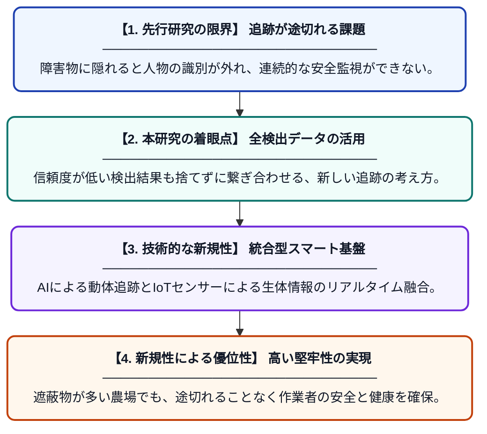

# AI、IoT、ウェアラブルセンサーを用いた農作業者向けAI搭載スマート安全帽：レビュー

**Original Title**: *Artificial Intelligence-Powered Smart Safety Cap for Farm Workers Using Artificial Intelligence, IoT and Wearable Sensors: A Review*

> **💡 一言要約**: AIとIoTで農場を見守る次世代の安全管理術

| 項目 | 内容 |
|---|---|
| **著者** | KP Dilip, AA Khatri, B Abhishek, SB Bhosale |
| **アラートキーワード** | Multi Camera Tracking |
| **PDF** | [https://ijcrst.com/wp-content/uploads/1792755546_TSJCoECOMP-106.pdf](https://ijcrst.com/wp-content/uploads/1792755546_TSJCoECOMP-106.pdf) |
| **原文リンク** | [https://ijcrst.com/wp-content/uploads/1792755546_TSJCoECOMP-106.pdf](https://ijcrst.com/wp-content/uploads/1792755546_TSJCoECOMP-106.pdf) |
| **PDF版要約** | [README.pdf](./README.pdf) |

---

## 📊 新規性の図解（先行研究との違いと本研究のブレークスルー）

## 📝 要約

農作業者の安全を確保するために、AI、IoT、ウェアラブルセンサーを統合した「スマート安全帽」の最新技術をまとめたレビュー論文です。特に、障害物が多い農場環境でもByteTrackなどの最新アルゴリズムを用いて作業者を正確に追跡・監視する手法の有効性を解説しています。

## ❓ どんな問題に取り組んだか

農業現場は事故や熱中症のリスクが高い一方で、屋外特有の複雑な環境や障害物が原因で、従来の監視カメラでは作業者の動きを正確に捉え続けることが困難でした。また、単一のセンサーだけでは、緊急事態をリアルタイムで検知・通知する仕組みが不十分であるという課題がありました。

## ✨ 何が新しい？何がすごい？（新規性）

本研究は、低信頼度の検出結果も活用して追跡を維持する「ByteTrack」などの最新AIアルゴリズムを農業分野に応用し、部分的な遮蔽があっても作業者のIDを維持できる点に着目しました。さらに、AIによる視覚情報とウェアラブルセンサーによる生体情報をIoTネットワークで統合し、農作業者の安全を包括的に管理する「スマート安全帽」という形態の優位性を体系化しました。

## 🎓 大学1年生向けの解説

農作業は外で行う大変な仕事で、事故や体調不良のリスクがあります。この研究は、AI（人工知能）を積んだ「かしこい帽子」を使って、作業者がどこで何をしているかを見守る技術についてのまとめです。カメラに木や道具が重なって作業者が見えにくくなっても、AIが「これはさっきの人だ」と正しく判断し続けることができます。もしもの時にすぐに助けを呼べる、農家の人を守るためのハイテクな仕組みです。
