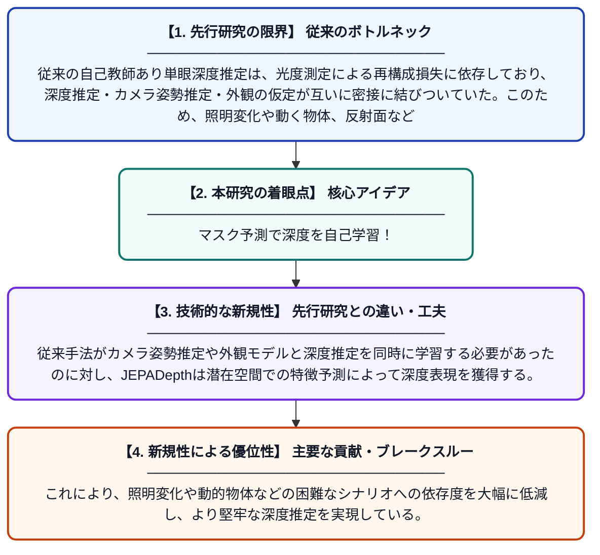

# JEPADepth：自己教師あり単眼深度推定のためのマスク予測表現学習

**Original Title**: *JEPADepth: Masked Predictive Representation Learning for Self-Supervised Monocular Depth Estimation*

> **💡 一言要約**: マスク予測で深度を自己学習！

| 項目 | 内容 |
|---|---|
| **著者** | I Grigore, CA Popa |
| **掲載誌** | arXiv preprint arXiv:2607.26600 2026 |
| **アラートキーワード** | representation learning |
| **PDF** | [https://arxiv.org/pdf/2607.26600](https://arxiv.org/pdf/2607.26600) |
| **Git リポジトリ** | [https://github.com/ionut-grigore99/JEPADepth](https://github.com/ionut-grigore99/JEPADepth) |
| **原文リンク** | [https://arxiv.org/pdf/2607.26600](https://arxiv.org/pdf/2607.26600) |
| **PDF版要約** | [README.pdf](./README.pdf) |

---

## 📊 新規性の図解（先行研究との違いと本研究のブレークスルー）

## 📝 要約

本論文では、単一カメラ画像から深度を推定する自己教師あり学習フレームワーク「JEPADepth」を提案する。従来手法が依存していた光度測定に基づく再構成損失を用いず、JEPA（Joint Embedding Predictive Architecture）の考え方を活用したマスク予測表現学習を深度推定に応用している。これにより、深度・カメラ姿勢・外観に関する仮定の密結合という従来の課題を克服することを目指している。

## ❓ どんな問題に取り組んだか

従来の自己教師あり単眼深度推定は、光度測定による再構成損失に依存しており、深度推定・カメラ姿勢推定・外観の仮定が互いに密接に結びついていた。このため、照明変化や動く物体、反射面などの条件下では推定精度が著しく低下するという問題があった。これらの仮定の複雑な絡み合いが、モデルの汎化性能と学習の安定性を制限していた。

## ✨ 何が新しい？何がすごい？（新規性）

本研究の最大の新規性は、画像の光度再構成損失に頼らず、JEPA（Joint Embedding Predictive Architecture）に基づくマスク予測表現学習を単眼深度推定に初めて導入した点にある。従来手法がカメラ姿勢推定や外観モデルと深度推定を同時に学習する必要があったのに対し、JEPADepthは潜在空間での特徴予測によって深度表現を獲得する。これにより、照明変化や動的物体などの困難なシナリオへの依存度を大幅に低減し、より堅牢な深度推定を実現している。

## 🎓 大学1年生向けの解説

スマートフォンのカメラ1台だけで「写真のどこが近くて、どこが遠いか」をAIに学習させる技術の研究です。普通はAIに「正解の深度データ」を大量に与えて学習させますが、この研究はそういったラベルなしで自動的に学習する方法を考えました。従来の方法は「2枚の写真を比べて色や明るさの差から深さを推測する」仕組みに頼っていたため、暗い場所や光が反射する場所では上手くいきませんでした。そこでこの研究では、画像の一部を隠して残りの部分から隠れた部分の特徴を予測させるという新しい学習方法（JEPAという手法）を使うことで、より賢く深度を学習できるようにしました。
